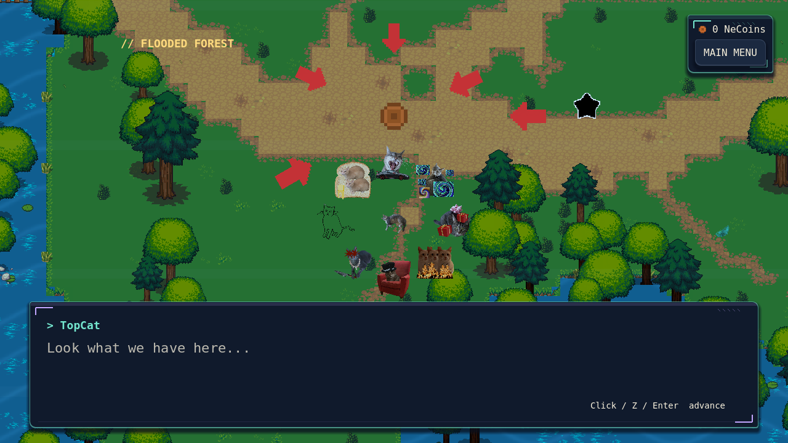
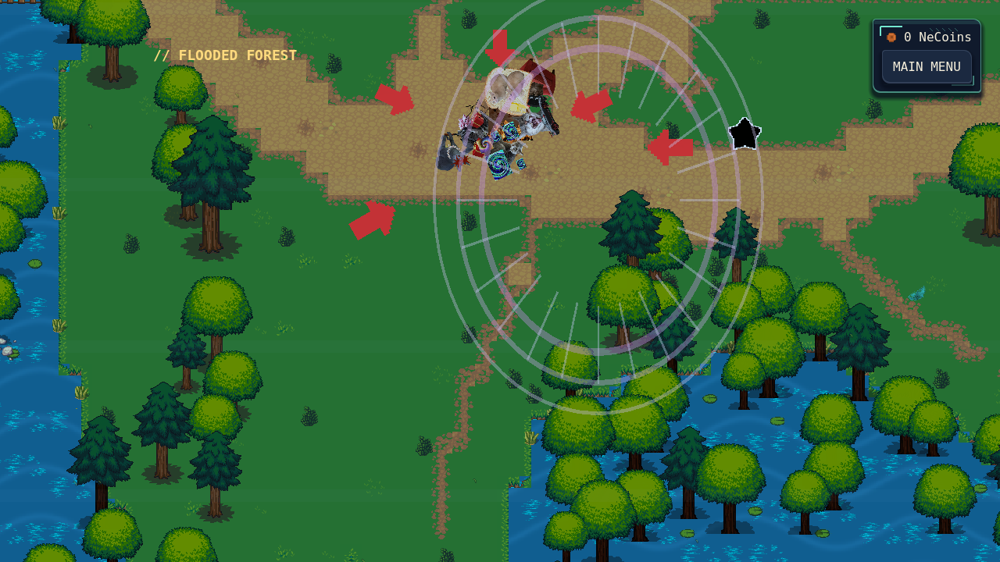
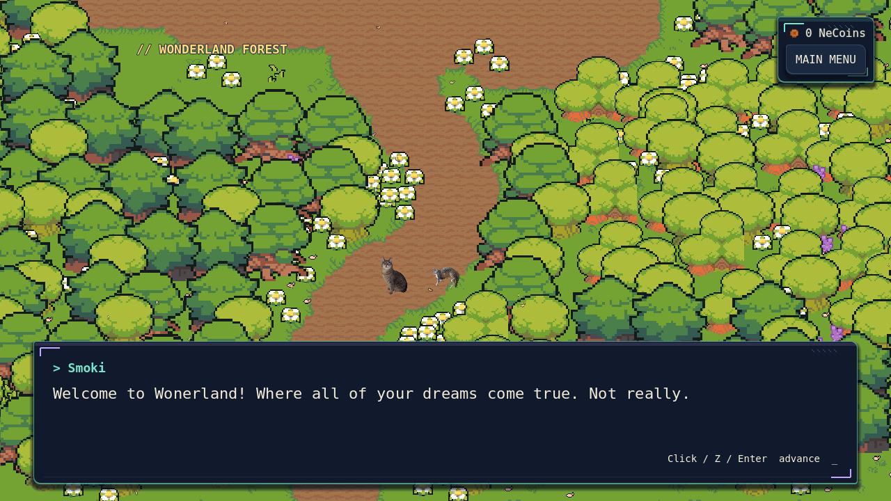

# The Ambush and Wonderland restoration

The post-Doppelcat trap is on Flooded Forest's main route at local `(2660, 1100)`, east of the northern bridge and before its existing save star. Interact with Z. The giant coin never calls the currency system. Five red arrows use an existing licensed icon, as approved by the user; they are not newly painted artwork.

## Restored content

Nothing had to be rebuilt or recovered from deleted images. All original Wonderland content was still present, but the current world loader, travel checks, and save validation restricted play to the four forests. This change restores the existing 18 scenes through the current world wrapper:

- Six outdoor regions: Wonderland Forest, Tea Gardens, Mushroom Thicket, Royal Woods, Wonderland Village, and Queen's Castle Grounds.
- All eight village buildings and furnished interiors.
- Four castle rooms behind the original castle lock.

The original implementation is commit `c5e8815`; its verified human-art replacement is `f584be9`, followed by visual polish `0f9ce54`. **The existing human-art version is retained.** No earlier generated artwork was restored. All scene files, layouts, decorations, interiors, region connections within Wonderland, and terrain resources are unchanged. Original Overworld music and Wonderland ambience resume on arrival. No Princess fight or defeat state exists; none was invented.

The old Wonderland-to-Flooded seam is disabled. The destroyed ambush portal and Smoki's departure effect have no travel collider. `wonderland_fast_travel_unlocked` is persisted, initially false, with no arbitrary destinations or premature unlock behavior.

## Sequence and persistence

`scripts/story/ambush.gd` owns the sequence across the scene transition; `ambush_trap.gd` supplies the interactable and existing atlas artwork; `ambush_portal.gd` renders permitted procedural portal/blast effects. The current dialogue renderer supplies all ten exact lines, including “Wonerland”. Click, Z, and Enter advance; keyboard repeats and held mouse buttons do not advance multiple lines. Movement, random encounters, map/menu input, and other interactions are locked through the sequence.

All eight enemies are texture-only actors with no hitboxes, damage, or battle logic. Smoki appears only after the taunts. The rescue has a portal entry, enemy charge, anticipation pause, expanding blast, individual ballistic arcs/spins, and exaggerated landings. Arrival has both cats tumble out and recover, followed by the five-line introduction and a smaller departure portal.

The approved new `Song that plays when you get ATTACKED! - 009.mp3` plays continuously during the forest sequence, looping if dialogue takes longer than the track. Its local player fades out before the existing world music resumes. Other soundtrack assignments are unchanged.

- Before arrival, no completion flag is written; a restart retains existing checkpoint/progress and the trap can be triggered again.
- After landing on clear ground, `wonderland_arrived` and a safe Wonderland checkpoint are written through the existing progress-save system. The trap is permanently absent on forest returns.
- If interrupted during the introduction, loading resumes its dialogue/departure in Wonderland, without replaying the ambush.
- After departure, `wonderland_intro_completed` prevents all replay. Controls and the exploration camera are restored.
- Older Wonderland saves retain their location and are treated as already introduced. Missing new fields default safely. Existing manual save interactions are unchanged.

No mid-animation coordinates are serialized. The existing atomic save/backup behavior handles write failures; errors remain visible through the existing notification system.

## Asset provenance

No creative files were generated, downloaded, redrawn, or modified. The new MP3 was already added by the user in `5ca4b5d`; only its Godot import sidecar is added here.

| Use | Existing source | Provenance/license |
| --- | --- | --- |
| Giant NeCoin | `assets/wonderland_human/rpg/roguelikeSheet_transparent.png`, existing currency atlas cell | Kenney, Roguelike/RPG Pack, CC0; original source and hashes in `assets/wonderland_human/provenance.json`. https://kenney.nl/assets/roguelike-rpg-pack |
| Five red arrows | `assets/wonderland_human/onebit/monochrome_transparent_packed.png`, cell `(24,12)` | Kenney 1-Bit Pack, CC0, retained license dated 2020-05-06. https://kenney.nl/assets/1-bit-pack |
| Enemies, Smoki, player | Existing encounter textures, `assets/bartboss.png`, current player texture | User's existing character assets, unmodified. |
| Portal drop | `assets/ambience_human/drippingwater_drip_a.ogg` | kddekadenz, Dripping Water Mod, CC0; retained `assets/ambience_human/SOURCE-LICENSES.txt`. http://minetest.net/forum/viewtopic.php?id=1688 |
| Comedic crash | `assets/weather_human/wood_creak.ogg` | CGEffex, modified by BlockMen, CC BY 3.0; existing Luanti recording, source/hash in `assets/weather_human/provenance.json`. https://github.com/luanti-org/minetest_game |
| Wonderland | Existing human-art scenes and atlases | See `wonderland-asset-credits.md`, `wonderland-polish-credits.md`, and retained licenses/provenance in each asset folder. |

The crash uses the existing wooden recording at lower pitch; no synthesized explosion sound was added. Portal rings and blast rays are runtime geometric effects, not replacement texture artwork.

## Validation and review

`tests/headless_ambush.gd` runs the actual sequence with mouse events, gates, exact dialogue, real soundtrack playback, eight landings, arrival persistence, interrupted-introduction reload, completion reload, all 18 map loads, absence of new random encounters, legacy migration, and trap removal. The same test captures standalone X11/Mesa screenshots when run with a display. Test profiles are isolated with `CATSSAGA_TEST_PROFILE=1` and separate XDG directories.

The final headless sequence suite passes 88 checks. Together with the five regressions below, all six headless suites pass **563 checks**. The standalone rendered sequence also passes 88 checks. Godot headless import completes without script/import errors. Detailed counts are in `review/ambush/validation.json`.

Additional regressions cover original Wonderland structure/art (87 checks), story/quest integration (81), RPG/save behavior (103), menus (56), and all ordinary encounters (148). Actual rendered review frames are in `docs/review/ambush/` and are excluded from runtime exports by `docs/.gdignore`.

Audio listening, subjective comedic timing, and hardware GPU performance still require manual playtesting. The test environment uses Dummy audio and software rendering. Existing shutdown-only ObjectDB/RID/PagedAllocator warnings remain; these are not claimed fixed.

