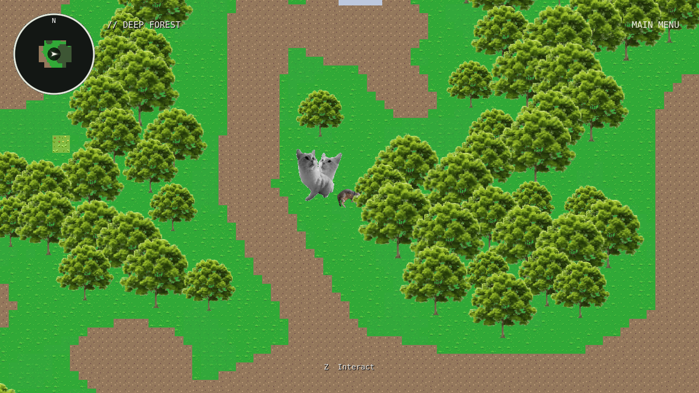
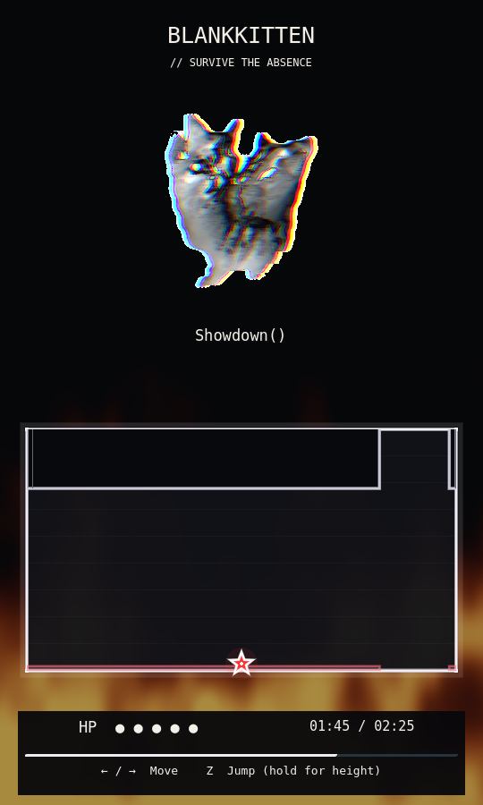
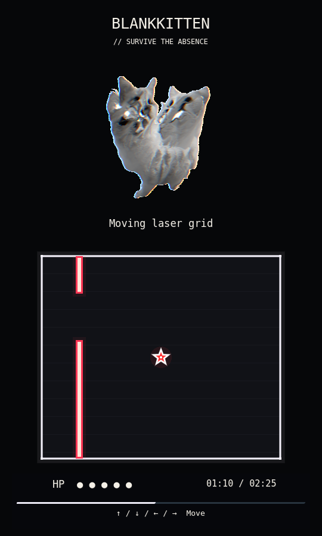
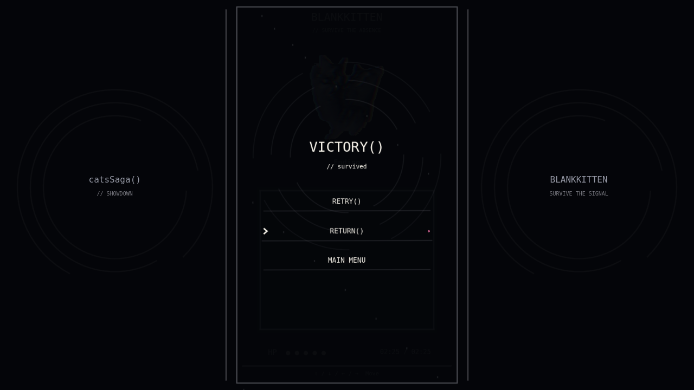

# BlankKitten encounter and universal battle entry

BlankKitten is an additional survival encounter. Existing Evil Bart and
Doppelcat attacks, clocks, HP, projectiles, player abilities, dialogue and
rewards remain intact. All three encounter entries and retries now use the
same accelerating black walls, impact, short rebound, sealed black scene
change and reveal. The default wall animation is 1.2 seconds plus a 0.3-second
reveal. Music starts at 0:00 only after the initialized battle is revealed.

## Finding and playing the encounter

BlankKitten stands in **Deep Forest at (824, 800)**, beside the grass south of
the existing northern NPC clearing. Its position was checked with the actual
player-sized collision shape and rendered to avoid tree canopy obstruction.
No paths, terrain, portal positions, existing NPCs or obstacles were moved.
Press Z within the interaction radius. The existing dialogue renderer shows:

1. `You... COME HERE`
2. `Let me tell you something... I. HATE. COLOR!`

Finishing the second line starts the fight immediately, with no choices.
The normal transparent texture is shared between this NPC and the battle.
The star has exactly **5 HP**, arrows to move, and Z to jump in gravity stages.
Tapping Z shortens the jump; holding it reaches the full height. There is one
jump per landing. Shooting and SATURATE are unavailable in this survival
encounter; existing combat players and abilities are unchanged.

Retry creates a fresh scene, resets every runtime state and restarts the
entire soundtrack. Victory records only `blankkitten_defeated` through the
existing version-one save system. RETURN restores the original overworld
position. The completed NPC stays visible and cannot retrigger the fight.
There are no new items, keys, rewards or invented ending dialogue.

## Music and cue sheet

The actual soundtrack is `assets/soundtrack/catVibes - 004.mp3`. FFprobe reports
**145.867750 s**; the requested survival endpoint remains **145.71 s**, followed
by a 0.15-second fade of the small remaining tail. The supplied 140 BPM is used
for the animation and impact grid. Audible beat alignment needs a listening
pass; the configurable `musical_phase_offset` defaults to zero.

| Playback interval (seconds) | Stage | Appearance |
| --- | --- | --- |
| 0–13.71 | Introduction, no hazards | Normal |
| 13.71–34.28 | Falling pillars, gravity | Normal |
| 34.28–61.71 | Bouncing ball, free movement | Distortion 1 |
| 61.71–68.57 | Safe break, free movement | Distortion 1 |
| 68.57–89.14 | Moving laser grid, free movement | Distortion 2 |
| 89.14–102.85 | Jumping beams, gravity | Distortion 2 |
| 102.85–130.28 | Showdown(), extreme pillars | Distortion 3 |
| 130.28–145.71 | Safe ending, optional authored lines | Distortion 3 |

The clock reads AudioStreamPlayer playback plus mix/output-latency compensation.
There is no accumulated phase timer. Each 0.75-second morph begins *before*
its cue and finishes at that cue. The same outline continuously interpolates;
outgoing hazards become harmless immediately. The star moves smoothly and is
protected during morphs. The independent spin and beat-bob pivots preserve
musical motion while alternating one clockwise/counterclockwise turn.
Backward seeks rebuild current state; skipped cues cannot replay old attacks.
Missing/stopped/early-ended audio fails safely with Retry and Main Menu.

Normal pillars use nine strikes on 4/4 measures (1.714286 s); extreme pillars
use half-measures (0.857143 s). Warnings and falls are scheduled backward from
impact. Seeded adjacent safe lanes, jump apex, beam clearance and recovery
windows are verified. Laser axes alternate, with telegraphed corridors that
move between predictable positions. The ball uses analytic wall/corner
reflection. Hazard collisions sample both player and hazard movement within
a physics frame. Debris is bounded and has no collision.

## Artwork and editable presentation

All four originals in `assets/enironment/bosses/boss3-BlankKitten` are preserved.
Separate `*-transparent.png` copies remove neutral near-white pixels connected
to an image edge. The script retains disconnected white islands and chromatic
fringes, with a one-pixel neutral matte cleanup. Source dimensions stay 490×653.
All display scales are uniform and use nearest-neighbor filtering.

To regenerate those copies after replacing source artwork:

```sh
# Utility dependencies only; these are not game runtime dependencies.
python -m pip install Pillow numpy scipy
python tools/prepare_blankkitten_textures.py
python tests/check_blankkitten_textures.py
```

No existing fire video was found. `shaders/blankkitten_fire.gdshader` supplies
animated procedural background flames without downloads or collision. Fire is
absent before 89.14, ramps smoothly to full at 102.85, stays full until 130.28,
and fades completely by 145.71. It renders below the box, actors, hazards and
HUD. To replace it, open `scenes/blankkitten/battle.tscn`, select `CinematicArena`
and assign an **Ogg Theora `.ogv`** to `Fire Video` in the Inspector. This player
loops and is muted. An MP4 is not assumed to be a supported Godot VideoStream.
No `.ogv` was supplied, so that optional playback path needs manual validation.

To author ending dialogue, edit **Ending Lines** on
`resources/blankkitten/timeline.tres`. The empty array is intentional. Authored
lines display automatically during the ending and never delay victory.
This makes the ending editable without inventing story content or requiring
Z presses against the soundtrack deadline.

## Main implementation files

- `scripts/ui/black_wall_entry.gd`: reusable viewport-sized curtain.
- `scripts/systems/session.gd`: shared entry and generic `begin_encounter` API.
- `scripts/blankkitten/battle.gd`: audio clock, states, morphs and result guards.
- `scripts/blankkitten/timeline.gd` and `resources/blankkitten/timeline.tres`:
  canonical cue sheet, arena shapes, seed, musical offset and ending data.
- `scripts/blankkitten/star.gd`: encounter-specific movement, jump and damage.
- `scripts/blankkitten/hazards.gd`: pillars, ball, laser grid, jumping beams.
- `scripts/blankkitten/presentation.gd` and `hud.gd`: visuals and reusable UI.
- `scenes/blankkitten/`: NPC, battle and existing portrait host integration.
- `data/dialogue/blankkitten.json`: the exact two-line encounter introduction.

The latest main commit moved `bosstwo.png` into `bosses/boss2` without updating
its consumers. The two affected scene references and import metadata now
point at that same moved PNG. No duplicate or altered Doppelcat art was made.
The cached world map was rebaked only to refresh its source hash; its pixels
were independently verified byte-for-byte unchanged.

## Validation and review

Tested with **Godot 4.6.3** in this cloud environment:

```sh
godot --headless --editor --path . --import
godot --headless --path . --script tests/headless_blankkitten.gd
godot --headless --path . --script tests/play_blankkitten.gd
godot --headless --path . --script tests/full_blankkitten.gd
python tests/check_blankkitten_preservation.py
python tests/check_blankkitten_textures.py
```

The rendered checks use a real compatibility renderer under Xorg/Mesa:

```sh
DISPLAY=:102 LIBGL_ALWAYS_SOFTWARE=1 godot --path . \
  --rendering-method gl_compatibility --audio-driver Dummy \
  --script tests/render_blankkitten.gd -- --output=/tmp/blankkitten-review
```

The cloud commands also set writable XDG cache/data/config directories outside
the checkout. No validation writes to the player's normal save; every suite
uses its own validation save path.

- Headless editor import and all **23 scenes** loaded/instantiated successfully.
- BlankKitten: **306 functional checks**, **4 accelerated gameplay checks**,
  **6 full-MP3 gameplay checks**, **85 rendered checks**,
  **237 exact source/function preservation checks**, **24 texture checks**.
- The movement-only pilot survives all stages with **5/5 HP**, without cheats,
  HP edits, early victory calls, or timeline overrides in the full-MP3 run.
- **14 existing headless suites / 1,022 checks** pass, covering shooting,
  SATURATE, BEAM, CATA, Bart HP/ending/rewards, Doppelcat survival/cross lasers,
  world dialogue, regions, maps/fog, inventory, player art, pause and saves.
- Existing cinematic, menu/UI and Doppelcat graphical suites pass **129 checks** as well.
  Old tests now wait for transition completion instead of assuming the old
  shorter white wipe; their gameplay assertions remain intact.
- Real playback endpoint is checked against the compensated audio position.
  The cloud Dummy driver can run slower than wall time under load; this does
  not change which soundtrack timestamp selects a stage. Visual changes
  appear on the first rendered/physics frame after their cue.

Human testing remains necessary for audible beat alignment, subjective
challenge, jump feel, moving flames/spins, visual comfort and hardware
performance. Still frames and a movement pilot do not establish those.
There are no missing required assets. Optional authored ending lines and an
optional fire video remain intentionally unprovided.





