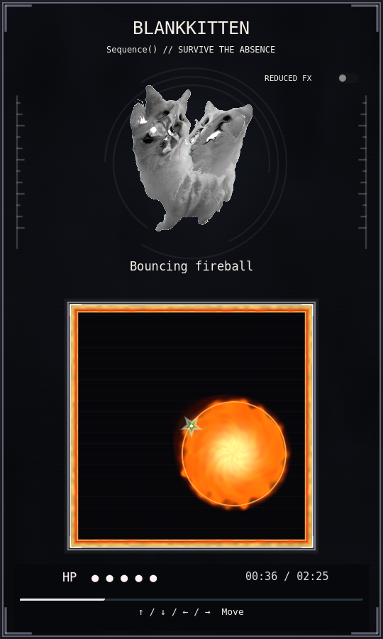
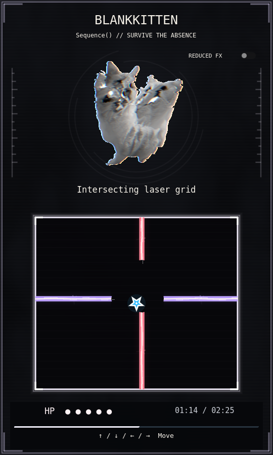
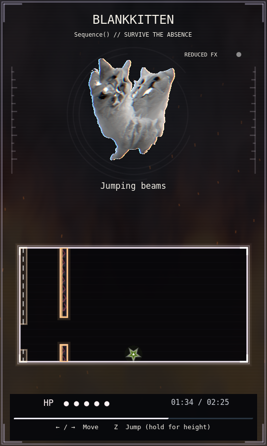
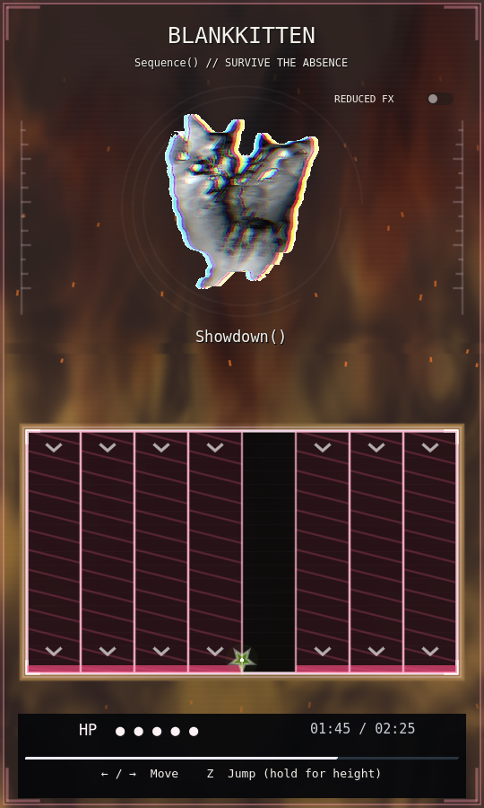
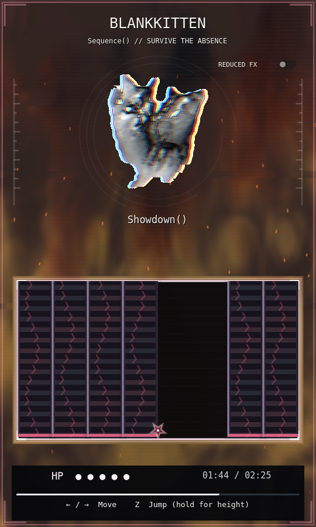
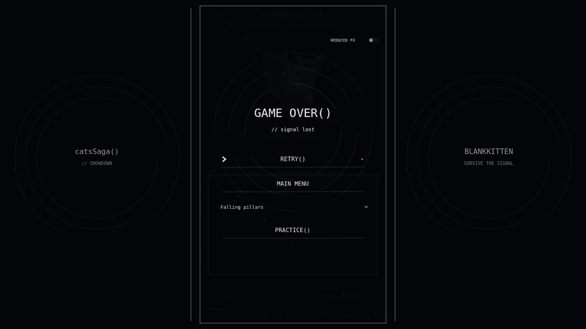
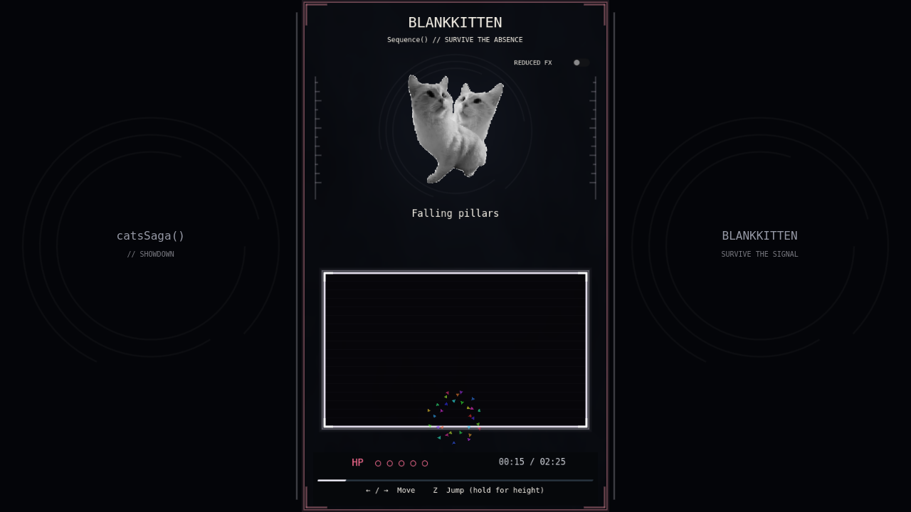
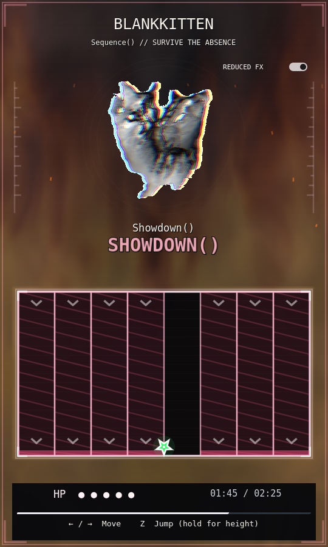

# BlankKitten Sequence() overhaul

This is a second pass on the existing encounter. The soundtrack clock, exact
stage timestamps, arena shapes, 0.75-second protected morphs, NPC interaction,
original artwork and ending/story outcome are retained. Changes are limited
to BlankKitten scripts/shaders, encounter tests and review documentation.
All other boss and overworld files are checked byte-for-byte against `a39aaf4`.

## Playing and testing stages

Find BlankKitten at its existing Deep Forest position `(824, 800)` and press Z.
The original two-line dialogue and battle entry remain unchanged. Sequence()
uses arrows to move, Z for variable-height jumps, five HP and no shooting or
SATURATE. Typing **CATA** toggles the existing invincibility behavior; typing it
again disables it. Key releases and key echo cannot advance the code. This
state belongs to the current star and resets on retry. BEAM retains its existing
meaning in attacking fights; this survival star has no SATURATE to replenish.
`thefogisleaving` remains an overworld map cheat, with its original implementation.

In an editor/debug build, **Ctrl+Shift+1 through Ctrl+Shift+8** seek the eight
stage starts. **Ctrl+Shift+7** previews the final inferno at `102.85` seconds.
For a particular timestamp, launch with:

```sh
godot --path . -- --blankkitten-seek=127.7
```

Enter BlankKitten normally; the timestamp is applied after the battle reveal.
It seeks the actual MP3 and reconstructs art, arena, player position, hazards,
fire/smoke, corruption and HUD together. Debug seeking marks the attempt
**PREVIEW**, disables completion rewards, and does not replace CATA. Normal
keyboard shortcuts are ignored by release builds. Invalid timestamps are rejected.
The script method `battle.seek_timestamp(seconds)` is also debug-only.

After encountering a minigame in a normal attempt, its entry is available in
that session's **result/retry screen**. Select it and press **PRACTICE()**.
Practice loads a fresh five-HP battle at that stage's actual music timestamp,
stops before the outgoing morph, and displays **PRACTICE COMPLETE()**. It never
sets story flags, gives rewards, or presents a full victory. **RETRY()** starts
an ordinary full encounter. Practice unlocks are kept only until the application
closes; the save format and story data are unchanged.

The **REDUCED FX** switch at the top right lowers cosmetic flash/glitch/particle
strength, disables screen shake, and renders the soft atmosphere at quarter
resolution. The preference lasts for the application session, including retries.
It changes no hitboxes, timing, movement or attack geometry. It is a mouse control
so focused UI cannot steal Z from jumping.

## Gameplay corrections

- **Pillars:** eight exact-width lanes, individually highlighted floor strips,
  projected lane hatching and chevrons. Deterministic seeded phrases combine
  alternating lanes, adjacent slabs and moving one-/two-lane openings. Successive
  telegraphs are separated rather than painting every lane as simultaneously
  dangerous. Normal strikes use measures; final strikes use half-measures.
  The reachability test includes a **180 ms reaction allowance**, the complete
  star diameter and the previous attack's clearing time. The closing accents
  near `127.714` and `128.571` seconds widen the refuge and increase cosmetic
  impact strength. They clear before the protected ending morph at `129.53`;
  the ending stage still begins exactly at `130.28`.
- **Fireball:** exactly one ball, **170 px visible diameter** in a 340 px-wide
  arena, with a 73 px damage radius and slow predictable reflected velocity
  `(79, 67)` px/s. Its trail is cosmetic. All four animated wall bands have
  immediate contact damage, with the same one-HP loss and 0.85-second post-hit
  invulnerability as other hazards. An inset safe spawn avoids the flames.
- **Lasers:** introductory one-axis sweep, then staggered and intersecting
  horizontal/vertical beams, additional parallel beams, moving intersections,
  and a narrowing **112–88 px safe pocket**. The pocket moves continuously and
  remains reachable; all beam pieces are projected before activation. Exact
  **LASERS!** and other stage announcements sit above the playfield.
- **Jumping beams:** six authored ceiling/floor pairs move together, vary in
  direction, height, speed and opening size, and give 0.95-second edge warnings.
  Their 50–58 px openings accommodate the entire star with margin, while ceiling
  collision prevents simply holding Z for maximum height. Tap/hold jump physics
  and the one-jump-per-landing rule are preserved.
- **Star/arena:** the 13 px star plus its 0.75 px outline is included in the
  conservative circular collision extent. Clamping also includes the border's
  one-pixel inner surface. The downward point rests on the inside floor edge;
  the sprite glow is cosmetic. Free movement and morphs use the same bounds.
  Collision sampling includes both hazard and star movement between frames.
- **Death/ending:** fatal damage stops hazards immediately, fades music, breaks
  the star into rainbow fragments and reveals the existing retry UI after a
  short 0.7-second animation. The ending continues through the original song,
  fades fire/smoke/corruption, settles bobbing/tilt and smoothly reduces the
  star's color-cycle velocity to zero. Victory remains guarded and occurs only
  at `145.71`. No new story dialogue was added.

## Visual and audio systems

The original normal/distortion PNGs remain intact. A localized sprite shader
adds restrained channel separation, horizontal tearing, grayscale progression
and a short transformation glow. Bobbing stays on an independent pivot, so
140 BPM motion continues through alternating eased 360-degree spins.

The atmosphere combines three differently moving/turbulent noise fields with
a second foreground smoke veil and layered organic fire. Smoke and heat
illumination rise at the existing distortion cues; the inferno develops from
`89.14`, reaches full strength at `102.85`, and fades from `130.28` to `145.71`.
The arena interior suppresses the backdrop; the smoke veil excludes its bounds.
The vivid star, warning lanes and active beams are drawn above the atmosphere.
Only soft atmospheric layers render in a separate **270×450** viewport (135×225
with Reduced FX); boss art, hazards and HUD remain native **540×900**.

Hazards reuse one rendering style: beveled cracked slabs, high-contrast lane
warnings, animated gradient laser cores/flow/intersection sparks, a procedural
flame-ball material, and perimeter fire. The arena has fine layered borders,
corner brackets, beat pulses and restrained texture. Analytic embers/trails
cannot accumulate across stages. Impacts add temporary floor cracks, sparks,
smoke, lighting and small shake, without adding obstacles. Near misses emit
rainbow feedback with a cooldown and confer no gameplay benefit.

A bounded effects canvas caps particles at **192**, temporary cracks at **20**,
and sound voices at **4**. Quiet synthesized warning/impact/laser/bounce/jump/
damage/morph/glitch/fire/graze sounds are cached at startup, behind the unchanged
soundtrack mix. They introduce no external files or missing-resource dependencies.
The optional muted looping `.ogv` override remains supported; no video is required.

## Files changed

| Files | Purpose |
|---|---|
| `scripts/blankkitten/battle.gd`, `combat_host.gd` | Shared clock integration, practice/debug guards, death/ending and stage effects |
| `scripts/blankkitten/hazards.gd`, `timeline.gd` | Authored hazards, synchronization, collision and descriptive stage names |
| `scripts/blankkitten/star.gd`, `hud.gd` | Star alignment, CATA, ending color, announcements, practice and Reduced FX |
| `scripts/blankkitten/hazard_style.gd`, `feedback.gd` | Reusable visual treatments, bounded debris, sound and feedback |
| `shaders/blankkitten_{fire,fireball,walls,smoke,art}.gdshader` | Procedural fire, atmosphere and controlled character corruption |
| `tests/headless_blankkitten.gd`, `headless_sequence_overhaul.gd`, `blankkitten_robot.gd`, `render_blankkitten.gd`, `profile_sequence.gd`, `check_sequence_preservation.py` | Updated acceptance checks, real movement pilot, rendering, profiling and preservation |
| `docs/review/sequence/` | Actual Godot-rendered review screenshots |

## Validation

All checks below completed successfully using Godot **4.6.3**.

| Validation | Result |
|---|---|
| Headless editor import | Exit 0; no script/resource errors |
| Scene validation | 23 scenes loaded and instantiated, zero failures |
| Updated BlankKitten integration/collision suite | 566 checks, zero failures |
| CATA, debug seeking, practice, bounds, near misses, reduced effects | 102 checks, zero failures |
| Accelerated complete movement-only pilot | 4 checks; all stages survived with 5 HP, no cheats/HP edits |
| Actual full MP3 playback and physics | 6 checks; 5 HP throughout, victory at 145.71 s (measured audio 145.724 s) |
| BlankKitten renderer/layout/mouse/death checks | 126 checks, zero failures; screenshots inspected |
| Existing headless regression suites | All 14 suites, 1,022 checks, zero failures |
| Existing graphical regressions | All 3 suites, 129 checks, zero failures |
| Preservation | 283 existing files byte-identical to `a39aaf4` |
| Original texture transparency/pixel audit | 24 checks passed |
| Command-line `--blankkitten-seek=127.7` | Synchronized preview confirmed, no completion rewards |

The movement pilot uses real star stepping and collision routines. The full-audio
run retains the actual AudioServer playback clock; the accelerated pilot does
not stand in for that test. Tests of failure handling intentionally exercise a
missing host and missing/early-ended audio, and verify safe recovery. No normal
validation produced a script or resource error. The software driver emits an
expected unsupported V-Sync warning.

Reproduce with:

```sh
godot --headless --path . --editor --import
godot --headless --path . --script tests/headless_blankkitten.gd
godot --headless --path . --script tests/headless_sequence_overhaul.gd
godot --headless --path . --script tests/play_blankkitten.gd
godot --headless --path . --script tests/full_blankkitten.gd
python tests/check_sequence_preservation.py
godot --path . --rendering-method gl_compatibility --script tests/render_blankkitten.gd
godot --path . --rendering-method gl_compatibility --script tests/profile_sequence.gd
```

Rendered tests require a display; use `--audio-driver Dummy` for unattended
validation. Profiling samples 120 final-phase frames per effect mode after a
warm-up. The final isolated Mesa llvmpipe profile measured:

| Effects | Median frame | 95th percentile | Peak particles | Nodes |
|---|---:|---:|---:|---:|
| Full | 39.394 ms | 50.036 ms | 84 | 81 |
| Reduced | 29.159 ms | 37.528 ms | 28 | 81 |

There were no exit leaks in the final profile. This software renderer does
**not** establish a 60 FPS target: target-GPU frame pacing still needs manual
validation. Particle/node counts stay bounded, and Reduced FX lowers the
rendering workload without simplifying collisions or changing attacks.

## Manual review

Check normal human reaction/jump feel, sound mix against the music on real
speakers, perceived beat offset, animated smoke/fire/tearing comfort, and frame
pacing on your target hardware. Automated pilots prove a zero-damage route,
but do not establish subjective difficulty. Try Reduced FX as well as the full
presentation. Check the practice selector with keyboard/mouse in the result UI.
The optional video override cannot be visually tested without an actual `.ogv`.










