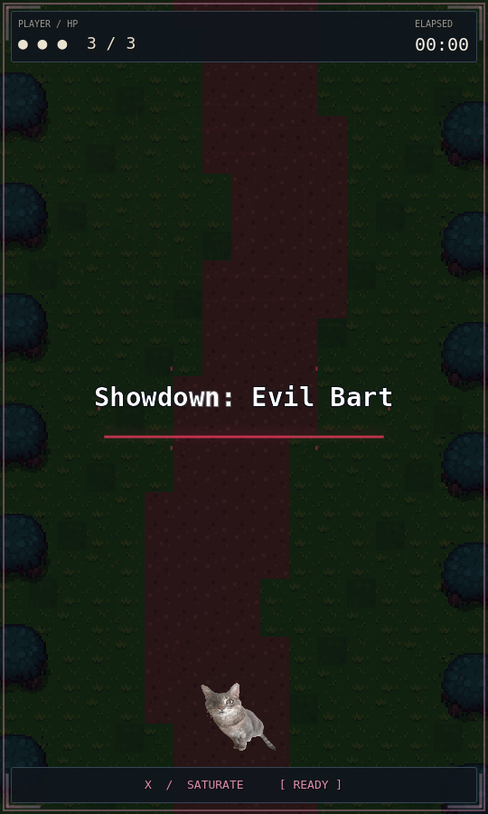
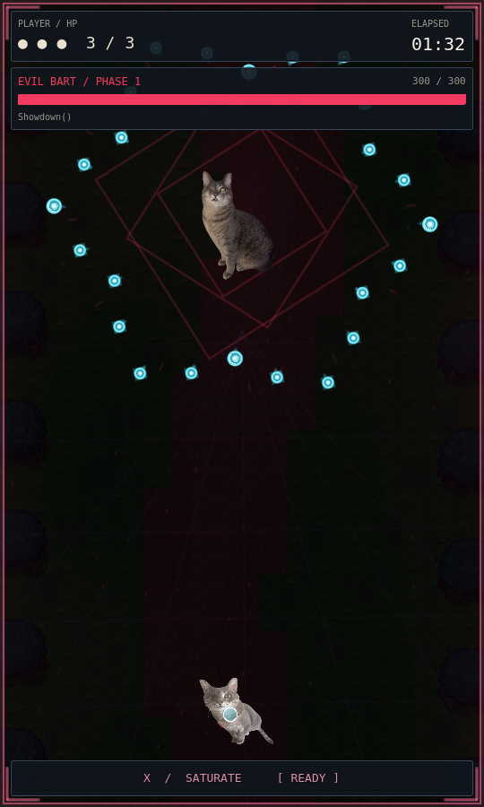
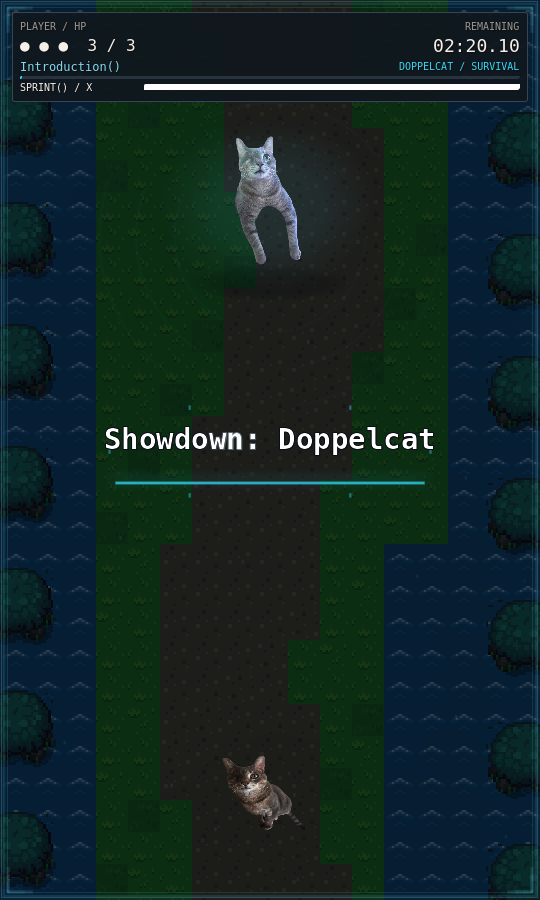
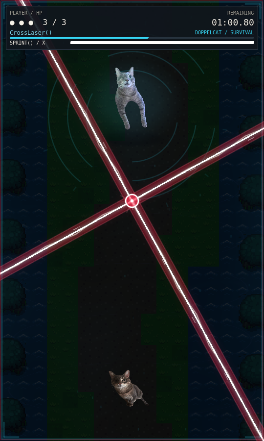
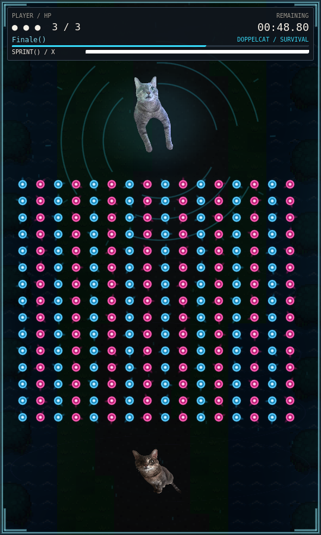
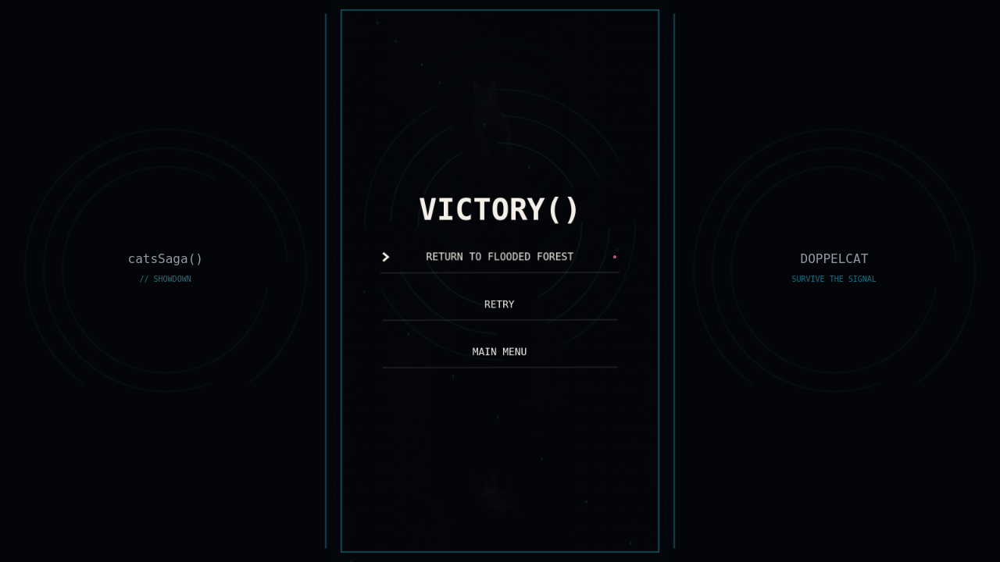

# Cinematic boss presentation

Branch: `feature/cinematic-boss-presentation`  
Base: `683591d` (main, including the merged region/dialogue update).

Both existing encounters now share an arena presentation system, bold monospace
introductions, compact themed HUD cards, final-phase typography, projectile
rendering principles, and animated result framing. Evil Bart uses crimson,
purple, angular geometry and forest scenery. Doppelcat uses cyan, violet, broken
circles and flooded forest scenery. Existing source artwork stays untouched.

## Presentation changes

- `CinematicArena` in each battle scene observes that battle's existing elapsed
  time. It never starts music, schedules attacks, advances the timeline, changes
  collisions, pauses combat, or writes progression.
- `resources/battle/evil_bart.tres` and `doppelcat.tres` provide the boss name,
  palette, motifs and decorative music cues. The introduction, boss HUD name and
  widescreen mat read the same name resource; a future encounter can reuse these
  components with another profile.
- A 1.75-second, mouse-transparent introduction displays **Showdown: Evil Bart**
  or **Showdown: Doppelcat**, centered in the 540×900 arena. Cubic entrance/exit,
  settling scale, an expanding accent rule, a single glyph shimmer and sparse
  drifting marks give it motion. Music, opening enemies, player input and attack
  activation retain their existing start times.
- Familiar terrain samples use the authorized GFX `Overworld.png` and
  `objects.png` atlas regions. Ground is rendered at 2× with nearest filtering;
  intact trees stay at the edges. These are background drawings with no physics
  bodies, navigation or tile collisions. No overworld scene is loaded for combat.
- Independent, seamless shader mist layers, low-opacity lighting, 36 seeded
  motes, drifting geometry and faint floor marks provide depth. A separate local
  RNG keeps decorative randomness away from gameplay randomness. Terrain drawing
  commands are retained rather than rebuilt every frame.
- Existing song cues smoothly darken the scenery over two seconds and increase
  abstract geometry. Bart's final presentation starts at **89.14s**, Doppelcat's
  at **89.60s**. The existing 116s Bart presentation remains inside his original
  final attack phase. Pulses use the existing 1.6s Boss 2 measure; Bart's visual
  measure subdivision comes from the existing 6.85s arrival cue (not a claim of
  newly measured soundtrack BPM).
- Background-only distortion and scenery displacement leave actors, projectiles,
  focus markers and hitboxes in their original coordinates. The cinematic
  component's Inspector `effect_strength` controls the new decorative effects.
- Player health, timers, phase captions, boss HP/survival progress and existing
  SATURATE/sprint states retain their data and navigation. The portrait viewport
  stays **540×900**; the outer window and overworld remain **1280×720**. A quiet,
  responsive widescreen mat decorates the existing spare space.
- Bullet color/shape distinctions and exact collision radii remain intact. Shared
  cached gradient layers give sharp cores and compact halos; velocity-based tails
  are capped at 12 pixels. Boss 2's oversized extra halo/trail is replaced by this
  shared treatment. Player shots retain their pink identity and movement, using
  the same lightweight rendering component.
- Existing laser warning/charge/activation timings remain exact. The cross's
  **3px white damaging core** is distinguished from the translucent **24px red
  energy envelope**; all effects draw in its current transform, with **18 RPM**
  unchanged. The blue lasers retain their full original dangerous footprint.
- Tiny player artwork breathing/lean and fading focus brackets animate a visual
  child only. The existing precise focus hitbox indicator and Boss 2 sprint
  shader/afterimages stay intact. Bart gains a short artwork-only damage flash
  and very restrained floating after his existing entrance finishes.
- Existing victory/defeat screens keep their buttons, callbacks, focus behavior
  and progression. They share a themed animated backdrop and bold typography;
  the introductory title is hidden on defeat even when gameplay pauses. Original
  boss defeat animations and music fades remain in their existing controllers.
- The technical Boss 2 introductory-dialogue placeholder is hidden in the HUD.
  Its Inspector property remains unchanged; real authored text still appears
  automatically, and both existing mid-fight lines retain their exact text and
  timing. No new dialogue was invented or added.

The supplied request ended mid-sentence at “When sprinting.” This implements the
complete requirements available before that cutoff; existing sprint effects and
mechanics are preserved.

## Gameplay preservation

`python tests/check_visual_mechanics.py` makes **118 exact comparisons** against
base `683591d`. This includes entire boss and battle controllers, player movement
and abilities, timelines, lasers, ricochets, SATURATE, session/music/save systems,
dialogue, collision scenes, all existing assets and world scenes. In files whose
rendering changed, it separately compares every non-rendering function and all
declarations. Player-shot `_ready()` changes only construction of its visual.

In particular: Bart remains exactly **300 HP**; normal shots still deal 1 and
SATURATE still deals 30; BEAM and CATA remain intact. Boss 2 stays a survival fight
with shooting/SATURATE disabled and its existing focus/sprint/protection rules.
Music files, playback speed, start time, boss phases and projectile caps are
unchanged. Boss 2 still ends at **140.80s** and fades the remaining audio over its
existing **0.8 seconds**. World dialogue, saves and victory return behavior remain
untouched.

The only new imported asset is DejaVu Sans Mono Bold, covered by the existing
[DejaVu license](../assets/ui/fonts/LICENSE.txt). No copyrighted OMORI/Touhou art,
restricted TopDownFantasy-Forest assets, generated illustrations or modified PNGs
are used.

## Validation

Godot **4.6.3**, headless plus Compatibility rendering on the virtual Xorg display
with Mesa llvmpipe and Dummy audio:

| Check | Result |
| --- | --- |
| Headless editor import | Clean |
| All 20 existing scenes load and instantiate | Pass |
| 11 headless suites (gameplay, overworld, Bart/dialogue, Bart overhaul, Boss 2, Boss 2 overhaul, battle visuals, cross lasers, music/hitboxes, region update, new cinematic suite) | **823 checks, 0 failures** |
| Full uninterrupted Boss 2 music-clock encounter, all phases through victory | **3 checks pass**, 140.80s; peak 77 projectiles |
| No-cheat eight-direction focused cross route at fixed 60 FPS | **4 checks pass**, finishes with 3/3 HP |
| Exact mechanic/artwork comparisons | **118 pass** |
| New cinematic render suite | **65 checks pass**, 30 captures: 15 states at both native and wide resolutions |
| Existing UI, Bart, Boss 2, Boss 2 overhaul, cross and dense-bullet render suites | **117 checks pass** |

The cinematic suite covers names, anchors, exact introduction duration, continuous
visual cue changes, unchanged player/boss collision transforms, focus fading,
authored dialogue, real damage, defeat, victory, Retry and Main Menu navigation,
no premature survival completion and the existing audio fade. Existing gameplay
checks exercise shooting, SATURATE, BEAM, CATA, boss phases, saving and both
post-battle dialogue paths. Visual assertions were updated only for intentionally
changed phase typography and placeholder visibility. One old menu test now waits
for actual transition completion instead of relying on a fixed 0.45s startup.

The extra uncapped cross-route bot took one hit on two runs while still surviving.
It predicts exactly one 1/60s physics step per decision, so catch-up steps make
that run timing-sensitive. Both the base project and this branch finish with
3/3 HP using `--fixed-fps 60`; no movement, damage or collision code was changed
to make it pass. A bounded audio-mixer cleanup gap in this test prevents accelerated
simulation from exiting before the stopped menu sample is released.

The virtual OpenGL driver reports unsupported VSync; rendering still completes.
The 240-bullet/36-mote sample ran 120 frames on software rendering. Its wall timing
is **not** a target-hardware performance result. Headless import and functional
runs have no remaining script or import errors.

Reproduce the focused checks from the repository root:

```sh
godot --headless --path . --editor --import
python tests/check_visual_mechanics.py
godot --headless --path . --script tests/headless_cinematic.gd
godot --headless --fixed-fps 60 --path . --script tests/play_cross_survival.gd
godot --headless --path . --script tests/full_boss2_survival.gd
DISPLAY=:102 LIBGL_ALWAYS_SOFTWARE=1 godot --path . \
  --rendering-method gl_compatibility --audio-driver Dummy \
  --script tests/render_cinematic.gd -- --output=/tmp/cinematic-review
```

Use the documented cloud XDG directories to keep validation saves separate from
normal user saves. `:102` is this environment's virtual display, not a requirement
for a real desktop.

## Review captures and manual checks

Representative final frames are in `docs/review/cinematic/` (excluded from Godot
imports by the existing `docs/.gdignore`):








Manual playtesting remains necessary for animation/easing feel in continuous
combat, glow and contrast on actual displays, dense moving-pattern readability,
audible music alignment/fades, and frame pacing on target hardware. Verify focus
brackets do not distract from the exact marker, and compare both fights at native,
widescreen, resized and fullscreen sizes. Static captures and Dummy audio cannot
establish those subjective or hardware-specific outcomes.
