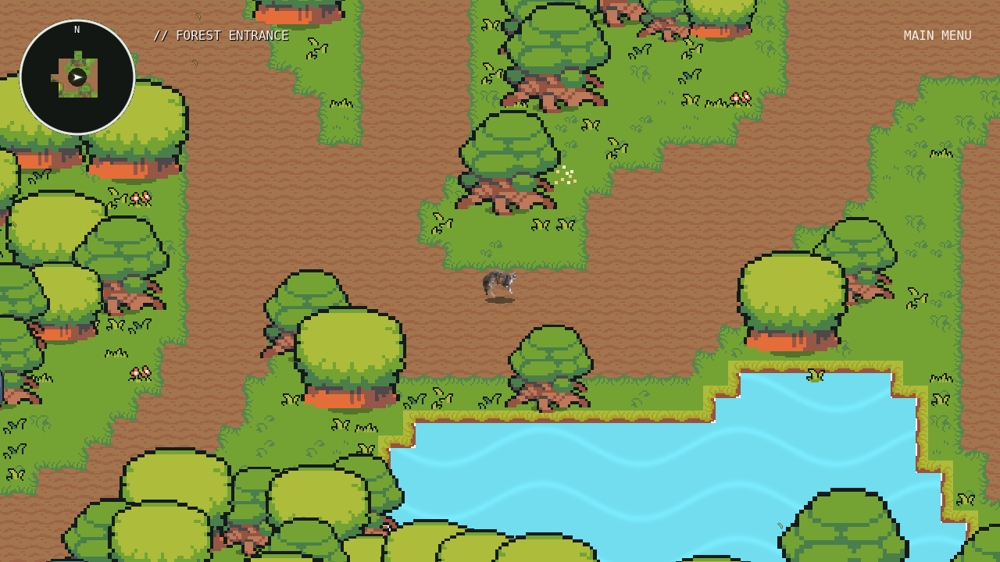
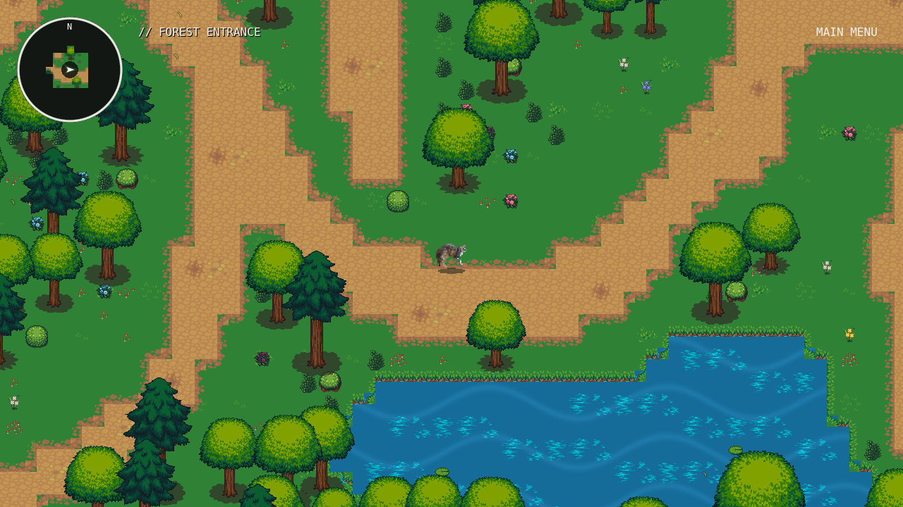
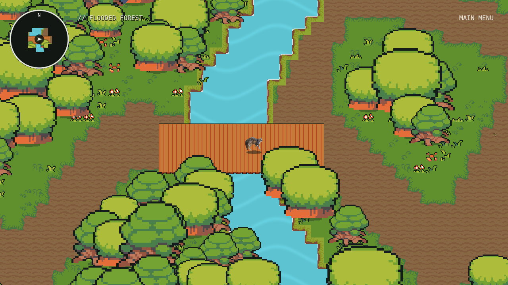
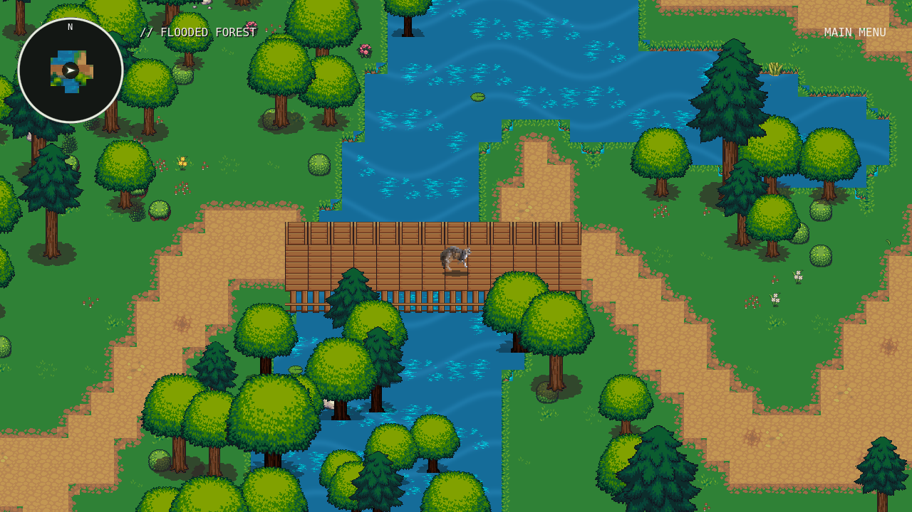
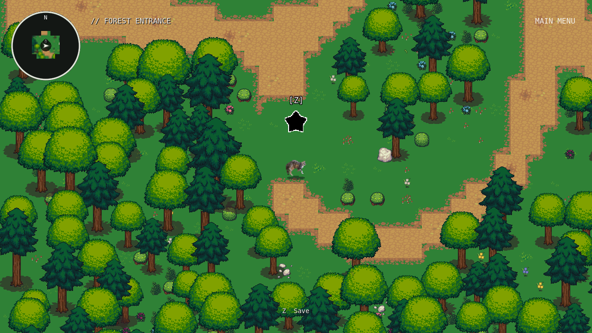
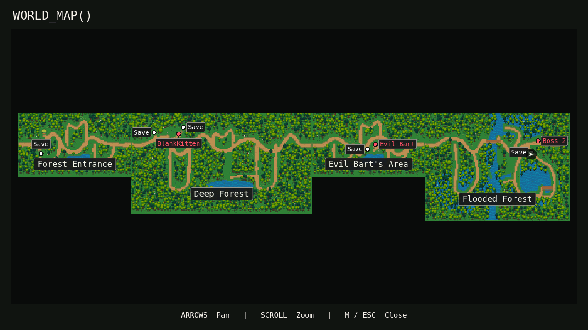

# Playable forest artwork and gameplay repair

The four existing journey maps retain their original bounds, region order,
entrances, landmarks and boss coordinates. Their artwork now uses detailed,
compatible LPC forest sheets instead of enlarged Ninja terrain and foliage.
The existing cat characters and soundtrack are unchanged. The checkpoint before
this work is `checkpoint/environment-repair-20261023` (`69771c5`); implementation
is on `feature/environment-repair`.

## Artwork and terrain

- Sharm's LPC outdoor trees, grass, dirt, water, banks, bridges and rocks use
  **CC BY-SA 3.0**. Matching LPC Revised plants and flowers use **OGA-BY 3.0**.
  Named artists, first-party source revisions, license notices, provenance
  evidence and source hashes are in [the asset credits](environment-asset-credits.md).
- Every imported PNG is an unchanged source file. Complete canopy regions and
  trunks are composed with Godot AtlasTextures. Native 32px terrain and nearest
  filtering replace enlarged low-resolution tiles. Broadleaf and evergreen
  silhouettes share deterministic Inspector-editable size multipliers.
- Existing tree positions and clusters remain, apart from 34 existing props
  shifted to clear required paths and approaches across the four maps. Trunk
  collisions scale with the artwork; canopies remain opaque and Y-sorted.
  Flooded trunks use a shader to conceal submerged roots, without altering PNGs.
- The existing routes and branches have smoother curves, irregular tile edges,
  narrower walking widths, and connected grass/dirt transitions. No new region,
  landmark, dialogue, secret area or exploration mechanic was introduced.
- Flooded Forest water increased from **1,088 to 4,003 of 12,288 cells**, or
  **8.85% to 32.58%**. Connected lowlands, waterways, dry islands, reeds and
  waterlogged trees distinguish it from the other forests. Both existing bridge
  locations remain. Every water footprint is solid except beneath bridge decks.
- `WORLD_MAP()` is rebaked from the rendered final maps. Its scene hashes and
  boss coordinates are checked. Save markers use the actual save-point positions
  and the existing persisted fog discovery; undiscovered points stay hidden.

## Focused repairs

**Boss interactions:** Bart, Doppelcat and BlankKitten all start through their
actual overworld prompts and Z dialogue. The confirmed failure was Doppelcat's
separate key check rejecting a fight after `anywhereiwant` had allowed region
access. Startup now uses the same centralized access rule. Normal key/progression
restrictions remain. No combat patterns, difficulty, HP, damage, phase timings,
soundtracks or protected entry implementation changed.

**Camera:** the exploration camera previously rounded its center onto a 2-world-
pixel grid while sampling fixed physics positions on render frames. Fractional
zoom/stretch made those steps uneven. Exploration presentation now interpolates
between physics ticks, and the camera follows that same visual position without
quantization. Walking bob, roll and squash are removed; idle breathing, facing,
movement physics and zoom remain. Protected entry freezes the existing branch
and retains its exact camera behavior and timing.

**Saving:** five reusable black stars with white outlines replace the cat/pedestal
visuals. The source is an original **Kenney Game icon pack** PNG, **CC0**, with a
dated 2020 distribution and original license. A shader supplies the monochrome
presentation; transforms provide a **4px, two-second bob**. Stars stand on grass
near the existing routes and encounters. Save/Cancel, slots, verified disk writes,
Continue and death checkpoints are preserved. No autosaves were added. The old
`CatSaveStatue` root name and metadata remain for compatibility; the cat visual
is gone. UI hints now refer to save stars.

## Validation

Actual Godot **4.6.3**, X11 native windows, GL Compatibility and llvmpipe were used
for screenshots, display checks and motion measurements. Audio used the Dummy
driver; playback nodes and clocks were checked without claiming speaker listening.

| Check | Result |
| --- | --- |
| Final headless editor import | Passed; no script or shader import errors |
| Actual NPC approach, Z, dialogue, all three protected entries, defeat/manual reload, victory/progression and exploration return | **103 checks, 0 failures** |
| Existing journey bounds, routes, collisions, archived-content guards and save migration | **220 checks, 0 failures** |
| Every water cell, both complete bridge sweeps, required destinations and five exact star approaches | **123 checks, 0 failures** |
| Manual Save/Cancel, active slot, write failure, Continue, combat save ban and star animation | **15 checks, 0 failures** |
| Save markers, fog, coordinates, manual save/load and legacy migration | **37 checks, 0 failures** |
| Rendered map cache, unchanged atlas bounds and all three boss positions | **8 checks, 0 failures** |
| World-map label spacing, tooltip targets, zoom/pan and minimap preservation | **27 checks, 0 failures** |
| Menu, controller, settings, manual slots, death reload, shooting and SATURATE regression | **59 checks, 0 failures** |
| Bart / Doppelcat / Sequence combat regressions | **47 / 46 / 102 checks, 0 failures** |
| Music and hitboxes | **37 checks, 0 failures** |
| Protected entry regression | **3,090 frame-dependent checks, 0 failures** |
| Native fullscreen/windowed switching, zoom, combat pause/music resume at 1920×1200 | **84 checks, 0 failures** |
| Display preference restoration after process restart | **9 checks, 0 failures** |
| Native movement at fractional zoom and 1600×1000 window | **9 checks, 0 failures**; 259.95px/s against 260, maximum tracked-player drift 0.81px |

The collision and boss-flow tests use the actual player shape and interaction
systems. Combat regressions include controlled phase/time advancement; these are
not new uninterrupted full-song or human dodgeability playtests. Current-format
saves still validate their position against actual collision after loading.

Fifteen final environment screenshots cover every region, both bridges, all five
stars, canopy front/back and the world map. Visual checks were repeated after
correcting the outline, submerged roots, star prompt and map label overlaps.
[Review screenshots](review/environment-repair/) include before/after comparisons.
They are real framebuffer captures, excluded from Godot import, not new game art.

A short stationary Deep Forest sample at 1280×720 averaged **20.43ms/frame** over
240 measured frames on llvmpipe software rendering. This is a local sample, not
a target-hardware frame-rate guarantee or a controlled before/after comparison.

All **1,785** starting files remain. The **7,515-check** preservation audit verifies
**1,294** unchanged protected files, including all **938** original asset files,
and the combat, fullscreen and archived-region implementations. All **21** imported source/notice hashes and the Kenney PNG hash match their
documented distributions. No AI image/audio/font service, drawing script or
synthetic replacement bitmap was used.

Existing ObjectDB/resource/RID warnings still occur during some test shutdowns.
Physical-GPU performance, speaker/headphone listening, subjective visual comfort,
high-DPI and non-X11 display behavior require manual playtesting. No platform
export was produced. The cave, Wonderland and Incarna remain excluded from
progression and fully preserved. The final playable boss still returns to free
exploration; no ending was added.

## Editing and reproduction

The active scenes remain ordinary editable TileMapLayers and bodies in
`scenes/journey/`. Shared TileSets live in `resources/journey/`; original licensed
PNGs live in `assets/environment_human/`. Per-tree `size_multiplier` is editable.
Water alternative 0 is solid and alternative 1 is reserved for bridge cells;
understory has no collision. The active source grid stays 32 world pixels.

After backing up manual map edits, intentionally run
`tools/refine_journey_terrain.gd -- --apply` for route/water refinement, then
`tools/integrate_forest_art.gd -- --apply` for the artwork migration. These tools
update the existing journey scenes; they do not rebuild the world from scratch.
Rebake cartography graphically with `tools/bake_journey_map.gd`, then run
`tests/headless_landscape.gd -- --check-map-cache`. The older world/archived
authoring tools and original artwork are preserved.

Use an isolated `XDG_DATA_HOME`, writable cache/config directories and
`CATSSAGA_TEST_PROFILE=1` for mutating tests. `tests/render_environment_repair.gd`
accepts `-- --output=/path` and needs a working display. Run
`python tests/check_environment_preservation.py` for the source/asset audit.

## Rendered comparisons

| Forest Entrance before | Forest Entrance after |
| --- | --- |
|  |  |

| Flooded crossing before | Flooded crossing after |
| --- | --- |
|  |  |

