# Extreme visual polish — review evidence

This pass builds on **6279633**, on `feature/extreme-visual-polish`. The previous
forest/combat implementation remains the starting point; this repairs its terrain
construction and develops its approved visual direction. It introduces no story,
region, boss, ending, replacement character artwork, or additional combat HUD.

## Terrain and pixel consistency

The world remains **Forest Entrance → Deep Forest → Evil Bart's Area → Flooded
Forest**. Region dimensions, aligned west/east seams, boss/NPC positions, original
named exploration destinations, and progression conditions remain. Flooded Forest
approaches were reshaped to cross the river squarely and reach the pond landmark.

- The old path/water intersection stamping produced stepped wooden strips.
  Flooded Forest now has two deliberate, rectangular crossings: a 416×128 river
  bridge and a 320×128 bridge to the existing pond landmark. Both have continuous
  planks, bordered sides, open walking ends, and dry approaches. Actual player
  movement across both crossings is tested.
- Paths and shorelines now select the artist's **outside and inside corner
  quadrants**, rather than choosing only a whole-tile left/right/top/bottom edge.
  Pond banks in the other regions recede around dry trails instead of stamping
  disconnected fragments of wood.
- Logical terrain cells remain **32 world pixels**. Four **16px visual quadrants**
  render each occupied path/water cell. `Paths` and `Water` retain their editable
  logical footprints; `TrailSurface` and `WaterSurface` render the connected art.
  Hidden Water retains collision; its non-solid bridge alternatives remain.
- Existing native 16px floor art renders at 2×. Existing larger atlas regions
  render at 0.5×. The coarser pine is retained in the repository but replaced in
  active placement by two compatible existing tree families, based on 128px height.
  There are 3,469 baked trees; the stable 0.7–1.5 Inspector multiplier and scaled
  trunk shapes remain. Canopies stay opaque and Y-sorted.
- Cats keep their original files, proportions, and transparency. A nearest-sampled
  shader applies an approximately two-display-pixel grid without editing or
  exporting a replacement image. Small projectile collision rims and functional
  typography remain at native battle resolution for readability. A filtering
  pass alone does not turn the supplied photographs into newly drawn pixel art.

Trees, grasses, rocks and flowers retain natural clusters and clear routes.
Understory bending reacts locally to the player; existing canopy sway, drifting
human leaf frames, water ripples, shadows and footsteps remain. The map cache was
rebaked from the corrected scenes. Fog and save-format dimensions are unchanged.
Dry decks use pawprints rather than drawing ripples over their planks; the nearby
water signal used by ambience is unchanged.

## Player, camera and bosses

Exploration adds breathing, settling, stride squash and gentle leaning to the
**sprite only**. Existing movement code is byte-identical. Left/right controls
immediately flip the artwork and retain facing at rest. Battle poses add breathing,
shooting recoil and damage compression; collision shapes and shot origins stay put.
Sprint afterimages remember the sprite's facing and rotation.

An exploration-only camera has bounded 42px directional look-ahead, exponential
follow response and two-pixel camera centers. Map limits remain authoritative.
It freezes with its world branch during battle entry and does not take control of
combat cameras. Tests caught and corrected an initial late-attachment issue; the
camera script is now referenced directly by the existing player scene.

| Encounter | Presentation changes |
|---|---|
| Regular opening | Restrained woodland stage, clearer animated human projectile identities and textured trails; no advanced music reaction |
| Evil Bart | Approved purple/pink mandala retained and deepened; artwork breathing, anticipation, attack recoil, hit flashes and large upper-stage phase bursts |
| Doppelcat | Existing cyan identity developed with layered interference, measure-driven pose/tilt, pixel sampling, human spark feedback and correctly facing sprint ghosts |
| BlankKitten | Existing beat-bob, spin/morph sequence and distortion retained; artwork breathing, consistent sampling, human smoke/sparkle feedback and lane-contained impact frames |

Boss backgrounds still read the **existing soundtrack clock, authored section
cues and boss-only FFT accents**. New corona/echo layers use those existing values;
no timestamps, attacks, audio pitch, seek/restart behavior or track files changed.
Existing reduced effects and background-motion options remain functional.

Visual inspection caught oversized Sequence impact frames crossing into its safe
lane. Their maximum size is now limited by the actual lane width; the corrected
render is included below. Effects use existing human frames, with no new image,
font or sound asset generated.

## Authorized projectile correction

Only Bart's `fire_gapped_ring` / `fire_flower` and Doppelcat's `ring` change attack
formation direction. Their curved sectors now enter the lower reachable playfield
and lean modestly toward the player. Existing aimed fans and geometric waves did
not need rewriting. **All spiral functions and rotating spiral pairs are intact.**

Compressing a complete ring into a half-circle would double its active density.
The directed formation instead uses `ceil(original_count × 0.60)` candidates and
retains the existing angular escape corridor where one exists. Petal speed ranges,
heavy/diamond identities and curved motion remain. This deliberately changes
non-spiral geometry/counts; it is not a claim that every pattern is identical.
Cadences, phase boundaries, speed multipliers, damage, health, caps and survival
requirements remain. Human difficulty/fairness still needs playtesting.

## Protected content, saves and assets

The universal Undertale-inspired entry implementation, flash shader, cue sounds,
Session transition code, and Sequence's presentation/timeline/hazard geometry are
**byte-identical** to the starting revision. Runtime probes verify the exact order:
freeze → blackout → cat flash → loading → star travel → star flash → cat return →
reveal → idle. They also verify frozen controls, original transforms/destination,
black background, white flashes, soundtrack starting after reveal, and cleanup.
No transition was replaced or retimed.

All **1,679 tracked starting files still exist**; no existing file was deleted or
renamed. Every original asset is unchanged. Both preservation audits pass, including
the **seven original music tracks** and all **17 existing audio files**. The only
mechanics exceptions in the historical audit are the three explicitly authorized
formation methods; the rest of those source files must still match exactly.

SATURATE, BEAM, CATA, health/damage/invulnerability, player collision and controls,
boss timelines, dialogue, progression and save controllers remain. A current-format
save whose old position is now solid water is tested through actual save/load and
physics fallback: it relocates safely without changing its progression flags.
Wonderland, the cave and Incarna remain inaccessible and fully preserved. Existing
returns after victory still allow exploration; no ending was added.

No new in-game wording was added. Uncertain legacy wording remains flagged in the
[previous review](forest-combat-overhaul-review.md#artwork-text-and-preserved-content).

No new third-party artwork, audio or fonts were imported. Reused art is credited
**Pixel-Boy — Ninja Adventure, CC0**, alongside the existing supplied cats and
credited movement icons:

- Creator: https://pixel-boy.itch.io/ninja-adventure-asset-pack
- First-party source: https://github.com/pixel-boy/NinjaAdventure
- Dated distribution: https://github.com/clear-code-projects/Zelda/tree/5f4c57bfbb162d2f19b287a5c24816d93c17e08d
- Existing [license](../assets/overhaul_human/LICENSE.md) and
  [source/hash record](../assets/overhaul_human/provenance.json) remain unchanged.

No image/audio generation service, image-editing script or substitute bitmap was
used. Shaders and engine transforms provide the permitted technical effects. No
new blinking frames were available, so none were invented.

## Validation

Godot **4.6.3** headless import passed. Actual GL Compatibility renders were
inspected in several iterations, including all four regions, all three bosses,
reduced effects, projectiles, opaque canopies, both bridges, player facing and the
protected entry. Final captures contain no script/shader errors during play.

| Check | Result |
|---|---|
| New terrain, physical bridge crossings, facing, camera, save fallback, directed formations and ghosts | 189 checks, 0 failures; headless and actual GL renderer |
| World navigation, landmarks, collisions, density, saves and inactive guards | 220 checks, 0 failures |
| Protected entry, all active encounters and retry | 3,078 headless checks; 1,130 rendered checks; 0 failures; counts include per-frame assertions |
| Bart / Doppelcat / Sequence regressions | 47 / 45 / 102 checks, 0 failures |
| Music/hitbox / music levels / visual settings / transitions | 37 / 38 / 20 / 17 checks, 0 failures |
| Functional menus, shooting, SATURATE, cheats, victory/retry/navigation | 0 failures |
| Sequence movement-only pilot across every cue | 4 checks, 0 failures; five HP retained; accelerated integration, not a new full-song run |
| Full uninterrupted Doppelcat soundtrack | 3 checks, 0 failures; victory at 140.80s, every phase visited, peak 66 projectiles |
| Real main-scene menu bootstrap and mixer/looping | 7 checks, 0 failures |
| Starting-revision / historical preservation | 1,096 / 1,000 checks, 0 failures |

Doppelcat's full run explicitly uses test invincibility and does not establish
human dodgeability. Source preservation and regression tests protect the other
unchanged schedules; no new uninterrupted full-length Bart/Sequence playtest is
claimed. The old 24-ray flower assertion was updated to test the requested
15-candidate directed formation, while retaining speed/identity/gap checks.

A controlled stationary Deep Forest sample used 35 warm-up and 120 measured frames
at 1280×720, on **llvmpipe software rendering**, comparing actual starting code to
this pass. [Raw measurements](review/extreme-visual-polish/benchmark.json):

| Metric | Starting 6279633 | This pass |
|---|---:|---:|
| Median frame interval | 16.256 ms | 15.862 ms |
| 95th percentile | 18.022 ms | 20.317 ms |
| Draw calls | 108 | 89 |
| Static engine memory | 78.17 MiB | 83.07 MiB |

Median pacing is similar; slower frames and memory use increased in this short
sample. It does not establish target-GPU performance, smooth long sessions or
subjective camera comfort. Some runners still report ObjectDB/resource/RID cleanup
warnings at shutdown; these remain unresolved and are not called a clean shutdown.
Audio used the Dummy driver: actual mixer samples and clocks were verified,
while headphones/speakers, visual comfort, redirected-pattern fairness and target
hardware still require manual playtesting. No platform export was produced.

## Reproduction and screenshots

The authoring tool updates the active `scenes/journey` scenes; original forest
scenes and all inactive content stay intact. If changing authored terrain, rerun
`tools/build_forest_journey.gd -- --apply`, then graphically run
`tools/bake_journey_map.gd`. `terrain_rules.gd` owns the quadrant source selection.
These tools intentionally rewrite the generated active scenes; preserve manual
editor edits before rebaking.

Run `godot --headless --path . --editor --import`, then the `tests/headless_*`
scripts named above, both Python preservation scripts and
`tests/test_native_music_startup.py`. The latter creates and cleans up its own
exclusive temporary override and will not replace an existing developer override.
For GL capture, run `tests/render_extreme_polish.gd -- --output=/path` and
`tests/headless_protected_entry.gd -- --capture --output=/path` with a working
display. There are **44 final environment/combat PNGs plus five entry PNGs**;
18 representative, actual renders are bundled here. These are QA captures, not
new artwork imported into the game.

| Before: intersection-stamped planks | After: deliberate river crossing |
|---|---|
| 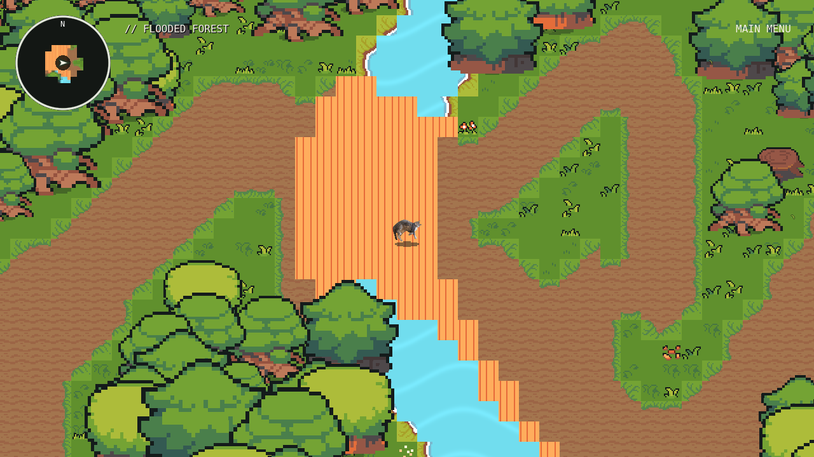 | 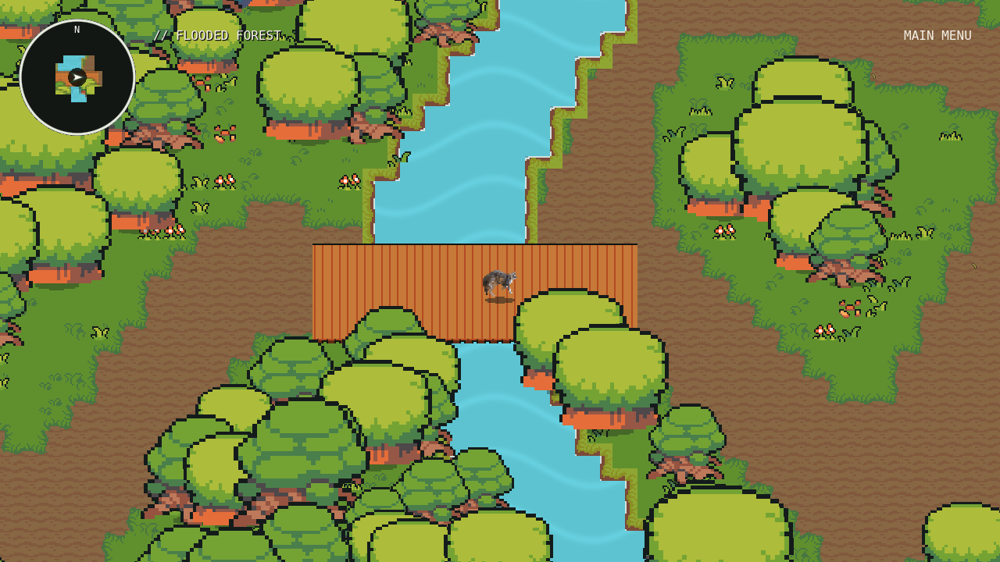 |

| Entrance | Deep Forest |
|---|---|
| 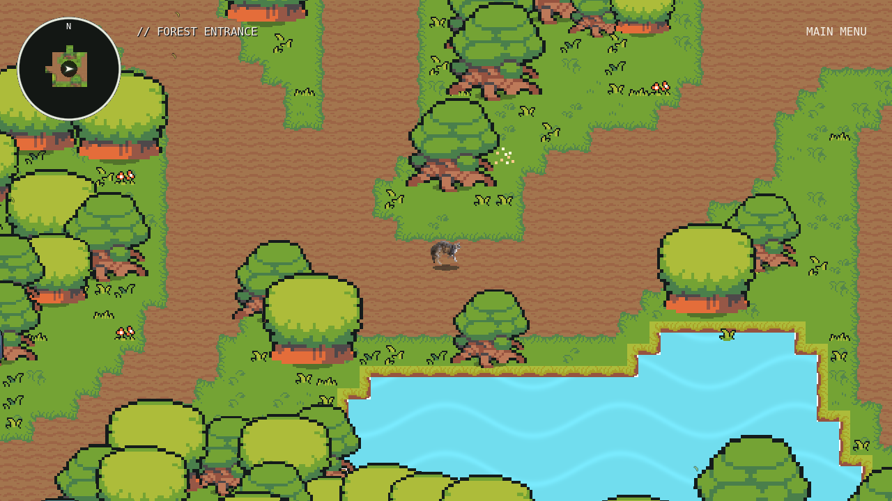 | 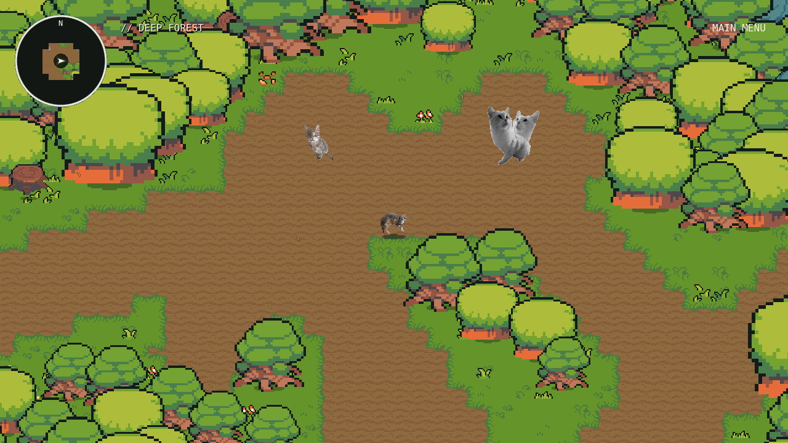 |

| Evil Bart's Area | Pond landmark bridge |
|---|---|
| 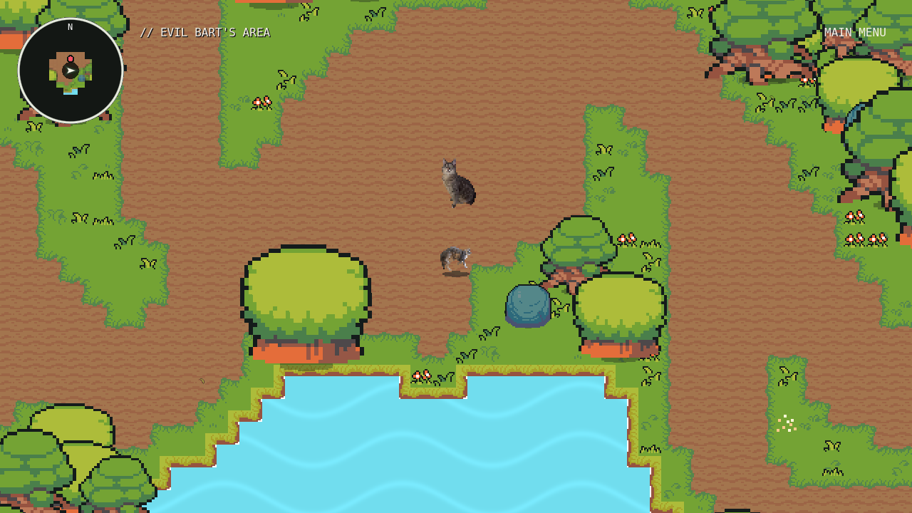 | 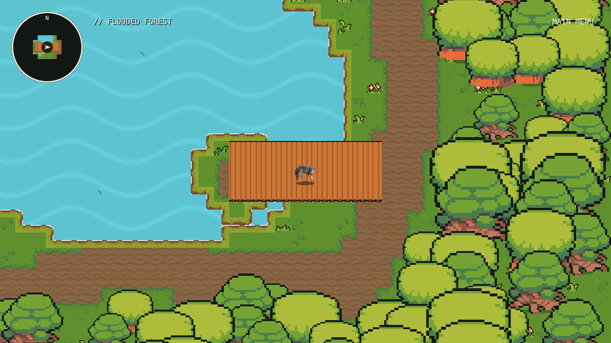 |

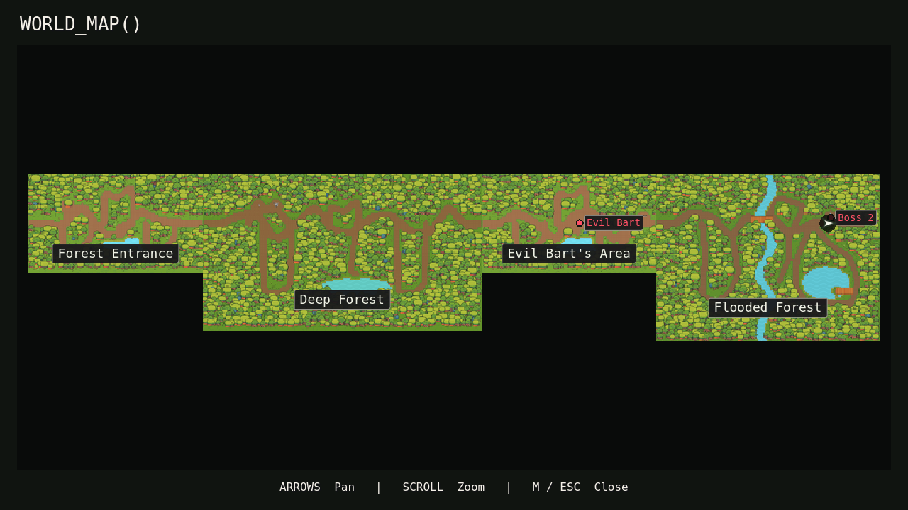

| Left facing | Right facing |
|---|---|
| 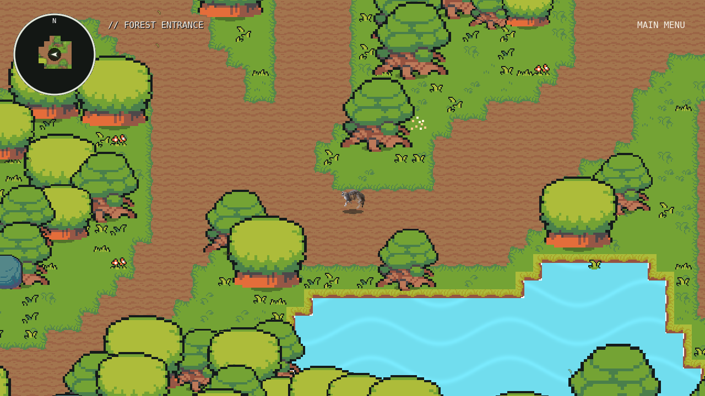 | 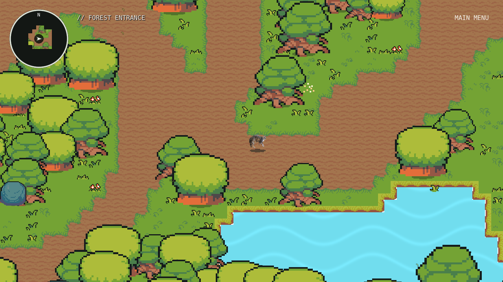 |

| Opaque canopy: behind | In front |
|---|---|
| 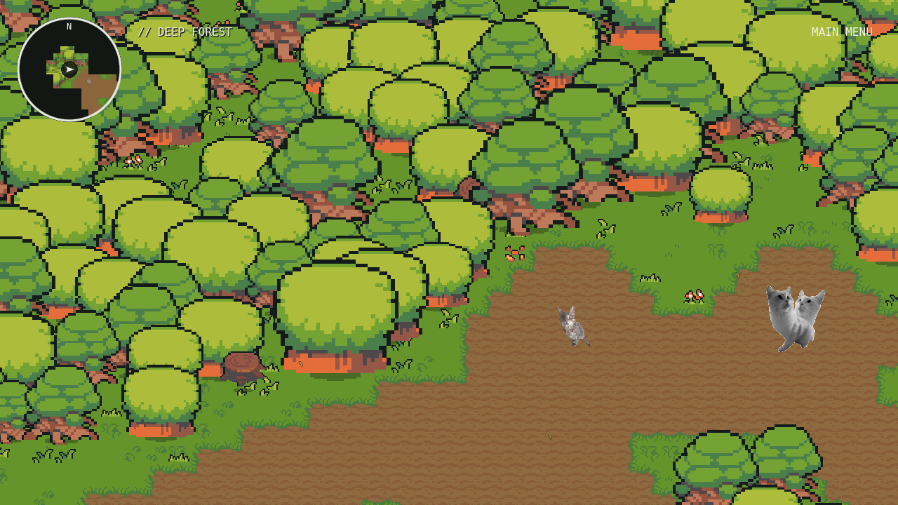 | 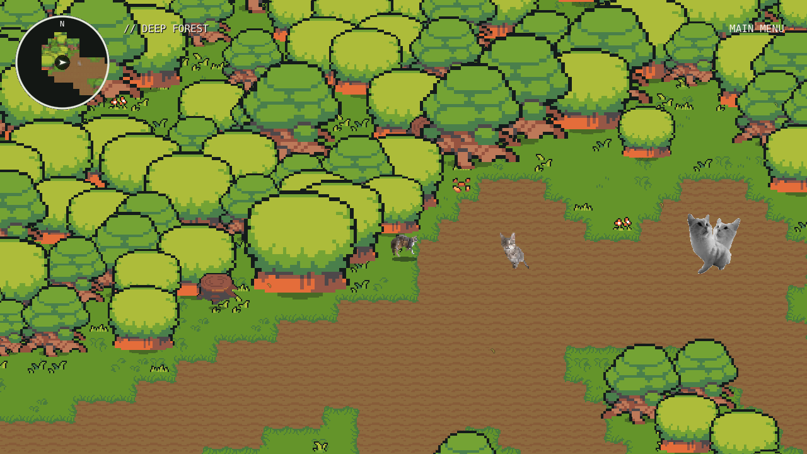 |

| Regular combat | Bart hit/phase feedback | Doppelcat cross | Sequence safe-lane impact |
|---|---|---|---|
| 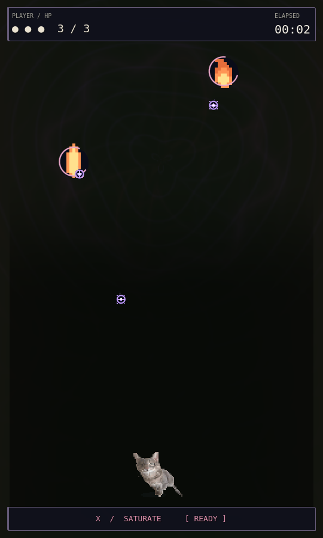 | 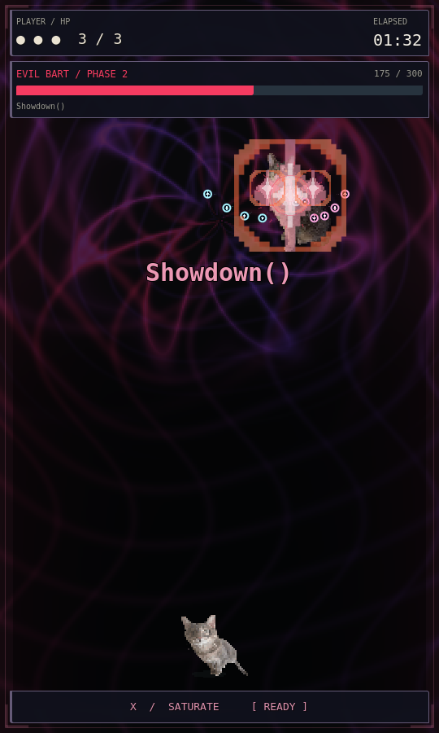 | 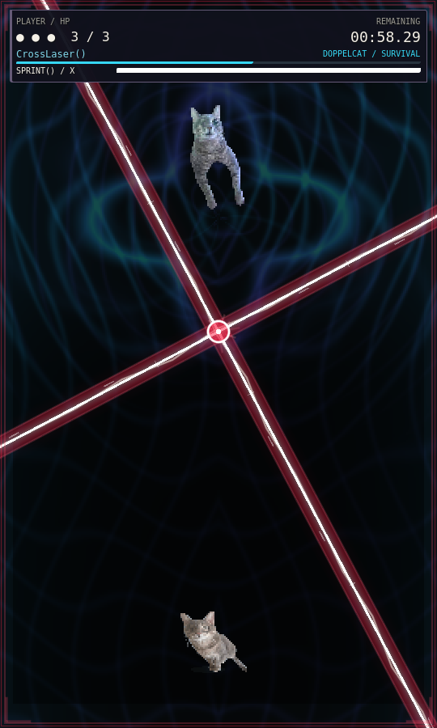 | 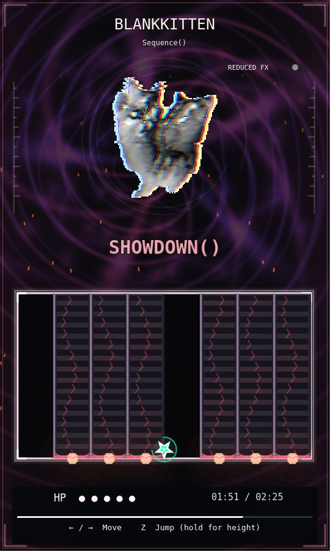 |

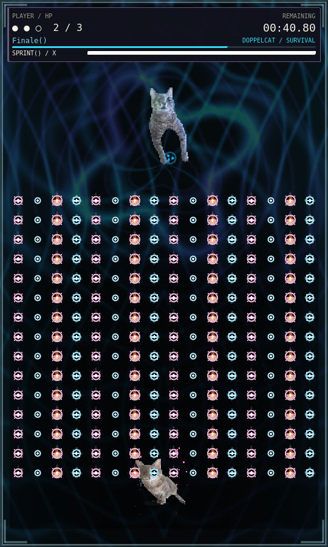

| Protected cat flash | Star travel | Cat return |
|---|---|---|
| 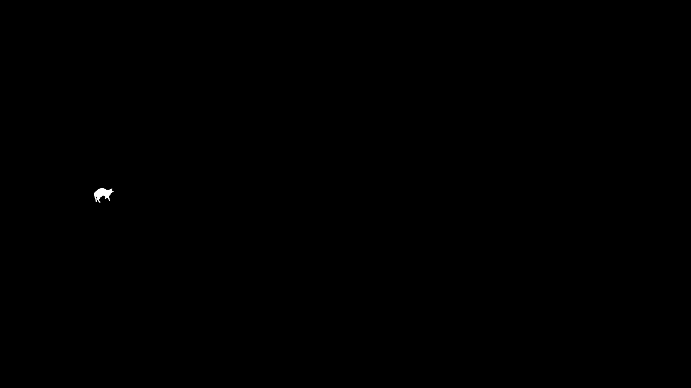 |  | 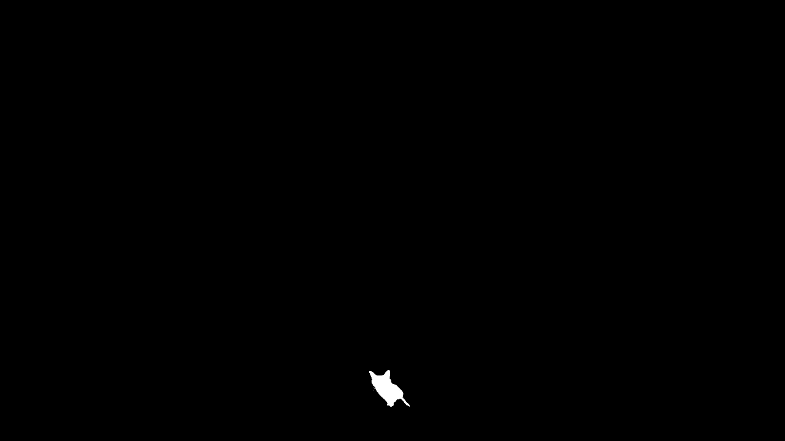 |
