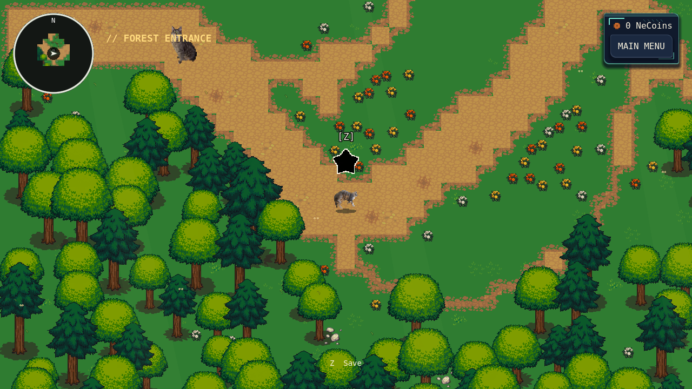
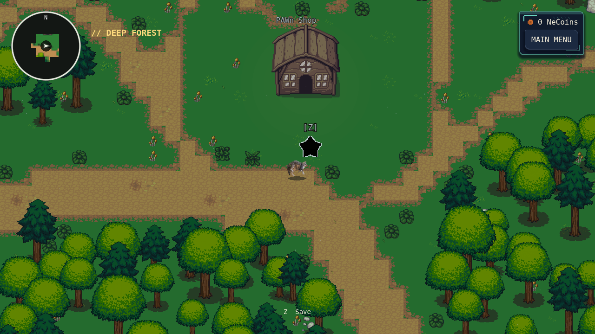
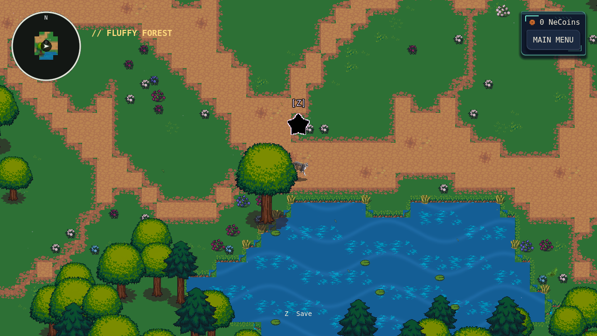
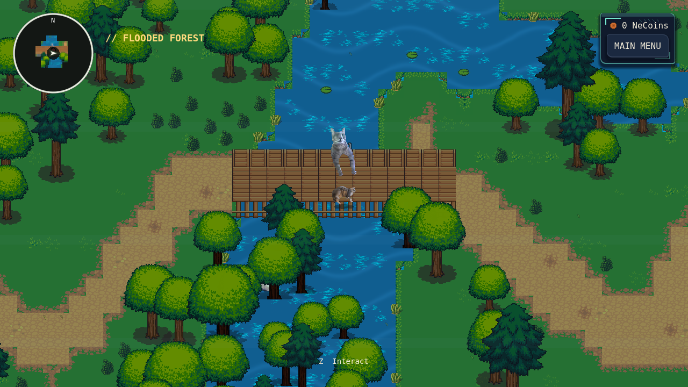

# Forest Chapter polish

This pass edits the four existing forest scenes. Region extents, connections,
story positions, water collision, bridge geometry, player artwork, and save
coordinates remain unchanged. No new creative asset files were added.

| Region | Changes |
| --- | --- |
| Forest Entrance | A broad, asymmetric route passes Smoki, the existing save star, and Butterscotch; narrower trails retain the northern and pondside discoveries. Warm white/yellow/orange flower clusters frame the clearings. |
| Deep Forest | The main route now passes the northern NPC grove, PAWn Shop/save point, and Cupid's pond bank before turning east. Ferns and mushrooms replace the uniform scatter of unrelated flowers. |
| Fluffy Forest | A soft, curved route connects the arrival, save-star clearing, and pond edge. White, pink, and violet flowers give the glades a distinct palette. |
| Flooded Forest | The bridge route continues past the existing save point, with short approach trails joining the southern bridge to its scenic loop; both original bridges and water boundaries remain intact. Reeds, lilies, and grouped understory distinguish wet banks from dry walking ground. |

All ten feathers, four save stars, NPCs, shops, existing landmark markers, and
progression gates remain. Only decorative trees/rocks intersecting the new main
corridors were cleared: 29 / 75 / 16 / 14 respectively. The remaining tree counts
are 423 / 1,357 / 455 / 1,102. Original scene and artwork files were not deleted.
Side trails remain walkable, with narrower paint to distinguish the main route.
Flower atlas alternatives offset intact cells by a few pixels to break rigid
rows without modifying the source PNGs or adding plant collisions.

The minimap/world-map terrain cache was rendered again from the changed scenes.
Fog coordinates, exploration bytes, map markers, and world transforms are intact.
The earlier story-planning PNG is a historical export; it was not overwritten.

## Effects, combat, and UI

- Rain now drives `WaterSurface`, which actually renders the water, instead of
  the hidden `Water` collision layer. Quantized ripple sampling suits the pixel
  terrain. Existing motion/reduced-effects settings govern foliage and water.
- Cached layer references avoid repeated scene traversal during rain sampling.
  The footprint sampler no longer overwrites the forest's broader shoreline
  ambience sample every 0.2 seconds. Existing grass reactions, footprints, bridge
  creaks, and water ripples remain; no sound or music files were changed.
- An ordinary projectile born within 120 pixels of the player's actual damage
  circle now travels as a hollow, harmless warning for 0.30 seconds before its
  core becomes damaging. Previously it could damage on its first overlapping
  physics tick. Normal distant volleys retain their immediate activation.
- Themed ordinary shots now visibly fill their complete circular damage core;
  diamond/flame silhouettes previously left parts of that circle invisible.
- FIGHT disables during Item Mode and other locked states. The shared weapon
  already rejected item-mode shots, but the button still accepted clicks and
  reset its firing cooldown. Both the button and callback now respect the lock.
- Leaving Fluffy Forest during its automatic arrival cancels the outgoing
  world's pending dialogue coroutine. Previously a fast scene change could
  resume that coroutine against a detached world and produce a runtime error.

No boss attack scripts, cue times, projectile budgets, enemy HP, weapon damage,
FLEE odds, rewards, RPG formulas, item prices, score formulas, or encounter
population rules changed. Tests support these focused corrections; they do not
justify a broad difficulty rebalance or establish human win rates.

## Preservation and save compatibility

An SHA-256 comparison against the starting revision verifies 866 protected files,
including every tracked original asset, story scripts, dialogue data, RPG logic,
boss scripts, and save manager. All are unchanged. A scene-property comparison
verifies 152 protected nodes across characters, entries, portals, landmarks,
boundaries, water, and bridges. New terrain introduces no solid collision bodies;
only the corridor decorations listed above were removed.

The new runtime tests save obstructed positions to disk and reload each region,
checking safe fallback positioning and retained EXP, inventory, NeCoins, quest
acceptance, and feather progress. Legacy files missing newer fields still load
through the existing migration. No new save version or migration is required.

## Human-created artwork and licenses

No new external artwork, audio, fonts, or dependencies were downloaded. Attempts
to inspect OpenGameArt, Kenney, and Pixel-Boy's first-party pages returned network
403 errors in this environment. Existing verified repository sources provided
the compatible artwork; blocked pages were not treated as licensing evidence.

| Artwork used | Creator / provenance | License / retained notices |
| --- | --- | --- |
| LPC grass, dirt, trees, rocks, bridges, water | Lanea Zimmerman (Sharm), original Liberated Pixel Cup tiles. [Upstream](https://github.com/OpenGameArt/LiberatedPixelCup), revision `f61104a1ecc54e7bce54b82ada7d7ba4c41bc524`. | CC BY-SA 3.0 option; original notices, full license, source paths, and hashes in `assets/environment_human/lpc/`. |
| LPC Revised flowers, mushrooms, summer plants | Eliza Wyatt (DeathsDarling), Sharm, Hyptosis, and BlueCarrot16 as credited per sheet/row. [Artist repository](https://github.com/ElizaWy/LPC), revision `f07f7f5892e67c932c68f70bb04472f2c64e46bc`. Its retained Credits explicitly describes the collection as hand drawn; Terrain-Credits lists authors and upstream sources. | OGA-BY 3.0; `assets/environment_human/lpc_revised/Credits.txt`, `Terrain-Credits.txt`, and `provenance.json`. Source bytes unchanged; new compositions use Godot atlas coordinates only. |

Existing in-game environment attribution already includes these collections.
Their documented artist histories and source checksums provide credible human
provenance, not an absolute forensic guarantee. No image-generation tool was used.
All music, character identities and artwork, dialogue, story, quest outcomes,
meaningful locations, and player controls are preserved. Code, shaders, existing
atlas placement, and actual Godot screenshot/map-cache rendering are the only
visual work performed in this pass.

## Validation

Godot 4.6.3 headless import passes. The focused suites cover all eight moving
enemy hitboxes through real projectile → damage → HP display → victory/reward →
return flow, FLEE, consumables, leveling, Records, quest branches, shop purchase
and theft, all ten feathers, four save stars, actual region transitions, old and
new save files, menus, and all three bosses. The new chapter suite has 110 checks.

Two old fixtures needed maintenance: the Smoki test still entered his former
region (which now automatically starts BlankKitten) and expected three player
HP; BlankKitten's full-run test expected five HP and did not account for the
existing victory level-up heal. They now use the actual encounter location,
current RPG maximum, and actual damage count. No boss or progression logic was
changed to satisfy those old assumptions.

All **24 final suites passed**, totaling **3,593 explicitly counted assertions**,
plus the full story-object reachability scan and a separate-process save/Records
reload. The preservation script passes separately. Detailed suite counts are in
[`validation.json`](review/forest-chapter/validation.json).

- Moving projectile/damage/victory regression: 2,361 checks across all eight enemies.
- Story/quest integration and state: 148 checks; RPG foundation/battles: 156.
- UI: 149; menus/save slots: 56; standalone fullscreen switches: 84.
- Smoki: 47; Doppelcat focused mechanics: 45; cross lasers: 44; Sequence: 102.
- Full uninterrupted Doppelcat playback reached 140.80 s, visited all seven
  phases, and peaked at 66 projectiles (test invincibility explicitly enabled).
- Full uninterrupted BlankKitten playback reached 145.71 s with zero damage
  under the existing movement-only automated pilot, all phases visited, victory
  stored, and the remaining music tail faded. No clock overrides or cheats.

Twenty-two actual rendered screenshots cover all four forests at player scale,
regional overviews, rain, all eight ordinary enemy presentations, and the new
close-spawn warning. They were inspected and refined for plant alignment,
main/side-path distinction, safe routing around save stars and Doppelcat, bridge
approaches, projectile silhouettes, and UI readability. Godot ran standalone on
X11 with Mesa llvmpipe; rendering was not an editor preview.

Performance figures below are short stationary 90-frame software-renderer
samples at the same four views, after loading. They are diagnostic samples, not
frame-rate guarantees. Rendering work decreased; not every timing percentile
improved. Flooded Forest was recaptured independently after its bridge approach
refinement, so process-history-dependent memory figures are not compared.

| Region | Median frame time, before → after | 95th percentile, before → after | Draw calls, before → after |
| --- | --- | --- | --- |
| Forest Entrance | 16.73 → 14.98 ms | 21.08 → 18.15 ms | 285 → 152 |
| Deep Forest | 19.97 → 16.99 ms | 31.91 → 22.69 ms | 440 → 201 |
| Fluffy Forest | 18.39 → 18.56 ms | 23.75 → 22.14 ms | 423 → 208 |
| Flooded Forest | 16.76 → 18.49 ms | 19.97 → 21.64 ms | 156 → 118 |

Hardware GPUs, sustained sessions, audio listening, and subjective combat
difficulty/visual comfort still need manual playtesting.

Some runners retain baseline ObjectDB/resource/RID/PagedAllocator cleanup
warnings at shutdown. Final runs have no in-play script, shader, or import
errors; the cleanup warnings are not claimed fixed. No platform export or full
human-paced chapter playthrough was performed.

## Editing and review

- `scripts/journey/chapter_routes.gd` contains the authored main-route points and
  decorative grouping centers. Existing `layout.gd` remains the compatibility
  source for bounds and entry locations.
- `tools/polish_forest_chapter.gd -- --apply` performs a guarded one-time edit of
  the current baked scenes. Already-polished scenes are skipped. Subsequent
  manual painting should use the scene's TileMapLayers; do not rerun the older
  world-building generators over this work.
- `resources/journey/chapter_plants.tres` contains editable atlas alternatives;
  all source images are shared with the existing art collection.
- `python3 tests/check_forest_chapter_preservation.py` reproduces the source,
  meaningful-node, collider, and asset-provenance comparisons against `6c5674a`.
- `tests/headless_forest_chapter.gd` covers the new behavior; the existing story,
  RPG, projectile, boss, menu, and transition suites cover preserved systems.
- `tests/render_forest_chapter.gd` captures the actual standalone game, with
  `-- --combat-only` for all eight ordinary enemy presentations. Images in
  `docs/review/forest-chapter/` are review evidence, excluded from game exports
  by the existing `docs/.gdignore`.

