# Forest journey and surreal combat overhaul

The playable world now follows **Forest Entrance → Deep Forest → Evil Bart's
Area → Flooded Forest** through newly authored forest scenes. Existing bosses,
controls, damage, abilities, attack schedules, soundtrack and save flags remain.
Wonderland, the Underground Cave and Incarna are disconnected from play; their
original files remain intact. No new narrative, boss, region, quest or ending was
introduced.

Baseline: Git revision `6eb50b0`. `tests/check_overhaul_preservation.py` confirms
that **all 1,528 original tracked files still exist**, every original asset is
unchanged, the archived region/encounter implementations are unchanged, and the
protected combat functions still match the baseline. **No existing project file
was deleted or renamed. All seven original music files are byte-identical.**

## Playable geography

| Region | Retained pixel bounds | Baked trees | Connection / encounter |
|---|---:|---:|---|
| Forest Entrance | 3200×1824 | 451 | East to Deep Forest; original inspectable tree retained |
| Deep Forest | 5120×2880 | 1,421 | West to Entrance, east to Bart; BlankKitten remains here |
| Evil Bart's Area | 3200×1824 | 470 | West to Deep Forest; existing Bart/key progression opens the east exit |
| Flooded Forest | 4096×3072 | 1,180 | West to Bart; Doppelcat, marsh crossings, optional exploration; eastern road ends naturally in a grove |

This replaces the old maps' navigable geometry rather than merely repositioning
their existing rectangles. Curved main roads, connected scenic loops, compact
clearings, ponds, a marsh channel, dry boardwalks, stumps, rocks, flowers, tufts and
fallen branches compose the new journey. All six original exploration landmark
names remain as connected editor markers in each region. The old arbitrary
shortcuts survive in the original scenes but are not active connections.

All west/east seams meet at global Y=912 with matching road widths. The Flooded
Forest gate moves to Bart's eastern exit, retaining its existing key condition
and interaction. BlankKitten retains its existing optional interaction conditions;
no new boss ordering gate was invented. Finishing the available encounters leaves
their existing return/exploration actions in place, without forced credits or exit.

Trees have stable baked 0.7–1.5 size multipliers, with large trees less common,
uniform aspect ratio, shared foliage material, and matching scaled trunk capsules.
Each multiplier remains editable in the Inspector. Canopies remain opaque; they
can completely hide the player. Existing Y-sorting lets the player render in
front after walking past the trunk. NPC clearings and paths stay clear of critical
occlusion. Small plants and flowers have no collision. Water is solid except for
explicit non-solid alternative tiles beneath bridges.

The current cartography uses the actual newly rendered maps. It fits the whole
horizontal journey on opening, supports the existing pan/zoom/fog, and omits all
inactive entrance markers. An initially blank capture viewport was caught during
visual review and fixed; the baker now rejects a blank terrain render.

## Combat presentation

| Encounter | Result |
|---|---|
| Opening enemies / regular combat | Animated human flame tokens, textured nova/sparkle projectile cores, trails, crisp collision-radius rims and shared impact frames. Restrained woodland backdrop; advanced music reaction stays off. |
| Evil Bart | Rose/violet thorn mandala, unfurling ribbon interference and an escalating upper-stage composition. Original cat artwork, 300 HP, SATURATE damage/visual beam, attacks and victory behavior remain. |
| Doppelcat | Cyan/indigo mirrored water patterns, flowing laser highlights, textured projectile variants and shared hit/sprint feedback. Existing rotating cross geometry, 18 RPM cap, ricochet separation and survival-only X sprint remain. |
| BlankKitten / Sequence() | Folded-space violet/pink stage, retained portrait distortion and arena morphs, human pixel detail in the fireball, and synchronized sparks. Shared HUD framing and phase captions avoid duplicate simultaneous stage announcements. |

Every new background is a permitted procedural shader effect, behind all actors
and hazards. The dodging floor is deliberately darker than the upper spectacle.
Existing backgrounds/extra shader passes are hidden or disabled when replaced,
so they do not continue rendering underneath the new composite. No duplicate
combat HUD, boss, collider or attack scheduler was introduced.

`SurrealDirector` reads the **existing authoritative audio-driven encounter
clock**. Established cue sheets choose the section envelope; known beat/bar
periods anchor pulses. A unity-gain `BossMusic → Master` bus supplies read-only
low/high-band FFT accents. FFT never schedules an attack, seeks a track, changes
pitch, or replaces the section design. It activates only when a boss is active.
Regular opening combat is explicitly tested to have no advanced music reaction.

Actual source PCM was also inspected numerically at the existing section
boundaries: [music analysis](forest-combat-music-analysis.json). This measures RMS,
spectral centroid and positive spectral flux without altering the files. Loudness
alone does not choose intensity: for example Bart's authored breathing-room
section is not a corresponding full-file-RMS silence. No new cue timestamps or
claims of listening-based musical analysis were invented.

Options now persist **Reduced battle effects** and **Background motion** in
`user://visual-options.cfg`. Motion can stop. Reduced mode quarters the background
resolution, removes extra stage sparks, reduces phase flashes and portrait spin,
and stays synchronized with Sequence's existing REDUCED FX toggle. The ordinary
background composite runs at half resolution; UI, actors, hazards and collision
coordinates retain the native **540×900** battle layout. The overworld remains
**1280×720** with unchanged player movement code and artwork.

## Artwork, text and preserved content

New source artwork: **Pixel-Boy, Ninja Adventure, CC0**.

- Creator: https://pixel-boy.itch.io/ninja-adventure-asset-pack
- First-party repository: https://github.com/pixel-boy/NinjaAdventure
- Downloaded distribution: https://github.com/clear-code-projects/Zelda/tree/5f4c57bfbb162d2f19b287a5c24816d93c17e08d
- Verbatim license/artist notice: [LICENSE.md](../assets/overhaul_human/LICENSE.md)
- Original archive paths and SHA-256 hashes for all 44 unchanged PNGs:
  [provenance.json](../assets/overhaul_human/provenance.json)

The dated January 2022 distribution, explicit CC0 notice, named artist and
first-party repository provide credible human provenance. This is not a forensic
guarantee of every historical production step. The itch.io page could not be
re-read here. The 2.41 MiB source archive passed its CRC check. Attribution is
optional under CC0 and is nevertheless included in the in-game asset credits.
Previously credited Ninja Adventure floors/details/trees/shadows are reused in
place; no duplicate source copies were made for them. Existing character artwork,
Lorc movement icons and their notices remain. No new audio or fonts were added.
No image/audio generation model or service was used, and no source PNG was edited
or re-encoded. The restricted TopDownFantasy pack and Fan-tasy trial were not
selected for the new forest or combat artwork.

Removed active decorative text: SURVIVE THE SIGNAL, BREAK THE SIGNAL, the side
SHOWDOWN subtitle, SURVIVE THE ABSENCE, SIGNAL LOST/survived result flavor and the
persistent overworld keyboard tutorial. The generic ForestNPC's explicitly
`[TEMP]` test conversation is disconnected while its character and original JSON
are retained. No replacement lines were written. Existing boss names, mode names,
functional controls, phase labels, victory/defeat navigation and authored dialogue
remain. Approval history cannot be established from code for every existing tree
description, boss taunt or `Showdown: <boss>` introduction; these were retained and
are flagged for editorial review rather than silently rewritten. The original
MY PET DEAD. line remains part of the game's existing personality.

Archived source is still under `scenes/wonderland/`, `scripts/wonderland/`,
`scenes/world/underground_cave.tscn`, the cave scripts, `scenes/incarna/` and
`scripts/incarna/`. Original forest scenes and map caches also remain. Active
maps live separately in `scenes/journey/`. `Overworld.ARCHIVED_MAP_PATHS` records
the inactive scene paths without initializing their content during play.

## Saves and controls

Save version 1 is retained. On first load into the new layout, an older active
save relocates to a safe entrance in its current region. A save inside an inactive
region safely returns to Flooded Forest. Existing flags, keys, boss completions
and current-format exploration bytes remain; reading does not overwrite the source
save. Existing backup/validation and older cave-format migration behavior remain.
The layout revision flag prevents repeated relocation. Current saves still use
real-collider validation for obstructed spawn points.

Inactive region travel is rejected centrally, even with the progression bypass.
Incarna/Wonderland/cave scene transitions are blocked through Session. No items or
boss victories are granted by the fallback. Inactive keys remain in save data but
are omitted from the active inventory UI. Ordinary collision, boundaries and
four-direction movement are unchanged. Shooting, SATURATE, BEAM, CATA, sprinting,
focus and existing developer shortcuts retain their mechanics.

## Validation and limits

Godot **4.6.3** headless import passed with no script/parse/import errors. Final
render captures have no in-play script or shader errors.

| Test | Checks | Failures |
|---|---:|---:|
| Forest routes, landmarks, real player-sized physics, density, archive/save guards | 442 | 0 |
| Actual body-entered transitions, key gate and map pan/zoom/fog | 17 | 0 |
| Visual settings, actual FFT input, rendering modes and collision radii | 20 | 0 |
| Existing Bart regression | 47 | 0 |
| Existing Boss 2 overhaul regression | 45 | 0 |
| Existing Sequence overhaul regression | 102 | 0 |
| Existing music/hitbox integration | 37 | 0 |
| Active music initialization/seek/return tests | 38 | 0 |
| Native menu startup, mixer output and WAV looping | 7 | 0 |
| Full uninterrupted Doppelcat soundtrack | 3 | 0 |
| Full uninterrupted BlankKitten soundtrack | 6 | 0 |
| Original files/assets/functions + human-source/license integrity | 1,000 | 0 |

That is **764 runtime assertions plus 1,000 preservation checks**. The separate
functional gameplay suite also reports zero failures, covering menus, shooting,
SATURATE, victory/retry and navigation. Source/function preservation checks ensure
that the final visual refinements do not alter the mechanics exercised by the
full-length runs. The existing music suite now exercises the three active bosses;
Malware/Incarna remains imported and preserved without reactivating the encounter.

Doppelcat's full run visited all phases, peaked at 78 projectiles, respected the
240 cap and reached victory at 140.80 s. That observation used explicit test
invincibility and does not establish human dodgeability. BlankKitten's existing
movement-only test pilot completed actual MP3 playback at 145.71 s with five HP,
every phase visited once, completion saved, and its tail faded/stopped. Neither
full run used clock overrides. These are automated regressions, not human playtests.

The density survey casts the actual player shape 5×walking-speed pixels from
walkable samples; it excludes directions that leave the map. Clear five-second
directions were 0/100 (Entrance), 12/443 (Deep Forest), 5/95 (Bart) and 6/335
(Flooded), or **0–5.3%**. Separate A* queries verify that this density does not
block intended destinations. This is a sampled geometry check, not an exhaustive
measure of every possible route or a playability rating.

The final renderer captured **32 actual images**: all four regions, multiple
forest views, map, canopy front/back, all three encounters in multiple phases,
reduced variants, options, and a 240-projectile stress scene. Twelve are bundled
below. The stress grid is an isolated rendering diagnostic; it is not a new attack.
The actual generated images were inspected and fixes were repeated for bridges,
placeholder graphics, map capture, labels and canopy demonstration.

A 120-frame stationary Deep Forest sample at 1280×720 on Mesa **llvmpipe software
rendering**, after 35 warm-up frames:

| Revision | Median interval | 95th percentile | Static engine memory | Draw calls |
|---|---:|---:|---:|---:|
| Original `6eb50b0` | 14.815 ms | 20.469 ms | 89.76 MiB | 73 |
| Overhaul | 17.273 ms | 21.631 ms | 78.12 MiB | 108 |

The richer forest costs more rendering time in this sample. Cached water-layer
lookup avoids repeatedly traversing thousands of scenery nodes, and inactive
scene preloads are removed. These short software-renderer samples do **not**
establish target-device performance or a guaranteed frame rate. Hardware GPU,
low-end device and long-session frame-pacing tests still require manual validation.

Some runners continue to report ObjectDB/resource/RID cleanup messages at exit;
the baseline also emits cleanup warnings. These remain unresolved and are not
presented as a clean shutdown. Audio used the Dummy driver: actual playback state,
PCM/mixer output and clocks were checked, but speaker/headphone listening and
subjective transition/visual comfort still need manual playtesting. No platform
export was produced; the project still has no configured export target.

## Editing and reproduction

- `scripts/journey/layout.gd` defines active region bounds, aligned seams and
  authoring route points. `scenes/journey/` contains ordinary editable baked
  scenes with TileMapLayers and per-tree Inspector controls.
- `resources/journey/` holds shared editable atlas TileSets and foliage material.
  Path terrain bits are configured. Water alternative 0 is solid; alternative 1
  is reserved for non-solid water underneath bridge cells. Decorations have no
  physics layer. Use nearest filtering and uniform tree sizes.
- `tools/build_forest_journey.gd -- --apply` reauthors **only the new journey
  scenes/resources**. It overwrites their manual edits: commit/back up edits before
  intentionally rerunning it. Do not run the old expansion tools on these scenes.
- After manual map changes, run the graphical `tools/bake_journey_map.gd` to update
  cartography. Original world/Wonderland/cave generators and caches are preserved.
- `scripts/ui/surreal_director.gd`, `shaders/surreal_battle.gdshader` and
  `scripts/ui/human_effects.gd` are reusable presentation components; gameplay never
  consumes their values. Visual preferences are separate from game saves.

From the project root with writable XDG cache/data/config directories:

```sh
godot --headless --editor --path . --import
python3 tests/check_overhaul_preservation.py
godot --headless --path . --script tests/headless_journey.gd
godot --headless --path . --script tests/headless_journey_transitions.gd
godot --headless --path . --script tests/headless_overhaul_visuals.gd
# Run native bootstrap separately from other Godot processes in this checkout.
python3 tests/test_native_music_startup.py
# Use a real graphical display for captures and the terrain cache:
godot --path . --rendering-method gl_compatibility --script tools/bake_journey_map.gd
godot --path . --rendering-method gl_compatibility --script tests/render_forest_combat_overhaul.gd -- --output=/tmp/catsSaga-review
```

Godot's generated import sidecars for the unused source-archive folder were
retained on disk and locally excluded from Git review. No original files were
removed to clean the workspace. Temporary source downloads, controlled baseline
snapshot, test saves and logs live outside the checkout.

## Rendered review evidence

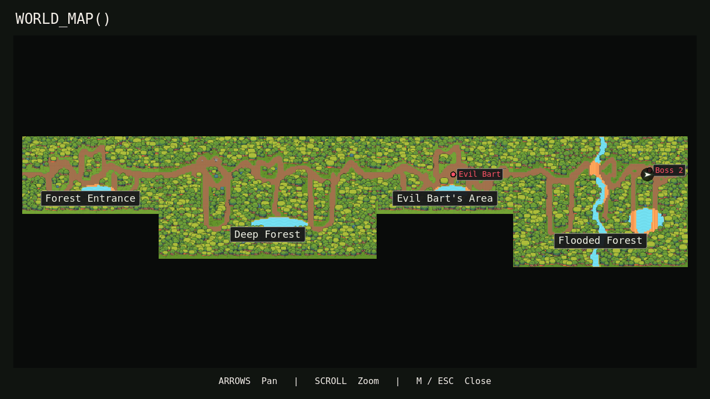
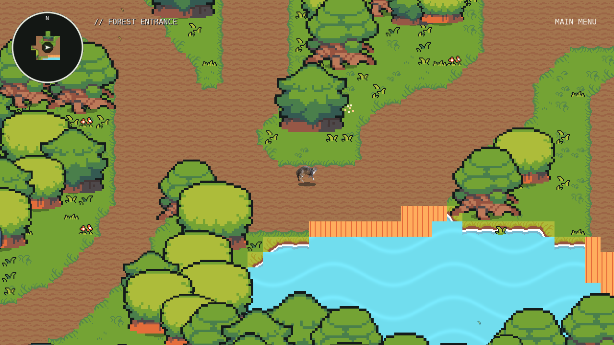
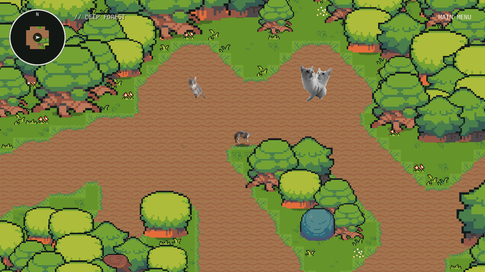
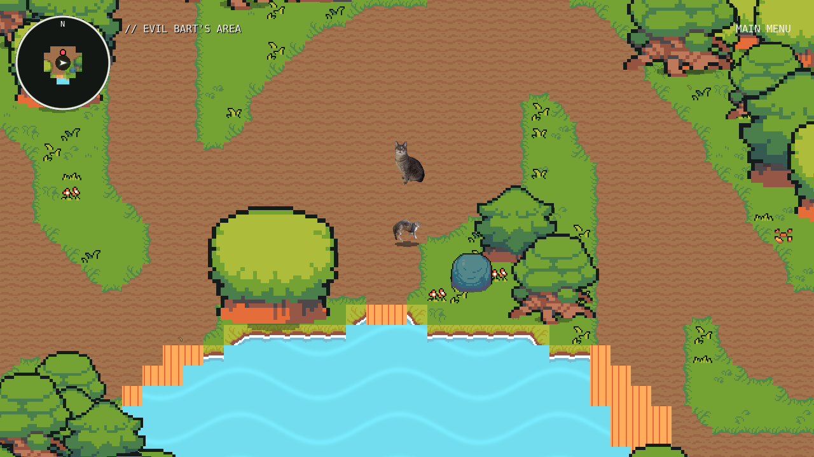

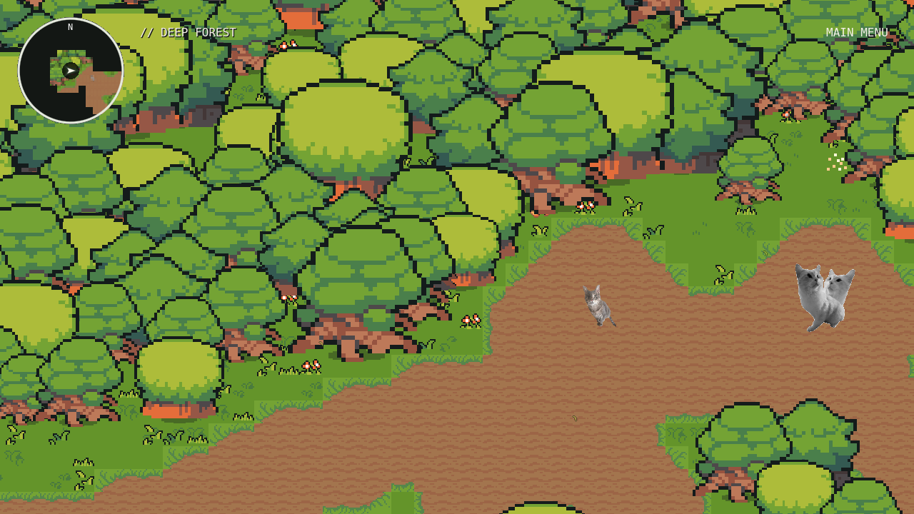
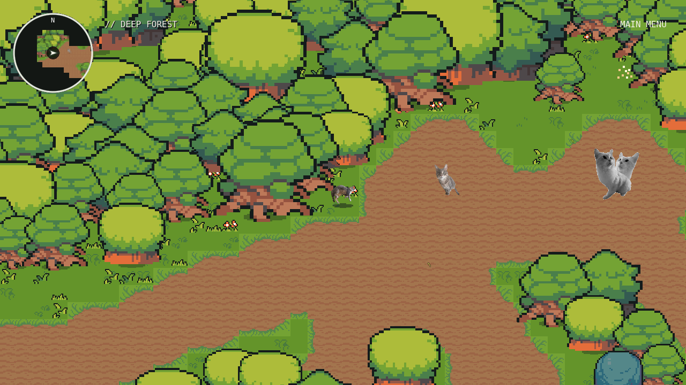
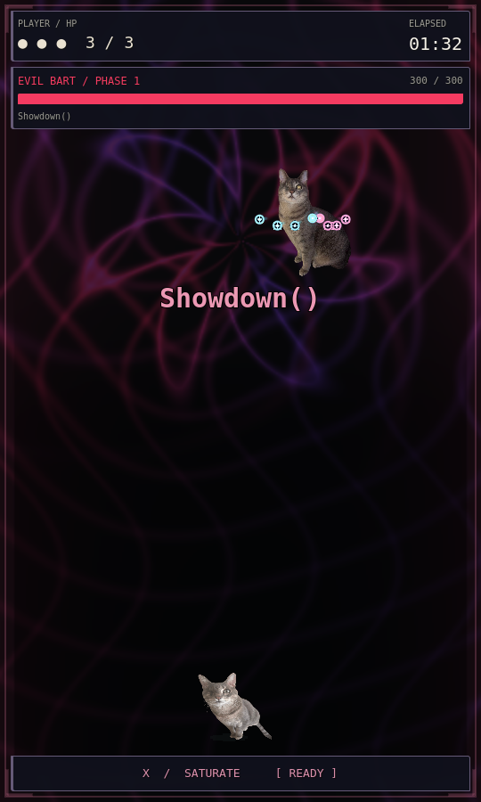
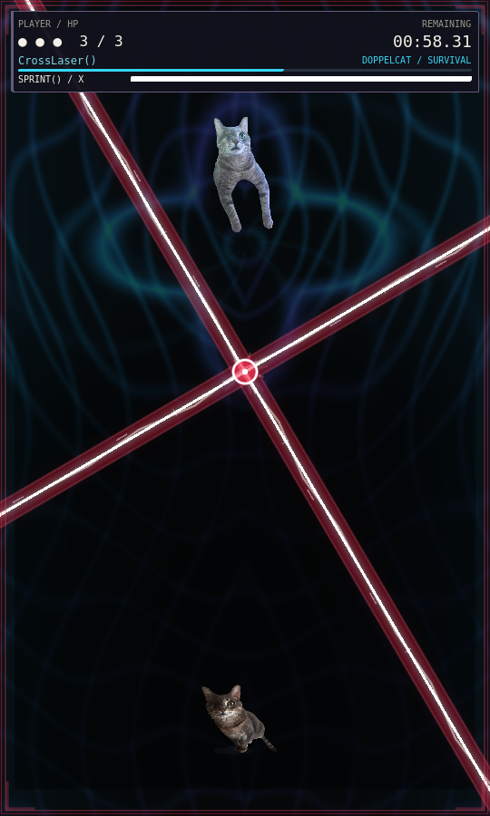
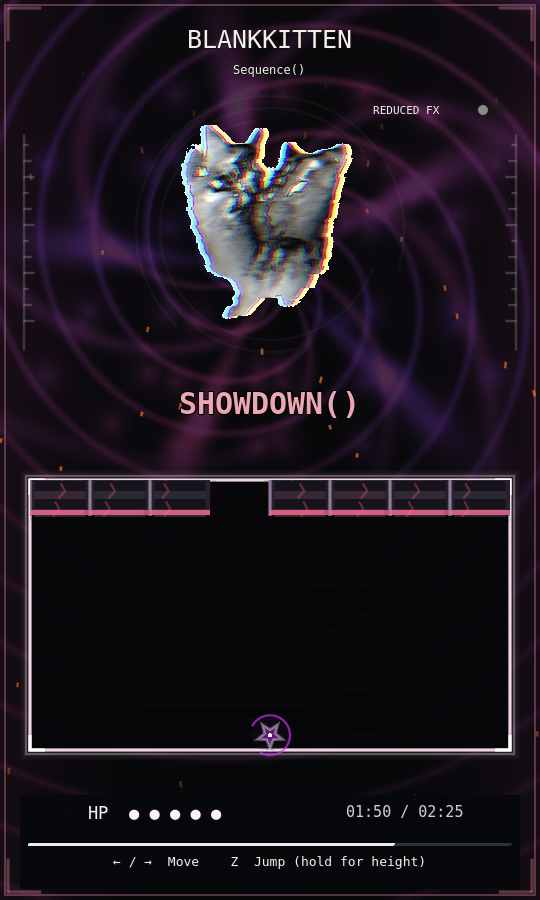
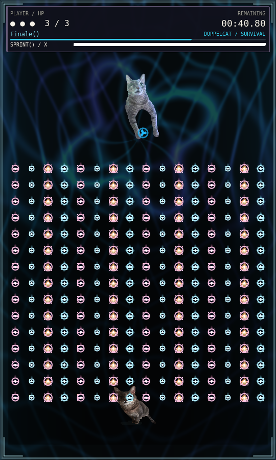
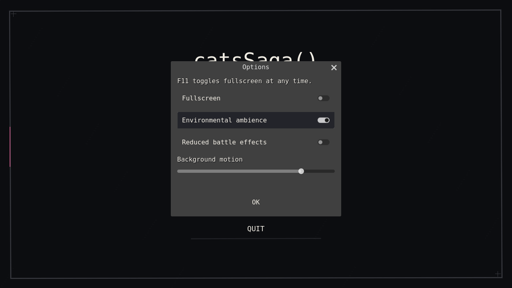
