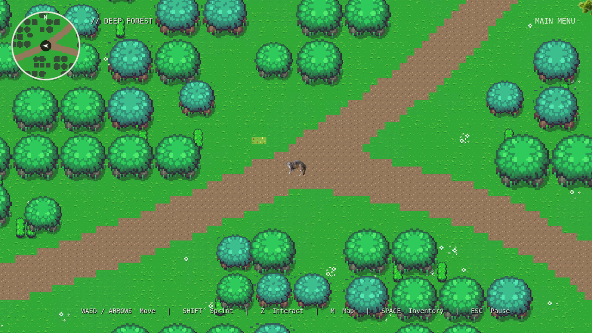
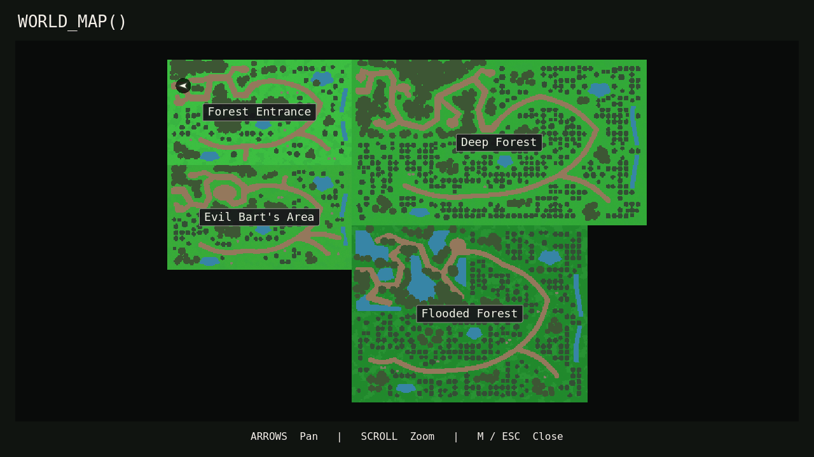

# GFX forests and cartography

The four expanded overworld scenes now use the repository's GFX terrain and vegetation. Exploration has a circular minimap, an interactive world map, permanent saved discovery, and a separate temporary map-reveal cheat. Existing boss fights, dialogue, artwork, music, progression gates, and world dimensions are preserved.

## Environment changes

Counts below are **additional GFX features**, excluding the original `tree.png` trees and existing decorative layers, which remain in place.

| Region | Existing dimensions | Additional trees | Plants | Boulders | Treatment |
| --- | --- | ---: | ---: | ---: | --- |
| Forest Entrance | 3200×1824 px / 200×114 tiles | 61 | 213 | 8 | Readable introductory routes, mixed grass, shrubs, and tree clusters around clearings. |
| Deep Forest | 5120×2880 px / 320×180 tiles | 427 | 464 | 3 | Denser varied foliage, darker ground, enclosed routes, and reserved secluded clearings. |
| Evil Bart's Area | 3200×1824 px / 200×114 tiles | 73 | 222 | 7 | Warmer soil/grass tint, denser woodland around the original boss approach. |
| Flooded Forest | 4096×3072 px / 256×192 tiles | 316 | 287 | 9 | GFX wave water and bank tiles, waterside vegetation, and clustered woodland. |

The existing winding path network, water footprints, entrances, NPCs, gates, and six future-content clearings per region remain. Some paths in the expanded portions are narrower; original progression corridors are retained. Seeded placement produces stable clusters and avoids protected objects, clearings, water, path edges, and existing tree canopies. New complete tree features use small/medium/large layer scales of 2.6/3.2/3.8, preserving aspect ratio. Original trees retain their existing individual scale controls.

`assets/enironment/gfx/Overworld.png` supplies four interior grass tiles, two darker ground tiles, two soil tiles, wave/bank tiles, complete round trees, boulders, flowers, and shrubs. `objects.png` supplies three complete leafy tree frames. Multi-cell trees, shrubs, and rocks remain intact atlas features. PNG pixels were not modified or duplicated. All eight GFX PNGs imported successfully; character, font, interior/cave, and animated stump-creature graphics are not repurposed as forest props. No confirmed suitable fallen-log or mushroom artwork was found, so those props were not fabricated.

Five editable shared TileSets are in `resources/world/`: `gfx_terrain.tres`, `gfx_water.tres`, `gfx_trees.tres`, `gfx_boulders.tres`, and `gfx_plants.tres`. Existing ground/path/water layers reference these resources. Six added TileMapLayers per scene hold coherent darker forest-floor patches, three tree sizes, boulders, and undergrowth. Nearest filtering preserves pixel edges; tree Y-sort origins follow trunk bases. Only trunks, rock bases, and water collide on the existing world/player layers. Flowers and shrubs are walkable.

### Editing the forests

Open a region scene and select its terrain, tree, boulder, or undergrowth TileMapLayer. Use the Godot TileMap editor to paint from the shared atlas palette. Each larger feature appears as one complete tile. Change the appropriate tree layer scale for a size class; original standalone tree nodes still expose their existing size settings. Keep protected progression routes and reserved clearings clear.

`tools/bake_gfx_forest.gd` records the initial deterministic authoring operation and refuses to rebake an already-integrated scene. It is not a runtime generator or an update command for manually edited forests. After any level edits, regenerate the cartography cache instead:

```sh
godot --headless --path . --script tools/bake_world_map.gd
godot --headless --path . --script tests/headless_gfx_forest.gd
```

## World map and minimap

M opens/closes `WORLD_MAP()`. It starts centered on the player's actual location. Arrow keys pan, the wheel smoothly zooms within 0.8–12, and M/Esc/X close it. Player movement and interaction are blocked while either map or inventory is open. Maps cannot open through dialogue, transitions, pause/options, or combat. The opaque full map avoids drawing covered world sprites and restores them on close; this has no effect on normal exploration visibility.

The north-up map uses one map pixel per existing 16-pixel terrain tile. Unequal region sizes use a staggered conceptual 2×2 layout, keeping uniform scale:

| Region | Map offset in tiles | Size in tiles |
| --- | --- | --- |
| Forest Entrance | (0, 0) | (200, 114) |
| Deep Forest | (200, 0) | (320, 180) |
| Evil Bart's Area | (0, 114) | (200, 114) |
| Flooded Forest | (200, 180) | (256, 192) |

The rectangles touch at their conceptual seams. Blank padding reflects unequal sizes; it is not another playable region. Existing portal and locked shortcut behavior is unchanged. A marker is transformed with `region_offset + player_position / 16`; travel uses each destination's real arrival position.

`tools/bake_world_map.gd` reads one existing region at a time and creates a compressed 520×372 terrain resource. Ground and path colors come from the real selected tiles; water cells, tree canopy extents, and rocks come from actual placed geometry. This is a coarse terrain map, not a second playable world or hand-drawn duplicate. NPCs, bosses, collectibles, discovery markers, and interaction nodes never become map icons. Only actual region names and the player arrow are overlaid. Source fingerprints make stale caches detectable by the GFX test.

The top-left minimap is 150×150 with a circular shader mask and border. It follows the player, keeps north fixed, and retains the last facing direction while stationary. Only its arrow rotates. The HUD title has room beside it. It hides automatically during dialogue, transitions, pause/modals, and full-screen map/inventory, and exists only in the overworld scene. Both map views share the terrain and fog textures. Terrain GPU data is approximately 0.74 MiB and fog data 0.18 MiB; the compressed terrain file is about 104 KiB. Four full worlds are never rendered for cartography.

## Exploration and hidden reveal

Legitimate exploration uses permanent per-region bitsets on Session, with 4×4-tile cells and a nearby reveal radius of 12 tiles (192 world pixels). Entering nearby cells sets bits permanently. Both maps use the same data; leaving a region cannot darken already discovered terrain. Fog is applied only by the map shader, never to world lighting, artwork, or the game camera.

The existing version-1 save includes an optional `exploration` dictionary containing four Base64 bitsets: 1198 raw bytes / 1608 Base64 characters total. Old saves lacking it load with unexplored maps. New game resets discovery; normal region travel and save/load retain it. Existing position, story flags, key migration, save backups, and boss-return data remain intact. Malformed exploration values are rejected through the existing save validator.

Typing `thefogisleaving` during normal overworld exploration toggles an **unsaved** `Session.map_reveal_cheat` boolean. Shader visibility changes; discovery bits and progression do not. Typing it again restores ordinary fog while retaining legitimately explored cells. New game and load reset the cheat. The case-insensitive sequence times out after 1.6 seconds between keys, resets on incompatible input/UI states, ignores text fields, and cannot run in dialogue, combat, or menus. Recognized prefixes temporarily block movement so A/S within the code cannot move the character while it is being entered.

Space opens/closes a minimal read-only `INVENTORY()` showing the existing Flooded Forest Key, or an empty state. There was no inventory UI in the baseline; no items, equipment, or invented mechanics were added. It cannot stack with the map. Z interaction/shooting, WASD/arrows movement, Shift sprint/focus, pause, and fullscreen remain. The actual baseline differs by fight: Bart's X is SATURATE; Boss 2's X is SPRINT. Those combat bindings were preserved and documented instead of changing working fights to fit a generic control table.

## Preserved systems

Boss scene/scripts, attack patterns, music synchronization, player/boss PNGs, NPC dialogue data, encounter locations, reward key, progression restrictions, shortcut rules, battle resolutions, and collision masks were not edited. Regression tests exercise SATURATE, BEAM, CATA, shooting, Bart victory/dialogue/key, Boss 2 survival/lasers/sprint, music timing, gates, save compatibility, and transitions. The overworld remains 1280×720; combat retains its existing 540×900 internal resolution.

GFX use relies on the user's explicit license confirmation. No additional license or AI-use restriction documents were found inside GFX; this is not independent license verification. `TopDownFantasy-Forest` assets were not referenced by the new scenes or resources. The restricted pack is still present in the repository; check export inclusion rules before packaging a future Windows build.

## Verification and review limits

Godot **4.6.3** completed editor/headless import with no errors. All **20 scenes** loaded and instantiated. Sixteen automated suites passed **1105 checks** with zero failures:

| Suite | Checks | Suite | Checks |
| --- | ---: | --- | ---: |
| overworld | 59 | gameplay | 150 |
| bart | 75 | bart_overhaul | 47 |
| boss2 | 72 | boss2_overhaul | 45 |
| battle_visuals | 56 | cross_lasers | 44 |
| music_hitbox | 37 | controls_trees_hitbox | 39 |
| qol | 81 | world_assets | 53 |
| forest_overhaul | 41 | overworld_expansion | 155 |
| cartography | 77 | gfx_forest | 74 |

These check actual scaled collision polygons, navigable routes to every entrance/discovery, water blocking real player movement, scenery resources/density, unchanged dimensions/progression, map transforms, modal input, pan/zoom bounds, retained facing, shared fog, reveal-code restrictions, and source-cache freshness. A separate fresh Godot process passed exploration restoration. No headless errors or script warnings were reported.

Run each corresponding `tests/headless_<suite>.gd` with `godot --headless --path . --script`. Run `tests/headless_cartography.gd` followed by `tests/reload_exploration.gd` to repeat the cross-process save check. Test saves are isolated from normal game saves.

A graphical smoke test on Xorg/Mesa llvmpipe passed **11 checks**, using real dispatched M/Space/cheat keyboard input, menu navigation, and region transitions. Eight captured views were inspected for map/fog placement, circular clipping, inventory, terrain, and controls spacing. Two are included below; all eight can be regenerated:

```sh
godot --path . --rendering-method gl_compatibility --audio-driver Dummy \
  --script tests/render_cartography.gd -- --output=/tmp/cartography-review
```





Software graphics timings are variable and do **not** establish a stable performance comparison: an initial sequential Deep Forest run measured 15.06 ms/frame on the baseline and 19.48 ms/frame with GFX; a repeat measured 52.44 and 18.74 ms/frame. The final visual capture measured 67.94 ms/frame in its dense clearing and 27.81 ms/frame on the full map. No Windows/native GPU performance or Windows export was tested, so a claim of no major performance regression would be unsupported. `tests/benchmark_forest.gd` provides a repeatable dense-clearing sample for target hardware.

Manual review remains necessary for sustained Windows/GPU performance, complete human navigation and boss playthroughs, exploration reveal pacing, pixel-art/photographic-art blending, water-bank transitions, and preference-based forest density. There are no failed automated checks. Missing confirmed log/mushroom assets and the lack of a configured Windows export preset remain limitations rather than substituted artwork or invented export settings.
