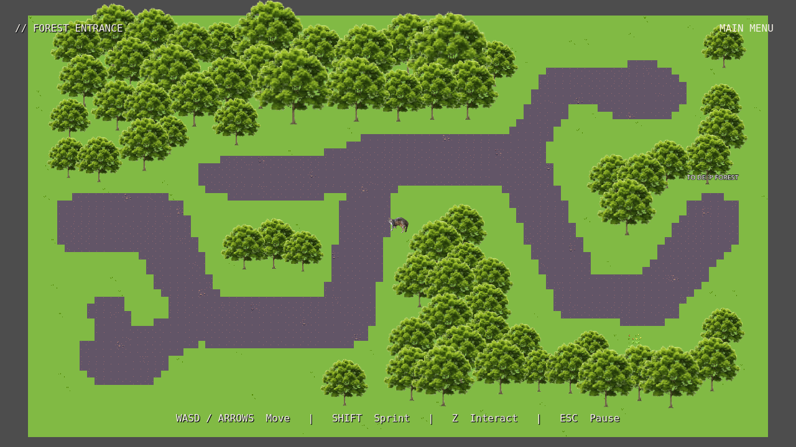
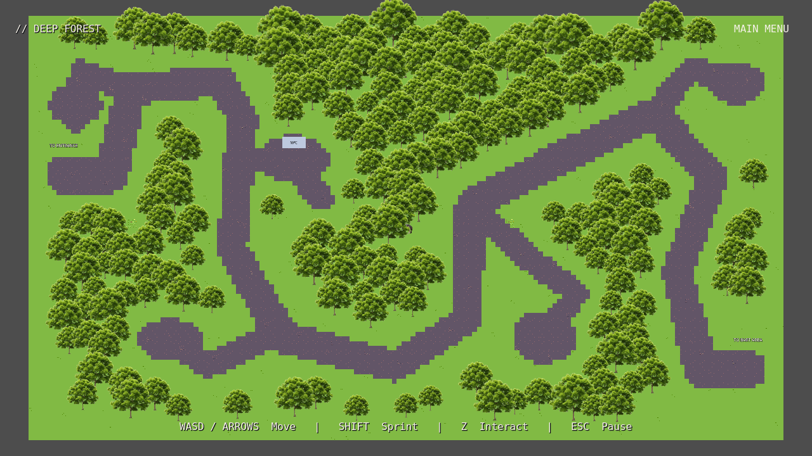
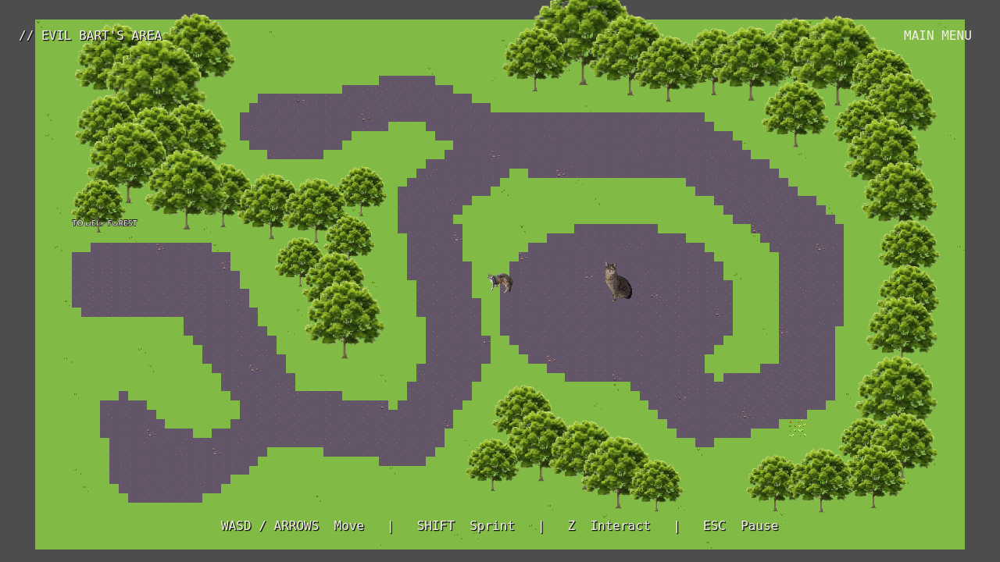

# Music, battle hitbox and forest restructuring

## Music integration

The actual new files on main are:

- `assets/soundtrack/Menu - 001.wav`
- `assets/soundtrack/Overworld - 002.mp3`

The new `Music` autoload in `scripts/systems/music.gd` owns a single persistent `AudioStreamPlayer`. It starts the appropriate theme on scene changes and retains the exact player/stream across all forest transitions. Menu WAV looping uses the original sample frames; overworld MP3 looping uses Godot's native loop flag. Runtime stream copies keep loop settings isolated; source audio files are unchanged. The WAV import retains uncompressed samples without trimming or normalization. Both themes use -12 dB and brief fades on theme changes. Forest music fades out during the boss wipe and resumes on returning from battle. Retries remain silent in the background manager so only the original battle soundtrack plays.

The battle scene still owns `assets/fight.v.scale - catsSaga version.mp3`. Its player, start cue, seek-based clock, pause handling, victory fade and attack timeline are preserved. For future themes, extend `THEMES` and `theme_for()`; keep the battle theme separate.

## Battle hitbox findings and correction

The old shape was enabled and did register real overlaps: neither a missing shape nor permanently enabled CATA caused the issue. However, the 5-pixel circle was centered at the player root, while the visible sprite center was displaced by approximately (-13, 17) internal pixels. Aimed attacks also targeted that displaced root. Enemy projectile collision circles had radius 20.22375 despite a visible solid core of 6.5 pixels. The geometry did not match what the player saw, and movement ran independently of the physics step.

The authoritative damage circle now has **7-pixel radius**, centered on the actual sprite. Enemy projectile circles match their **6.5-pixel visible cores**; the faint glow remains decorative. Explicit layers separate the player (2), enemy projectiles (4, mask 2), and enemies/player shots (1). Player and enemy-projectile movement now use fixed physics steps; speeds, acceleration, focus movement, shot interval and pattern parameters are retained. Aimed boss/opening-enemy shots target the actual damage center, including from diagonal and horizontal directions. All boss fan counts/spreads, rings, spirals, speeds and song cues remain intact.

Normal one-second damage invulnerability, three health points, CATA, BEAM, SATURATE damage/visuals and victory/death handling are unchanged. The overworld player scene and collision shape are untouched. In a debug engine build, **F3** toggles a small hitbox overlay; it is hidden by default and unavailable through this shortcut in release builds.

## Structurally different maps

| Area | Physical layout | Trees |
| --- | --- | ---: |
| Forest Entrance, 1600×900 | Southern bend, long northern turn, eastern descent, inspection spur and two optional pockets | 64 + inspectable tree |
| Deep Forest, **2560×1440** | Expanded area, northern approach, deep southern basin, northeastern ascent, southeast exit and four exploration spurs | **200**, previously 62 |
| Bart's Area, 1600×900 | Southern entry bend, northward climb, wrapping approach into a distinct central encounter clearing | 46 |

These are persistent, painted `TileMapLayer` scenes with separately editable tree instances. Trees populate interior islands as well as boundaries, with seeded 0.7×–1.5× sizes, medium sizes most common, nearest filtering, uniform proportions and scaled trunk capsules. Paths use the existing soil atlas column; grass and decorative cells use the existing 16×16 atlas. No texture was generated, downloaded, split or modified.

Forest Entrance's `FromDeep` arrival now sits at (1360,610). Deep Forest's Bart exit is at (2440,1200), and its `FromBart` arrival is at (2280,1200). Other entries, NPC coordinates, dialogue and progression order remain intact. Camera limits and version-one save bounds follow the enlarged Deep Forest. Old in-bounds saves remain readable; restored positions intersecting new trunks fall back to an existing safe entry without resetting story flags. The actual viewport stays **1280×720**, and battle stays **540×900 internally**.

### Review captures

These captures temporarily zoom the camera out to show entire maps; normal gameplay keeps its existing camera zoom.

For manual editing, use [the forest editing guide](forest-overhaul-guide.md): paint `GrassGround`, `GrassDetails` and `Paths` through the TileMapLayer editor; move reusable instances under `Trees`, and set their `Size Override` or `Variation Seed` in the Inspector. Ground/path/details are non-solid; scaled tree trunks and four outer boundaries provide collisions.

## Changed files

- `project.godot`, `scripts/systems/music.gd`, `scripts/systems/session.gd`, and the two new audio import configurations: persistent themes and transition fades.
- `scenes/player.gd`, `scenes/player.tscn`, `scenes/enemybullet.tscn`, `scripts/enemybullet.gd`, `scripts/boss.gd`, `scripts/enemy.gd`, and `scripts/ui/battle_hitbox_debug.gd`: damage geometry, physics movement, corrected aiming and optional debug overlay.
- Three forest scene files, reusable tree scene/script and tree import configuration, `scripts/world/overworld.gd`, `scripts/systems/save_manager.gd`: redesigned maps, deterministic tree sizing and safe restored positions.
- Regression tests, this review, the editing guide and three full-map captures.

The branch includes the preceding unmerged tree-variation work as its foundation, followed by this larger restructuring. The previous X menu-back device correction is retained. Original image, audio and font bytes were compared with updated main and remain unchanged.

## Verification and remaining manual work

Godot **4.6.3** headless editor import passed. **591 automated checks passed**:

| Suite | Checks |
| --- | ---: |
| `headless_gameplay.gd` | 150 |
| `headless_overworld.gd` | 59 |
| `headless_qol.gd` | 81 |
| `reload_saved_progress.gd` | 7 |
| `headless_bart.gd` | 71 |
| `headless_world_assets.gd` | 53 |
| `headless_controls_trees_hitbox.gd` | 39 |
| `headless_forest_overhaul.gd` | 41 |
| `headless_music_hitbox.gd` | 37 |
| `render_ui.gd` with Xvfb/Mesa | 53 |

Music tests seek both songs to their real ends and verify native loop wrap, continuity across areas, battle fade/isolation and restoration. Collision tests disable CATA and test stationary/moving hits, near misses, normal invulnerability, single aimed shots from four directions, and fan patterns in all five active song sections plus rings and spirals. Existing tests cover shooting, BEAM/CATA toggles, SATURATE, boss phases, victory/loss, retry, dialogue branches, controls and cross-process save persistence. Map checks cover route connectivity, real player-shape clearance, tree canopy clearance, entry/exit access, enlarged save coordinates and blocked-save fallback.

Test saves are isolated from normal progress. Immediate test termination with a looping MP3 produced a Godot playback cleanup warning; stopping the background player and allowing an audio processing interval before test exit removes it. Test teardown now does this. The graphical runner's only expected driver warning is unsupported V-Sync. No manual gameplay or audible listening is claimed: graphics used software OpenGL and Dummy audio.

Please manually review audible loop joins and relative volume, hitbox/dodge feel throughout the fight, dense-canopy depth while walking, exploration pacing, performance on your hardware and native window behavior. The project's preexisting 4.7 declaration is preserved; validation used the available 4.6.3 engine.
