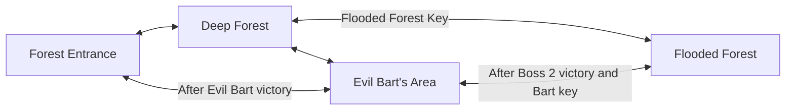

# Expanded overworld review

The four existing regions remain separate scenes loaded by `overworld.tscn`.
Each ground grid is doubled in both dimensions, providing four times the painted
overworld area. No boss arena contributes to these totals.

## Dimensions

Using the previous survey's convention of **one 16×16 tile = one square meter**:

| Region | Previous painted grid | New grid | New pixel bounds | Rectangular area |
| --- | ---: | ---: | ---: | ---: |
| Forest Entrance | 100×57 | 200×114 | 3200×1824 | 22,800 m² |
| Deep Forest | 160×90 | 320×180 | 5120×2880 | 57,600 m² |
| Evil Bart's Area | 100×57 | 200×114 | 3200×1824 | 22,800 m² |
| Flooded Forest | 128×96 | 256×192 | 4096×3072 | 49,152 m² |
| **Combined** | **38,088 tiles** | **152,352 tiles** | — | **152,352 m²** |

Total: **15.2352 hectares / 0.152352 km²**. These are full rectangular ground
areas, including water and obstacles, rather than an estimate of walkable land.
The first and third maps previously declared 900px height while painting 57 rows
(912px). Their new bounds follow the doubled painted grid, avoiding partial tiles.
One pixel is not being interpreted as one meter. The 1280×720 overworld viewport
and 540×900 battle viewport are unchanged.

## Region changes

- **Forest Entrance:** Keeps the starting route and inspectable tree. An eastern
  meadow route curves south through open ground, with small groves, ponds, flowers
  and a dry crossing through the far-edge stream. A southern shortcut connects to
  Bart's area after Bart's victory.
- **Deep Forest:** Keeps the starting NPC, Bart route and key gate. The eastern and
  southern expansion adds a long winding branch, broad meadows, grove clusters,
  pondside spaces and a stream. It remains the largest region.
- **Evil Bart's Area:** Keeps Bart and his original approach. Adds open eastern and
  southern ground with sparse groves and water landmarks. Later routes connect
  north to Forest Entrance and east to Flooded Forest.
- **Flooded Forest:** Keeps the existing shoreline, land route, Boss 2 and return
  portal. New land extends east and south, with separated tree clusters, three
  small ponds, a far-edge stream and a westbound shortcut after Boss 2's victory.

Each scene has six editor-only `Discoveries` markers: `EastMeadow`,
`PondsideClearing`, `SouthernGrove`, `LowerMeadow`, `QuietHollow` and `FarGlade`.
They identify open spaces for later content; they add no story, pickups, quests,
dialogue or discovery UI. All six are reachable on the first visit to that region.
Names are editor organization, not additional lore.

Original grass, flowers, soil and water cells are preserved exactly. Ordinary
trees intersecting the new connecting paths are removed to open those paths;
protected NPCs and the inspectable tree remain. New clusters use the existing
shared `tree.tscn`, original `tree.png`, stable size seeds and trunk-only capsules.
The existing Inspector size override continues to work.

## Connections and progression



Existing connections and the original key gate are unchanged. The original
Deep Forest-to-Bart route is retained even though the intended 2×2 layout is
conceptual rather than a continuous coordinate grid. The new shortcut script
checks Bart's defeat, the existing key flag, and the relevant boss victory flag.
Locked routes show `[LOCKED]`; unlocked routes show `[OPEN]`. No new route grants
a key or bypasses an undefeated required boss. Bart's existing key reward and
Boss 2's existing victory return are untouched.

New paired spawn markers sit 160px along the approach away from the portal center,
outside its 96×96 trigger. Tests exercise actual body-entered transitions and
verify arrivals cannot bounce back immediately.

## Preserved positions

Coordinates below are pixels in the original map coordinate system, unchanged:

| Region | Character / object | Position | Original arrival markers |
| --- | --- | ---: | --- |
| Forest Entrance | Inspectable tree | (450, 280) | Start (280, 450); FromDeep (1360, 610) |
| Deep Forest | Starting ForestNPC | (900, 430) | FromEntrance (280, 540); FromBart (2280, 1200) |
| Deep Forest | FloodedGate | (1750, 1090) | FromFlooded (1750, 1010) |
| Evil Bart's Area | EvilBart | (1000, 450) | FromDeep (280, 450) |
| Flooded Forest | Boss2NPC | (1840, 360) | FromDeep (260, 768) |

Original portals also stay at their previous coordinates. Dialogue resources,
NPC scripts, player art and movement, bosses, battle controls, damage, SATURATE,
BEAM, CATA, music and timelines are not edited. Version-one saves keep their
schema, coordinates and progression flags. Only the allowed area bounds change;
the existing collision fallback still handles saved positions blocked by terrain.

## Editing and performance

Open a region scene and select `GrassGround`, `Paths`/`WindingTrails`,
`MeadowDetails` or `ExpansionWater`. The Godot TileMapLayer editor can paint these
layers directly using the existing shared resources. Ground and flowers do not
collide; water uses the existing collision-enabled TileSet. There is no runtime
terrain generation or thousands of new decoration nodes. Approximately 56 tree
instances per region are attempted; path, water, spawn and clearing exclusions
can reduce the accepted count. The original map shell loads only one region.

`tools/expand_overworld.gd` documents the one-time terrain bake. It refuses to run
against already expanded scenes, preserving manual edits. Re-baking requires
restoring the original four scenes first; do not run it as part of normal startup
or import. New path cells are added without replacing existing ones.

Rendered Linux/Mesa validation measured scene load, instantiation and the first
frames at approximately 164–313ms, including a deliberate 120ms frame wait.
This is not a Windows frame-rate benchmark. Scene text grows to roughly 3MB
combined because the complete ground grids are saved for direct editor painting.
No PNG, texture duplication or additional large art files are added.

## Asset limitation

The six `TopDownFantasy-Forest` PNGs are present on `main`, but no license or
source attribution accompanies them. Their permitted use remains unverified.
They are therefore **not referenced by this expansion**. Rocks, logs, mushrooms,
waterfalls and polished water/bridge art from that pack are deferred until its
source/license is supplied. Water retains the existing gradient placeholder;
land crossings require no new artwork. No replacement artwork is generated.

## Validation

Godot **4.6.3**, headless import: passed with no script/import errors.
All **20 scenes** load and instantiate successfully.

| Automated suite | Passing checks |
| --- | ---: |
| Expanded world routes, collisions, gates and save/load | 155 |
| Existing overworld flow | 59 |
| Save, inventory and interaction QoL | 81 |
| Controls, trees and combat hitbox | 39 |
| Shared world assets | 53 |
| Forest paths and tree variation | 41 |
| Boss 2 encounter and return | 72 |
| Boss 2 overhaul | 45 |
| Gameplay / menu / shooting / SATURATE / victory | 150 |
| Music and hitbox regressions | 37 |
| Evil Bart overhaul | 47 |
| **Total** | **779** |

The expansion suite constructs routes using actual solid shapes enlarged by the
28×28 player footprint, checks every arrival/portal/discovery with real physics
queries, and moves a CharacterBody into each region's new water to confirm it
cannot enter. It checks all four shortcut directions while locked and unlocked,
safe arrivals, retained character positions, out-of-bounds save rejection and
real save/load of a distant new clearing.

Baseline tile data comparison also confirms all original ground, path, flower and
water cells remain unchanged. Existing forest tests now expect the larger bounds
and check large trees leave reserved clearings open; they continue to verify full
canopy clearance, tree scaling and actual path collision clearance.

Example commands, run from the project root:

```sh
godot --headless --path . --editor --import
godot --headless --path . --script tests/headless_overworld_expansion.gd
godot --headless --path . --script tests/headless_overworld.gd
godot --headless --path . --script tests/headless_boss2.gd
godot --path . --rendering-method gl_compatibility --audio-driver Dummy \
  --script tests/render_overworld_expansion.gd -- --output=/tmp/world-review
```

Eight actual viewport images were captured and the four overviews inspected.
The virtual display emits a non-fatal unsupported V-Sync warning. No final
headless failures or import/scene errors remain. The newly added test shuts down
music gracefully to avoid a test-exit MP3 playback warning.

**Manual playtesting still needed:** exploration pacing and landmark variety,
camera feel, shortcut sign readability at normal zoom, water placeholder visual
quality, and loading/frame rate on a Windows build. Neither a Windows build nor
human playtesting was performed in this Linux environment.
