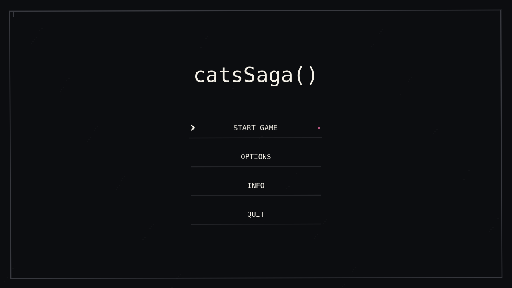
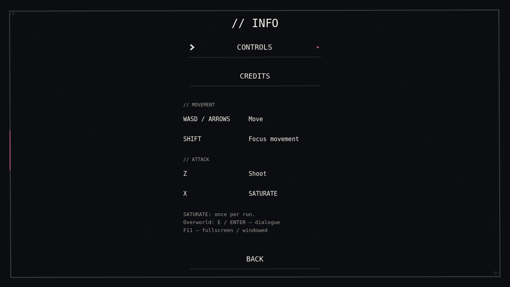
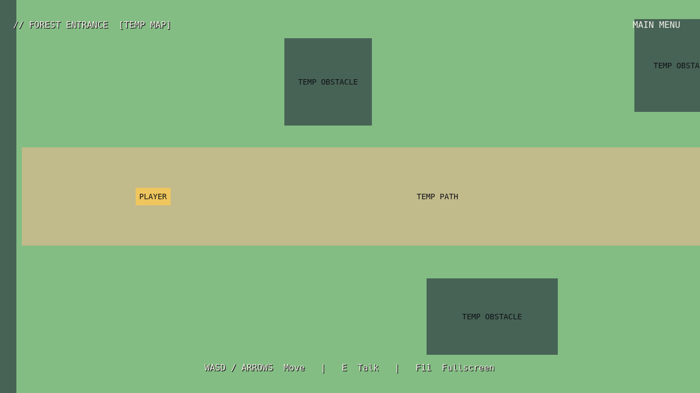
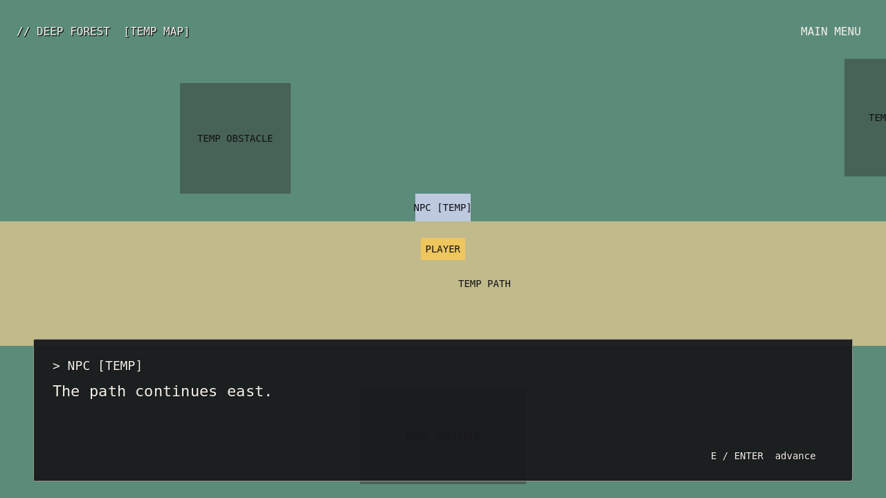
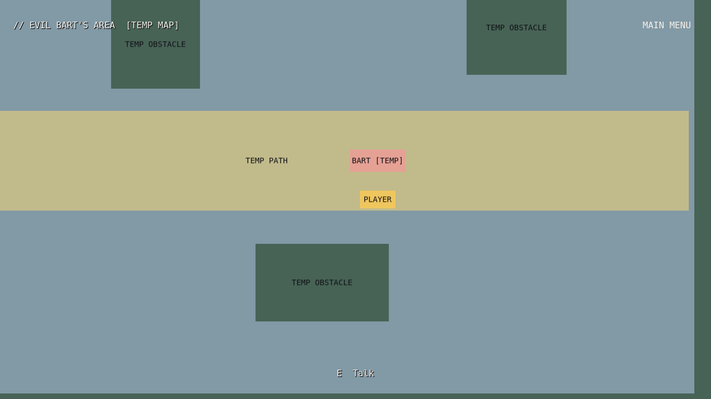
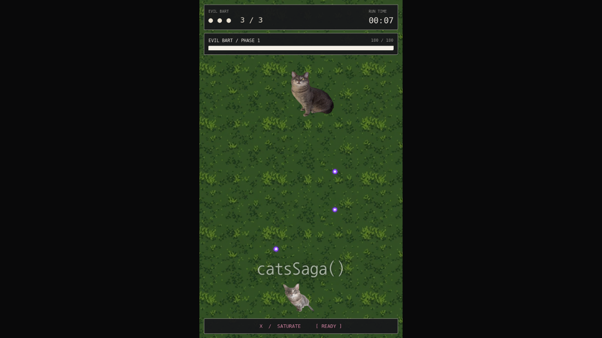
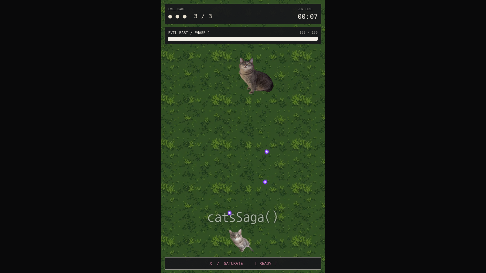
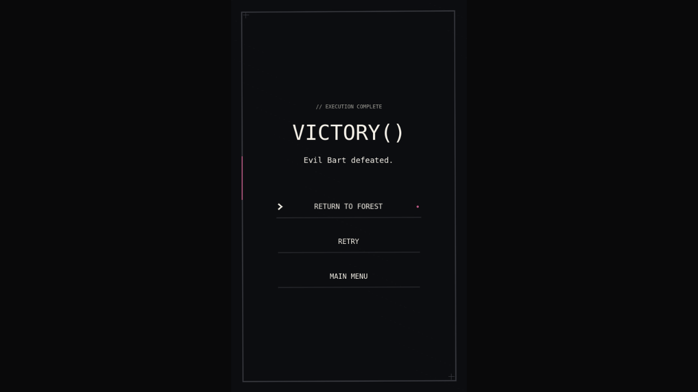

# Widescreen overworld and portrait combat

Start the project normally from its configured main menu. Start Game now begins a new playthrough in Forest Entrance. Walk east into the labeled exit to reach Deep Forest, then continue east to Evil Bart's Area. Walk near an NPC and press **E** to talk. **E or Enter** reveals/advances dialogue. WASD/arrows move; diagonal movement is normalized and obstacles are solid. **F11** toggles fullscreen, with a matching control in Options.

Bart's initial conversation starts the existing fight. After his defeat animation, **RETURN TO FOREST** restores the exact pre-battle position. Retry and Main Menu remain available. Bart's defeated state persists while moving between areas in this playthrough; talking to him again uses alternate dialogue and cannot restart the encounter. Start Game starts a new playthrough and resets this state. There is no disk save or inventory system.

## Display architecture

The project presents a **1280×720** logical canvas. Canvas-item window stretching with a fixed aspect ratio scales widescreen UI uniformly on larger displays.

`scenes/combat_host.tscn` hosts the unchanged `scenes/main.tscn` arena in a dedicated **540×900 SubViewport**, with its own 2D physics world. Its SubViewportContainer has **stretch disabled**. Only the container's transform changes:

```
scale = min(available_width / 540, available_height / 900)
position = (available_size - Vector2(540, 900) * scale) / 2
```

At 1280×720, scale is 0.8, visible combat size is **432×720**, and the left edge is **x=424**. Side panels are plain dark rectangles. Larger windows scale the entire image uniformly; simulation size stays 540×900. No internal camera, collision dimensions, player limits, boss boundaries, attack patterns, health, or timing values changed. Run combat through the host rather than running the raw main.tscn scene directly at a widescreen size.

The existing combat actors use `combat_context.gd` to find their owning combat root instead of spawning into the outer current scene. This keeps player/enemy projectiles, SATURATE, impact particles, and screen shake inside the fixed arena. SubViewportContainer routes pointer events through its transform; keyboard input still reaches the existing player script. Combat pauses on defeat as before, while the existing HUD remains interactive. The host resets only the existing battle for Retry.

Session's guarded fades coordinate scene changes, stop outgoing combat audio before another scene starts, and preserve encounter state. The overworld has no soundtrack. The existing boss soundtrack and its victory fade remain intact.

## Reusable systems

| Location | Purpose |
| --- | --- |
| `scripts/systems/session.gd` | Per-playthrough state, fullscreen and scene fades |
| `scripts/systems/combat_host.gd` | Fixed viewport and battle lifecycle routing; exported battle scene supports future bosses |
| `scripts/systems/combat_context.gd` | Combat actor/effect ownership |
| `scripts/world/player.gd` | CharacterBody2D movement and collisions |
| `scripts/world/overworld.gd` | Area loading, proximity interactions and encounter flow |
| `scripts/world/npc.gd` | Reusable interaction radius and dialogue key |
| `scripts/world/portal.gd` | Area trigger and destination marker |
| `scripts/world/dialogue.gd` | Terminal UI, typewriter, reveal/advance and completion signal |
| `data/dialogue/test_dialogue.json` | Short replaceable test conversations |

Maps are separate scenes: Forest Entrance (1600×900), Deep Forest (1920×1080), and Evil Bart's Area (1600×900). Camera limits follow each map's exported dimensions. Portals lead to named entry markers outside the destination trigger, preventing immediate return trips.

## Replacing temporary visuals

All new overworld visuals are **labeled rectangles**, with no generated/downloaded character art, tiles, backgrounds, illustrations or audio.

- **Player:** open `scenes/world/player.tscn`. Replace the `VisualPlaceholder` child with your Sprite2D/AnimatedSprite2D. Keep the CharacterBody2D root, its movement script, collision shape, and Camera2D. Adjust collision separately if your art calls for it.
- **NPC and overworld Bart:** in each map's `Characters` branch, replace the character's `VisualPlaceholder` child. Keep its root and npc.gd script. Dialogue key, interaction radius, and encounter behavior are Inspector properties.
- **Map backgrounds and paths:** replace `BackgroundPlaceholder` and `PathPlaceholder` with your art or TileMapLayer nodes. Update area.gd's exported map_size and Camera2D limits through that setting if the map changes size.
- **Environmental collisions:** `Obstacles` contains StaticBody2D roots with independent CollisionShape2D and VisualPlaceholder children. Replace only visuals to preserve collision. Alternatively, migrate those collisions to your TileSet physics layers, removing the old bodies so collision is not duplicated.
- **Exits:** keep each Area2D trigger and destination/entry settings in `Portals`; replace its temporary visual/label. Update corresponding Marker2D entry nodes if moving an exit.
- **Dialogue styling:** dialogue.gd uses the existing licensed monospace theme. Change its panel/theme, padding, text size or character rate without changing JSON conversations or interaction logic.
- **Combat side backgrounds:** replace/style the host's `SideBackground` sibling, keeping the ArenaContainer's transform and its viewport size/stretch settings. Do not add art inside the arena for side panels.
- **Future encounters:** reuse npc.gd and the combat host's exported PackedScene. Add the corresponding encounter-state/dialogue keys to Session without changing viewport dimensions.

The current JSON contains brief testing lines, not final story. Names and conversations can be replaced there without editing dialogue UI code.

## Validation and review

Godot **4.6.3** headless import completed without errors or warnings. Automated checks passed:

- **149 combat/menu checks:** scene loading, 16:9 menu alignment and scaling, credits/controls, fixed arena and centering, non-silent original music output, real music-triggered boss entrance, every song section, bounded boss movement, shooting, SATURATE's 30 damage/projectile clearing, BEAM/CATA keys, victory guards, lethal SATURATE, game-over/Retry, and Main Menu.
- **58 overworld checks:** real movement/normalized diagonals, obstacle and boundary collisions, Camera2D limits, forward/reverse Area2D portals and arrival markers, NPC conversations/typewriter/reveal/advance/movement lock, encounter loading, isolated arena physics and projectile ownership, victory animation and state recording, exact return position, alternate Bart dialogue, quiet exploration, duplicate transition prevention and fresh-playthrough reset.
- **26 graphical checks, including captures:** real 1280×720 renders, larger-window arena rendering, Options and F11 fullscreen/windowed switching, mouse Retry and return-to-forest through the scaled viewport. Captured frames were inspected.

Run from the repository root:

```sh
godot --headless --path . --editor --import
godot --headless --path . --script res://tests/headless_gameplay.gd
godot --headless --path . --script res://tests/headless_overworld.gd
```

On a graphical display:

```sh
godot --path . --rendering-method gl_compatibility --audio-driver Dummy \
  --script res://tests/render_ui.gd -- --output=/tmp/catsSaga-review
```

The software OpenGL driver reports unsupported VSync configuration; there are no script errors or shutdown leaks in completed tests. Actual-device rendering, audible soundtrack synchronization/fades, movement/transition feel, and dense-pattern readability still need manual playtesting. The export configuration still has no invented platform presets; packaging is outside this change.

## Actual Godot viewport captures

| Widescreen menu | Controls and preserved typography |
| --- | --- |
|  |  |

| Placeholder entrance | Terminal dialogue |
| --- | --- |
|  |  |

| Bart's placeholder area | Original arena centered inside widescreen |
| --- | --- |
|  |  |

| Larger window | Victory with forest return |
| --- | --- |
|  |  |
