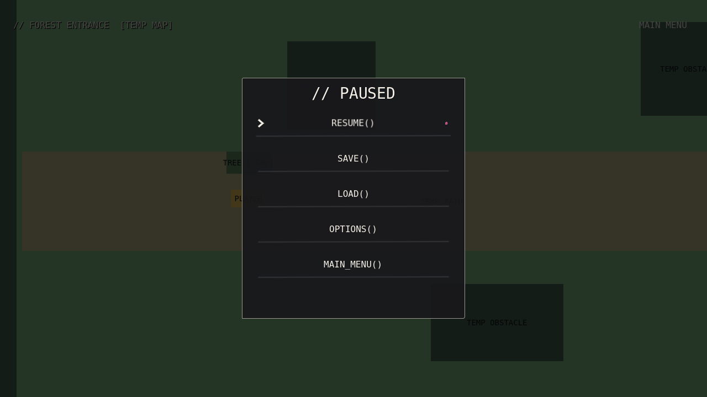
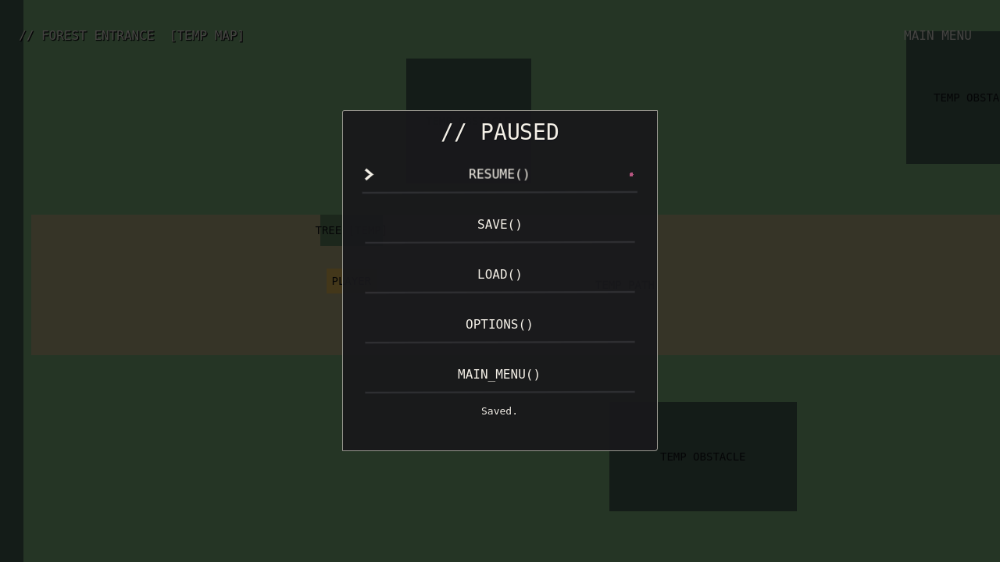
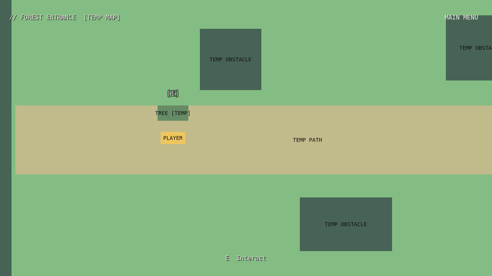
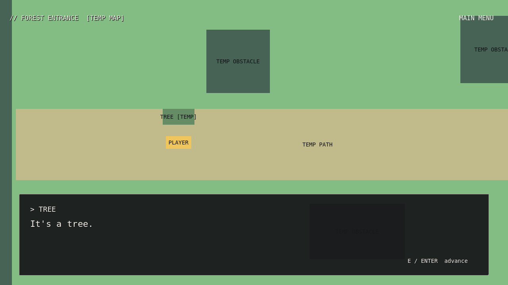
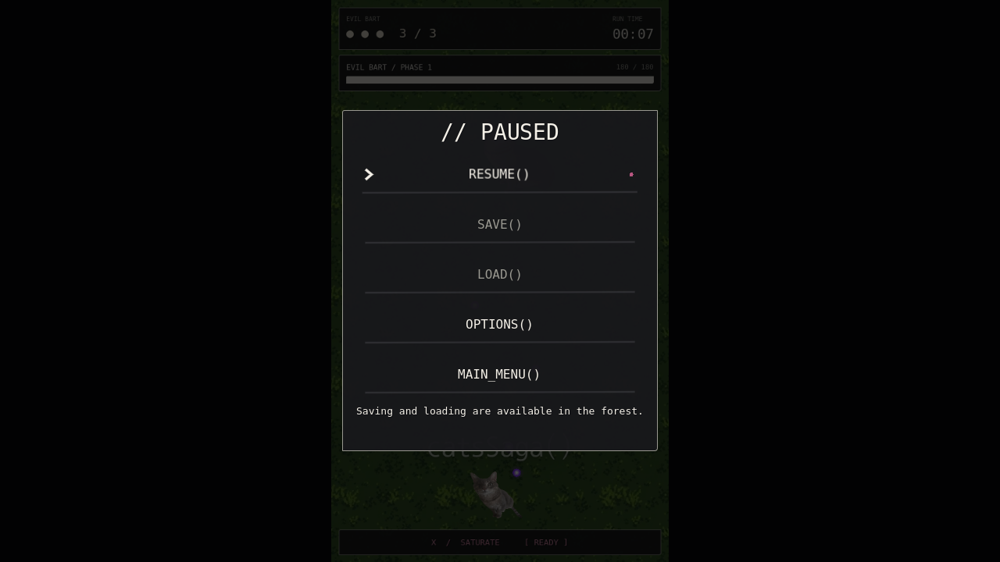
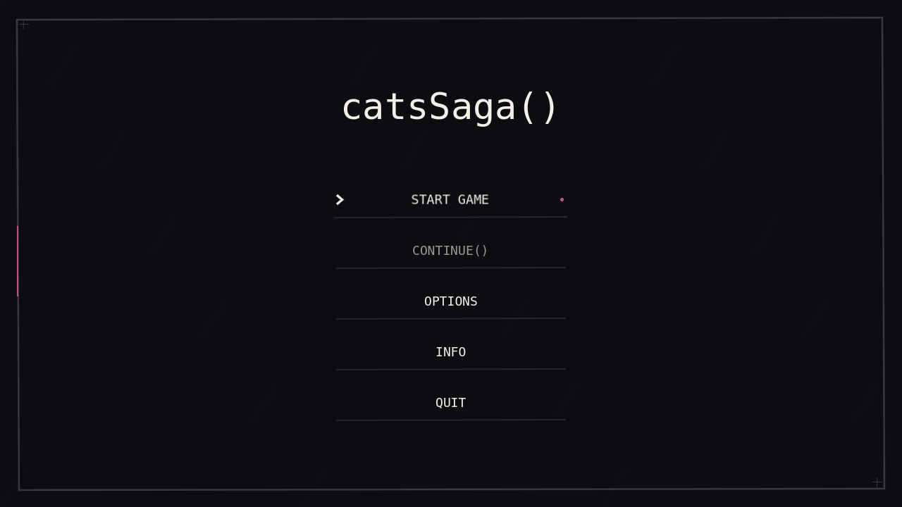

# Overworld quality-of-life update

This change extends the existing Session, forest/controller, terminal dialogue, interactions and fixed combat viewport. The seven requested systems are implemented. Resolution remains 1280×720 externally and 540×900 internally for combat, with the existing uniform scaling.

## Custom sprite attachment: blocked

The supplied image is visible in chat but is **not an accessible file in the workspace or attachments directory**. The existing assets/bartplayer.png is a different image. No artwork was substituted, regenerated, edited or downloaded, and the supplied image cannot be included in this commit.

The overworld controller is ready for the original file: import it into assets, open scenes/world/player.tscn, and assign **sprite_texture** to that resource. **sprite_height** defaults to 64 pixels and applies a uniform display scale without changing the source image or transparency. **artwork_faces_left** defaults to true for the supplied left-facing pose. Movement sets Sprite2D.flip_h for left/right and keeps the last direction when stopped. The collision shape and camera are separate; assigning the texture hides only VisualPlaceholder. Until the original file is supplied, the existing placeholder remains.

## Controls and pause

- **WASD/arrows:** overworld movement.
- **Shift:** overworld sprint; exported sprint_multiplier defaults to 1.5. Diagonal direction remains normalized, and movement/collision/camera logic is retained. In combat, Shift still focuses movement at the original speed.
- **E:** interact with the nearest eligible target.
- **E/Enter:** reveal or advance dialogue.
- **Escape:** open/close pause during exploration or a live battle.
- **F11:** fullscreen/windowed toggle, also available through Options.

The centered pause menu uses the existing theme and animated buttons: RESUME(), SAVE(), LOAD(), OPTIONS(), MAIN_MENU(). It stops the scene tree while remaining interactive itself. Opening it is blocked during dialogue, transitions, victory, and existing game over. Combat music, boss clock, projectiles and SATURATE freeze together and resume without resetting. Nodes that intentionally process while paused during normal game-over behavior are temporarily made pausable only for manual pause, then restored.

Save and Load are available in the forest. Combat pause disables them so temporary battle state is never saved. Load and Main Menu ask for confirmation when the current area, position or progression differs from the saved state. Cancelling preserves the scene and pause state. Main menu Continue is disabled without a valid save, and Start Game confirms before replacing one. Options is a single shared UI implementation, used by both menus.

## Save storage

One slot is stored at **user://save.json**, inside Godot's per-project user data directory (OS.get_user_data_dir()). In the editor, Project → Open User Data Folder opens it.

- JSON **version 1** stores area, position, evil_bart_defeated and story_flags.
- Newly introduced progression fields default to false/empty.
- Unknown areas, unsupported versions, non-numeric/non-finite/out-of-bounds positions and malformed progression fields are rejected.
- Writes go to save.json.tmp, are flushed and verified, preserve the previous valid save as save.json.bak, then rename the temporary file into place.
- Missing/corrupt files fail gracefully; a valid backup can recover the previous save.
- Manual saves reject dialogue, transitions and combat. Pause saving is safe because the world is frozen.
- Autosaves happen after new-game entry, successful area travel, boss defeat and victory return, never every frame.
- Boss autosave records only the known overworld return point and progression; it does not serialize projectiles, player combat health or animation state.

Tests use separate validation-* files, not the production slot. No inventory or additional progression systems were introduced.

## Shared interactions and inspectable objects

NPCs, Bart and inspectable objects use the same interactables group, proximity selection and E handler. The closest eligible target is selected; equal distances use stable scene/group insertion order. One outlined monospace [E] label follows the selected object. It hides out of range, in dialogue, during transitions and while paused.

To add an inspectable object:

1. Duplicate Characters/InspectableTree in forest_entrance.tscn, or attach scripts/world/inspectable.gd to a Node2D under a map.
2. Set **object_name**, **descriptions** (one or more Inspector text entries), and **interaction_radius**.
3. Optionally set **required_flag** to a story_flags key that must be true, and **completion_flag** to record completion when dialogue ends.
4. Replace its independent VisualPlaceholder with your artwork. Interaction does not depend on the visual child.

Empty description arrays disable interaction. The example TREE uses only the test lines “It's a tree.” and “Probably.” It records inspected_tree; the flag is saved and reloaded. NPC/Bart dialogue JSON and existing encounter behavior remain intact.

## Optional dialogue audio

No suitable typing sound exists in the assets, so **all audio slots remain empty**. No audio was generated/downloaded, and the boss soundtrack is unchanged.

On the dialogue scene/script, configure:

- **typing_sound:** optional AudioStream.
- **characters_per_sound:** default 6; avoids a sound for every character.
- **sound_interval:** minimum time between sounds, default 0.08 seconds.
- **typing_pitch**, **typing_volume_db:** default 1.0 and −20 dB.

Each NPC/inspectable can override **typing_sound**. A single AudioStreamPlayer prevents overlapping voices. Reveal, advance, completion and scene removal stop the active sound. Dialogue operates normally with no resource assigned. Audible sound configuration requires your own appropriate asset.

## Transitions

The existing Session fade is reused. **transition_duration** is exported, defaults to 0.36 seconds total, and can be adjusted between 0.3 and 0.5. Input locks during both halves, the overlay covers the entire window, and duplicate transitions are rejected. Missing destinations recover the screen and controls. Incoming menu fades also block premature Start activation. Pause state is reset on scene changes; outgoing combat audio stops before another scene starts.

## Validation

Godot 4.6.3 headless import and scene validation passed without application errors. Completed checks:

- **150 combat/menu regressions:** boss sections/attacks/music clock, non-silent original music, SATURATE 30 damage and clearing, BEAM/CATA, victory, defeat/Retry, fixed viewport, centered scaling, menu controls and overwrite confirmation.
- **58 overworld regressions:** movement/collision/camera, forest portals, dialogue, Bart encounter, victory return position/state and transitions.
- **79 new checks:** pause/resume/echo guards, movement and sprint lock, normalized sprint, sprite-facing properties, indicators/selection/conditions, inspections and flags, optional empty audio, manual/autosaves, safe replacement/backup recovery, invalid save schemas, errors, Continue/confirmation behavior, combat music/boss/SATURATE pause synchronization and transition recovery.
- **7 separate-process reload checks:** saved area/position/flags/Bart completion and alternate dialogue survive shutting down and starting a new Godot process.
- **32 graphical checks including captures:** actual UI renders, fullscreen modes, fixed arena scaling, mouse Retry/forest return and pause display.

Reproduce:

```sh
godot --headless --path . --editor --import
godot --headless --path . --script res://tests/headless_gameplay.gd
godot --headless --path . --script res://tests/headless_overworld.gd
godot --headless --path . --script res://tests/headless_qol.gd
godot --headless --path . --script res://tests/reload_saved_progress.gd
```

Run the reload check after headless_qol.gd using the same user data directory.

```sh
godot --path . --rendering-method gl_compatibility --audio-driver Dummy \
  --script res://tests/render_ui.gd -- --output=/tmp/catsSaga-qol-review
```

Actual 1280×720 Godot screenshots were captured under Xvfb/Mesa and inspected. The software driver reports unsupported VSync; no application errors or shutdown leaks remain. Manual testing is still needed for movement/transition feel, native rendering, audible synchronization, and typing sound quality once a suitable asset is supplied. Actual custom-sprite proportions/transparency/scale cannot be verified until the original image file is accessible.

| Pause | Saved confirmation |
| --- | --- |
|  |  |

| Shared indicator | Inspection dialogue |
| --- | --- |
|  |  |

| Combat pause | Continue menu |
| --- | --- |
|  |  |
