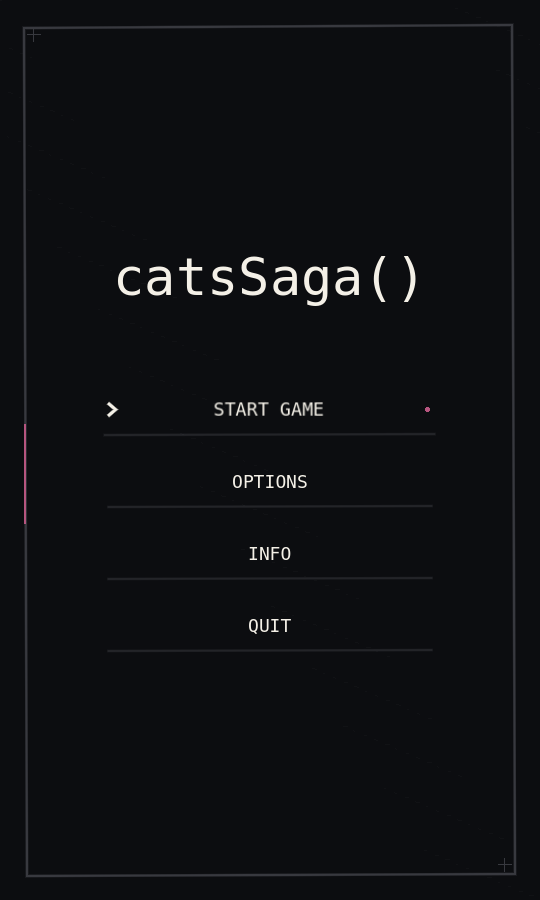
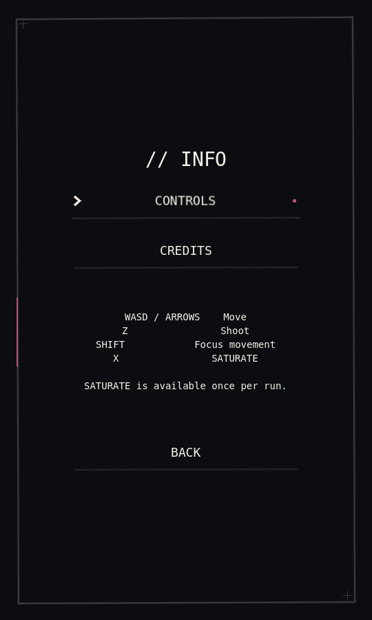
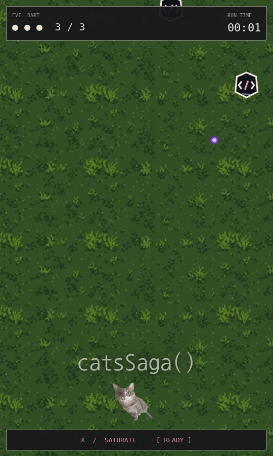
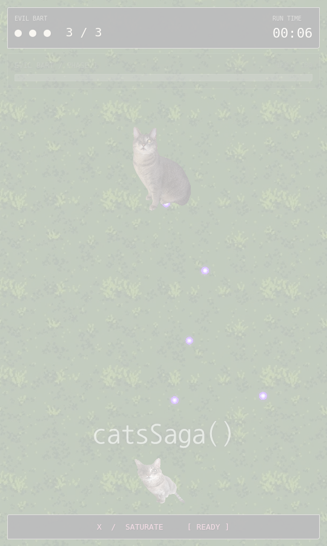
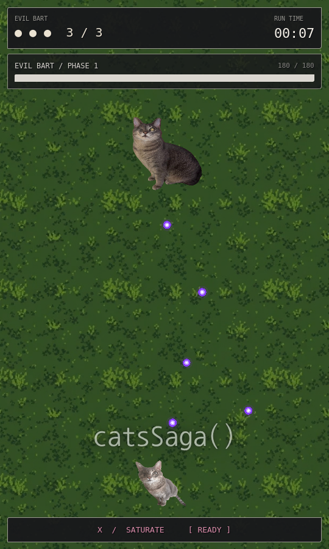
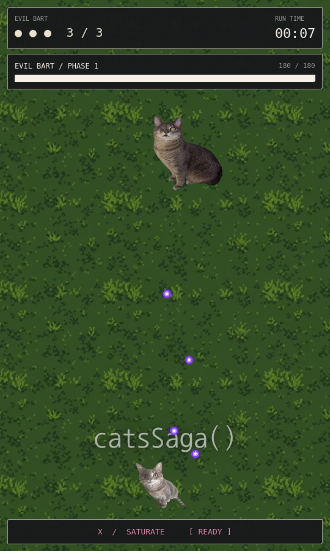

# Evil Bart entrance and UI polish

The main menu now uses a black background and the bundled, licensed DejaVu Sans Mono font throughout. Its single centered composition contains `catsSaga()` followed by Start Game, Options, Info, and Quit. The decorative cat and adventure subtitle are removed, and controls are moved into Info. Info has Controls and Credits categories, a Back button, and Escape navigation; credits remain “Credits coming soon.” Options retains its placeholder behavior. Normal menu rows are transparent, with selection chevrons, small accents, and hover/focus transitions.

The HUD keeps the existing lives, runtime timer, health bar, and SATURATE displays. “PLAYER / VITAL SIGNS” is replaced by EVIL BART, and the boss bar caption also identifies EVIL BART and his phase. No duplicate HUD nodes are added. Titles and game-over typography use the same bundled monospace font.

At the existing 6.85-second music cue, the guarded boss spawn:

1. Frees every node in the dedicated `opening_enemies` group immediately.
2. Spawns Evil Bart in his existing position at y=240.
3. Starts a 0.48-second eased bounce with mild squash/stretch on **only the sprite**; collision geometry and projectile origins remain fixed. Artwork stays below the HUD throughout.
4. Starts one white pulse at 85% opacity, fading to zero in **0.10 seconds**.
5. Reveals the existing boss bar over 0.35 seconds.

The spawn guard prevents regular enemies from spawning again, including on the entry frame. Existing enemy projectiles are retained; boss attacks and projectile logic are unchanged. No extra music player or screen shake was introduced.

Boss horizontal velocity now accelerates toward a gently varying target speed, eases near the boundaries, and decelerates through zero when changing direction. Sprite-aware bounds keep the boss visible. Existing phase speed ceilings, vertical positioning, attack patterns, and music timing are retained.

Opening enemies replace their purple placeholder polygon with an original monochrome, ink-framed `</>` token. Only visual construction and group membership changed: spawning intervals, movement, health, collision shapes, aiming, and firing are preserved.

SATURATE remains **30 damage per target per sweep**. BEAM's unlimited-use toggle and CATA's invincibility behavior are unchanged.

## Verification

Godot 4.6.3 headless import and **115 automated checks** passed with no errors or warnings. Checks cover:

- All eight scene loads and instances; 540×900 alignment and resizing.
- Menu focus/selection and transition; Info Controls, placeholder Credits, Back, and Escape.
- Existing health/timer updates and Evil Bart's bar/name.
- Natural music-clock entrance at 6.85 seconds, immediate enemy clearing, suppressed respawns, brief flash, restored sprite scale, and completed bar reveal.
- Thirty simulated seconds of bounded movement, with repeated turns and no abrupt velocity jumps.
- Original audio stream, unmuted Master bus, non-silent mixed audio, and all music sections.
- Shooting, boss attacks, SATURATE/projectile clearing, actual BEAM/CATA key sequences, and Retry resets.

```sh
godot --headless --path . --editor --import
godot --headless --path . --script res://tests/headless_gameplay.gd
```

## Actual Godot screenshots

Captured and inspected at 540×900 with Xvfb and Mesa software OpenGL. These are viewport renders, not mockups.

| Main menu | Info Controls |
| --- | --- |
|  |  |

| Opening enemy artwork | White entrance pulse |
| --- | --- |
|  |  |

| Entrance bounce | Settled gameplay HUD |
| --- | --- |
|  |  |

Reproduce on a graphical display:

```sh
godot --path . --rendering-method gl_compatibility --audio-driver Dummy \
  --script res://tests/render_ui.gd -- --output=/tmp/catsSaga-review
```

The software driver reports unsupported VSync configuration, without script errors. Static screenshots and automated timing checks verify the captured appearance and event timing, but real-device audible synchronization, bounce feel, hover/focus feel, and sustained dense-pattern readability still require manual playtesting.
