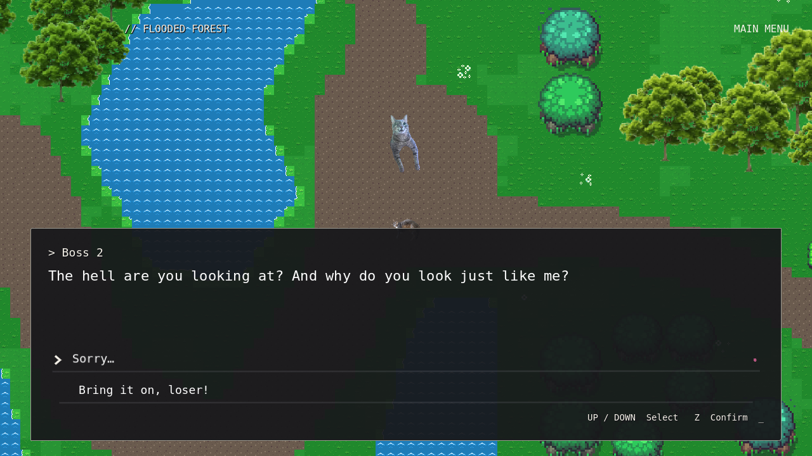
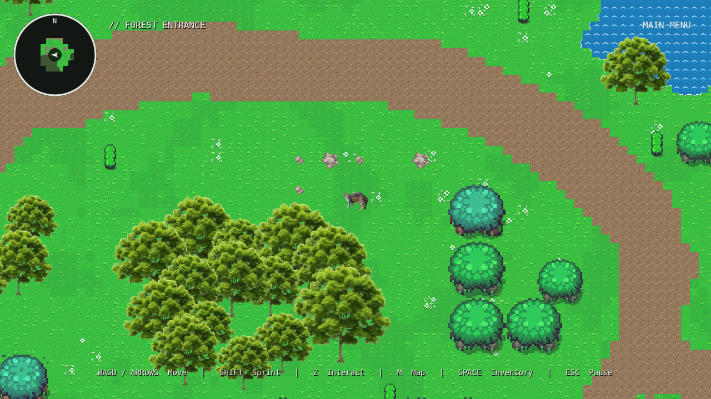
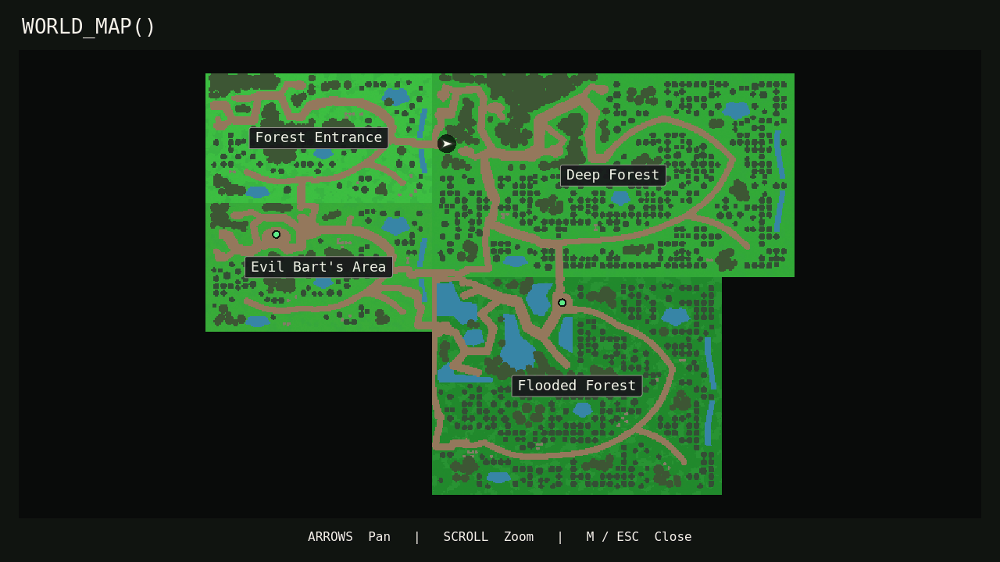

# Boss 2 dialogue, forest connections, and boss map dots

This update extends the merged GFX/cartography work. It replaces Boss 2's overworld dialogue placeholder, slows only the rotating cross, repairs the existing region entrances, corrects the rock atlas selection, and adds fog-aware boss dots. It does not regenerate the entire forest or replace combat, dialogue rendering, cartography, or save storage.

## Boss 2

`data/dialogue/boss2.json` uses the existing graph renderer and existing entity name, **Boss 2**. The bottom dialogue box shows exactly:

> The hell are you looking at? And why do you look just like me?

Up/Down and Z select between **Sorry…** and **Bring it on, loser!**. Nothing is selected automatically. The apology displays **get out of my sight**, then restores exploration without completion, rewards, or battle; this branch can repeat. The challenge finishes the graph directly into the existing battle transition, with no added confirmation or dialogue line. The original in-battle introduction remains unchanged.

Actual survival victory sets the existing `boss2_defeated` flag and saves a pending dialogue acknowledgment. Returning through the existing victory screen's forest-return action displays exactly:

> What the hell?? I underestimated you…! Get out of here, me!

The line also survives quitting/loading before acknowledgment. Advancing it clears the pending flag, records that it was seen, and autosaves. Future Z interactions show **You're not telling anyone about this** and never restart the fight. Older saves with Boss 2 already defeated and no pending acknowledgment go directly to the repeat line. Boss 2 stays at **(1840, 360)** and uses the same original `bosstwo.png` texture. No new item, key, achievement, region, or reward is granted. Existing Boss-2-gated shortcuts still use their original completion condition.

The cross's existing `maximum_rpm` is now **18.0**, using `rpm × TAU / 60`: 0.3 turns/second, 108°/second, and 3.333… seconds per turn at the plateau. Existing acceleration/deceleration easing, 70.40–89.60 music boundaries, telegraph/charge durations, fixed pivot, three-pixel damage core, swept collision, geometry, and shattering remain. Other projectile speeds and attacks are unchanged.

## Rocks and routes

The former `gfx_boulders.tres` selection, Overworld atlas **(10, 11)**, was a piece of a connected brown cliff. Repeating it as an individual boulder caused the detached vertical shapes. It now references two complete 32×32 features from `objects.png`: the small stone at **(6, 4)** and compact stone pile at **(8, 4)**. The later dispersed frames are not scattered around as static props. Mirrored display alternatives vary orientation without altering the PNG. Each variant has a solid lower-footprint polygon and matching Y-sort origin; grass and flowers remain walkable.

Placement is deterministic and irregular, reusing existing rock neighborhoods where safe. Current stone feature counts are **12 Entrance, 9 Deep Forest, 14 Bart, and 18 Flooded Forest**. All four retain rocks. Clusters avoid paths, water, characters, entrances, and reserved clearings.

Five existing route pairs now reach their actual shared boundaries in the unchanged staggered four-region map:

| Connection | Shared map boundary, in 16px tiles | Condition |
| --- | --- | --- |
| Forest Entrance ↔ Deep Forest | (200, 62) | Existing normal route |
| Deep Forest ↔ Evil Bart's Area | (200, 176) | Existing normal route |
| Deep Forest → Flooded Forest | (312, 180) | Existing Bart victory and Flooded Forest Key |
| Flooded Forest → Deep Forest | (312, 180) | Existing return route |
| Entrance ↔ Bart shortcut | (84, 114) | Existing Bart victory/key requirements |
| Bart ↔ Flooded shortcut | (200, 222) | Existing Boss 2 victory/key requirements |

Old progression portal/arrival names are retained; their positions are moved to corresponding shared edges. New dry connectors bend through the existing terrain and join the original winding network. The Entrance/Bart east edges use existing dry stream crossings. Water footprints are not removed to make roads. Two retired west-edge tails end inside existing clearings instead of pretending to be active exits. Trees or undergrowth obstructing repaired corridors are locally cleared; other trees retain their artwork, seeds, scale settings, and trunk/Y-sort behavior. NPCs, bosses, the original Flooded Forest sign, inspectable tree, six reserved discoveries per region, and meaningful objects keep their positions.

The four region dimensions remain **3200×1824**, **5120×2880**, **3200×1824**, and **4096×3072** pixels. Existing water, outer walls, key progression, and shortcut restrictions remain. Walkable spawns are 144 pixels inward from their portal centers.

## Automatic transitions and persistence

Ordinary portals and victory-gated shortcuts already used body-entry signals. They now sit on the aligned boundaries. The old Flooded Forest sign still gives its original locked Z message, but entering Flooded Forest uses a key-checked automatic boundary Area2D. Once the key is obtained, the sign indicates an open path and is no longer a manual travel interaction. Z still handles NPCs and inspectable objects; boss interactions remain manual.

Only region travel receives separate **0.3-second black fade-out and 0.3-second fade-in**. Existing menu/battle transitions retain their durations and white-wipe behavior. Session's existing busy guard prevents duplicate loads, velocity is cleared, and movement stays locked. Destination bodies and the camera initialize while the screen is black; the camera is reset before revealing the world. Arrival markers specify an inward-facing direction. Safe spawn spacing prevents an immediate reverse transition. Valid saved coordinates remain valid; the existing blocked-position fallback still preserves story/exploration state.

The version-1 save format and exploration bitsets are unchanged. Boss 2 adds only optional dialogue-state flags to the existing story dictionary. Repaired paths do not mark terrain explored or reset legitimate discovery. Travel retains inventory, completion flags, exploration, and the existing temporary map-reveal state.

## Cartography

The terrain cache has been regenerated from the revised scenes. Its existing uniform transforms and region labels remain. The bake also records Bart/Boss 2 positions from the actual NPC nodes; there are no separately guessed marker coordinates. Both map panes draw a small dot, **red before defeat / green after defeat**, using `Session.evil_bart_defeated` or the saved `boss2_defeated` flag. Marker changes participate in redraw state so colors update immediately.

Dots appear only when their terrain cell is explored, or when the existing `thefogisleaving` reveal is active. Disabling reveal restores ordinary visibility without changing exploration. A discovered boss remains visible on later map visits. Minimap dots are clipped to the circle; both views use the same world positions under pan/zoom. The minimap remains absent in combat. No other NPC, quest, item, or secret icons were added.

After editing terrain or moving a boss NPC, regenerate and validate:

```sh
godot --headless --path . --script tools/bake_world_map.gd
godot --headless --path . --script tests/headless_gfx_forest.gd
```

`tools/repair_forest_connections.gd` records this one-time authoring pass and refuses to rerun over repaired/manual scenes. Normal future editing should use the Godot scene and TileMap editors, then regenerate cartography. All supplied source PNGs are unchanged; no generated/reconstructed artwork or restricted TopDownFantasy-Forest assets were introduced.

## Changed files

- Dialogue: new `data/dialogue/boss2.json`; `scripts/world/dialogue.gd`, `overworld.gd`; `scripts/boss2/npc.gd`, `combat_host.gd`.
- Laser: only the default speed in `scripts/boss2/cross_laser.gd`.
- Terrain: all four `scenes/world` region files, `resources/world/gfx_boulders.tres`; new authoring tool `tools/repair_forest_connections.gd`.
- Travel: `scripts/world/portal.gd`, `flooded_gate.gd`, the arrival-facing helper in `player.gd`, and `scripts/systems/session.gd`.
- Maps: `scripts/maps/map_ui.gd`, `map_canvas.gd`, `map_ink.gd`; `tools/bake_world_map.gd`; regenerated `resources/maps/world_terrain.res`.
- Tests: new focused `headless_region_update.gd` and `render_region_update.gd`; existing route/spawn assertions, cross-speed assertions, and capture labels updated to the requested behavior. Godot script UID companions are included.

Evil Bart's dialogue data, player/boss source textures, Boss 2 battle/timeline/player logic, original player shooting/SATURATE/BEAM/CATA code, music scripts, export/project settings, and both resolutions were not edited.

## Validation

Godot **4.6.3** headless import passed; all **20 scenes** loaded and instantiated. All **17 headless suites / 1252 checks** pass, including **145 focused checks** for dialogue branches, explicit keyboard choice navigation, repeated apologies, battle entry, exact laser conversion, no rewards, victory acknowledgment persistence, both boss markers, all ten directed automatic boundaries, fade timing, inward arrivals, no bounce, and locked access. The terrain and expansion suites validate actual player collisions and reachability for every entry, exit, and discovery. Existing regression suites cover Bart, shooting, SATURATE/BEAM/CATA, key rewards, saves, UI, Boss 2 sprint/lasers/projectiles, and music clocks.

Fresh-process tests pass for saved exploration and existing Bart progress. The full uninterrupted Boss 2 audio timeline passes all **3 checks**, reaches survival victory at **140.80 seconds**, and observes all seven phases with a peak of **78 projectiles**. A real-input focused cross route passes **4 checks**, retaining 3 HP without invincibility, health changes, or cheats.

All **nine graphical validation scripts** completed successfully: `render_ui`, `render_bart_overhaul`, `render_battle_visuals`, `render_boss2`, `render_boss2_overhaul`, `render_cross_lasers`, `render_cartography`, `render_overworld_expansion`, and the new `render_region_update`. They passed **144 explicit checks** and generated eight additional forest overview/grove captures. The new script contributes **16 checks** with native dispatched keyboard input and twelve captures: opening, choices, apology, challenge transition, victory/repeat dialogue, green dots, stone clusters, boundary fade/arrival, fog, and the joined map. Selected captures were visually inspected; screenshot generation alone is not human inspection of every captured frame.

```sh
godot --headless --path . --script tests/headless_region_update.gd
godot --headless --path . --script tests/full_boss2_survival.gd
godot --headless --path . --script tests/play_cross_survival.gd
godot --path . --rendering-method gl_compatibility --audio-driver Dummy \
  --script tests/render_region_update.gd -- --output=/tmp/region-update-review
```







Graphical testing used Xorg/Mesa llvmpipe and dummy audio. The environment reports unsupported VSync changes. Human review remains for forest/path aesthetics at every connection, audible music/laser synchronization, the slower cross's difficulty, sustained Windows/native GPU performance, and a complete ordinary playthrough. The full-song test uses explicit test invincibility to observe the timeline; it does not establish that the whole fight can be survived by a human. No Windows export or target-hardware performance claim is made.
