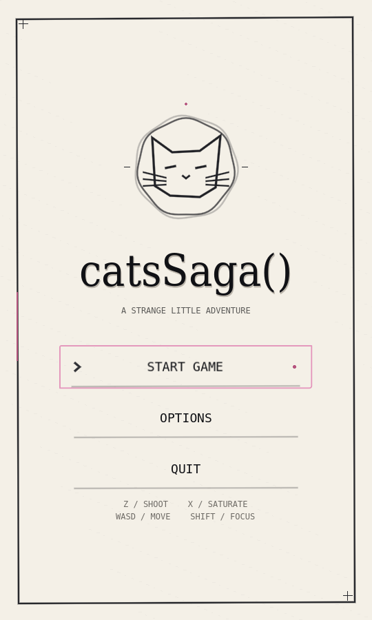
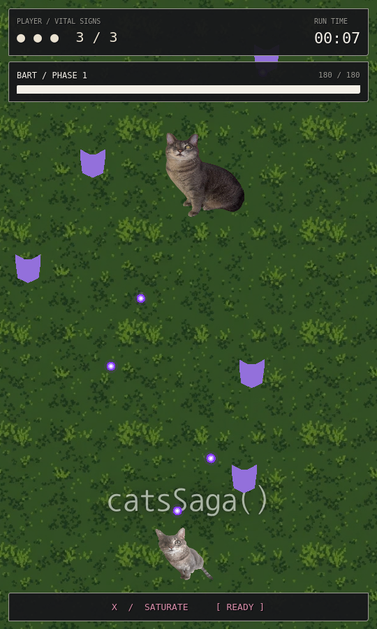
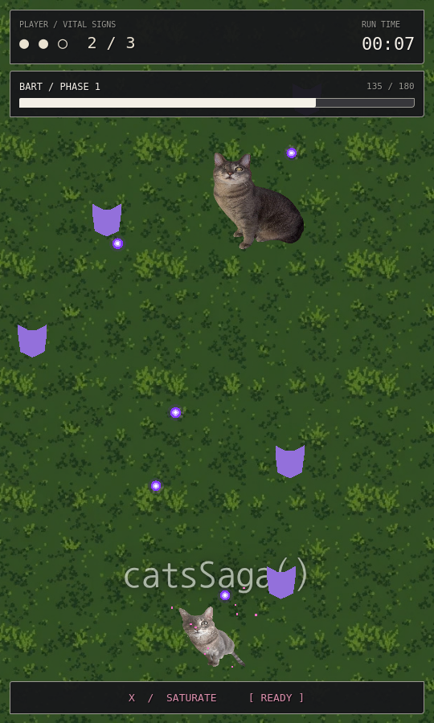
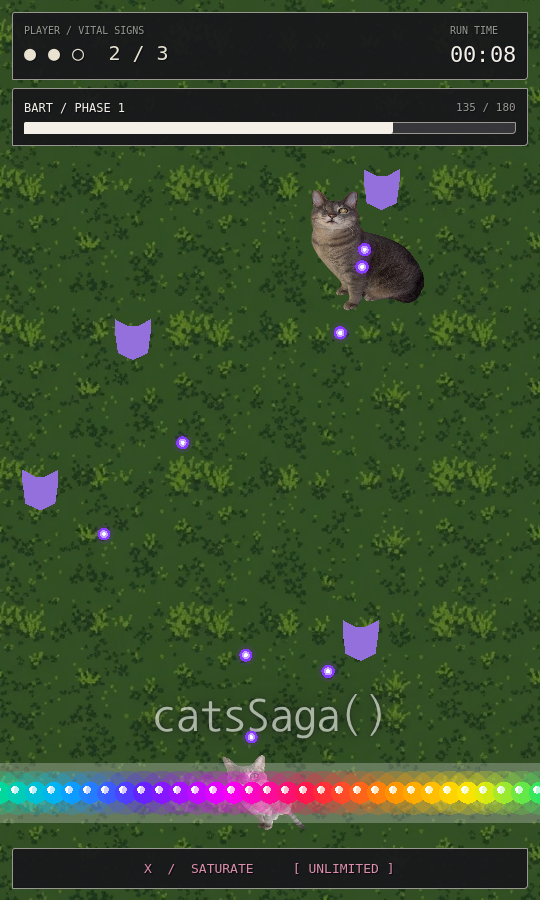

# UI and gameplay review

The menu is one vertically and horizontally centered composition: original cat emblem, serif title, ink-on-paper grain, transparent menu rows, keyboard selection marks, hover contrast, and a guarded fade into gameplay. The bundled DejaVu fonts include their redistribution license in `assets/ui/fonts/LICENSE.txt`. No OMORI artwork is used.

The HUD reuses the existing health, game-over, and Retry nodes. Framed edge panels display health pips plus a numeric value, elapsed time, boss health and phase, and SATURATE's READY / USED / UNLIMITED state. Damage briefly tints the health panel. Boss values come from the existing health signals; the progress bar smoothly follows those values. HUD controls ignore pointer input, except Retry. Retry remains usable while gameplay is paused.

At 540×900, the player starts at (270, 780). Runtime centering uses the viewport width and leaves 120px below the player's origin. The boss spawns at y=240 below the HUD; horizontal movement bounds account for its actual sprite so it remains fully visible. Speeds, collision geometry, projectile patterns, and controls are unchanged.

The original MP3 is assigned to the single gameplay MusicPlayer, with explicit 0dB Master routing. Tests verified an unmuted bus, playback initialization, non-silent mixed samples, and continuous boss synchronization. Timeline checks now evaluate thresholds in descending time order, making the existing SHOWDOWN section at 89.14s reachable. No section timestamps or attack patterns were changed.

CATA retains its existing invincibility toggle. BEAM had no implementation in the available repository/history; following the clarified request, it now toggles unlimited X-key SATURATE uses. Ordinary SATURATE stays single-use. Every sweep deals **30 damage once per target**, as requested, and retains its visuals and projectile clearing. Both cheats reset on Retry.

## Rendered screenshots

These are actual Godot viewport captures at 540×900, inspected using Xvfb and Mesa software OpenGL, with the compatibility renderer. They are not mockups.

| Menu | Gameplay |
| --- | --- |
|  |  |

| Health and boss damage | SATURATE and BEAM state |
| --- | --- |
|  |  |

## Validation

Godot 4.6.3 headless import and 95 automated checks passed, with zero application errors or warnings. Coverage includes eight scene loads, menu alignment and resize, selection/focus, a single Options dialog, transitions, player spawn, boss bounds and HUD clearance, health/bar updates, music samples and timeline sections, actual CATA/BEAM keyboard sequences, repeated 30-damage sweeps, projectile clearing, shooting, attacks, paused game-over UI, and Retry reset.

```sh
godot --headless --path . --editor --import
godot --headless --path . --script res://tests/headless_gameplay.gd
```

Screenshot reproduction requires a graphical display (desktop or Xvfb):

```sh
godot --path . --rendering-method gl_compatibility --audio-driver Dummy \
  --script res://tests/render_ui.gd -- --output=/tmp/catsSaga-review
```

The software display reported unsupported VSync configuration, a driver limitation; capture completed with no script errors. Rendered captures establish the inspected layout and single-frame appearance. They do not establish subjective animation quality, sustained readability under all dense bullet patterns, or audible playback through a real device. Those require an interactive full-song playthrough. No export target was selected.
