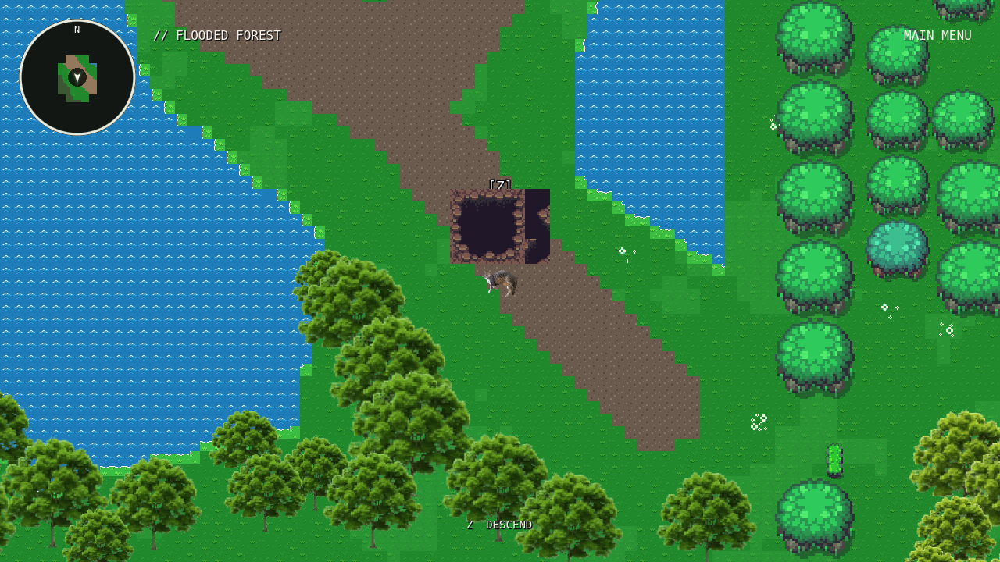
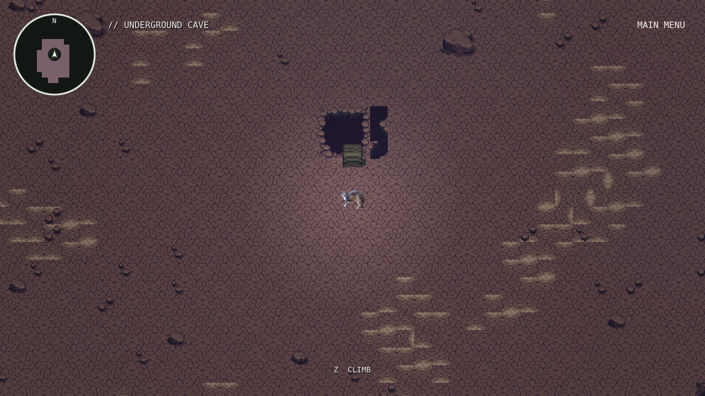
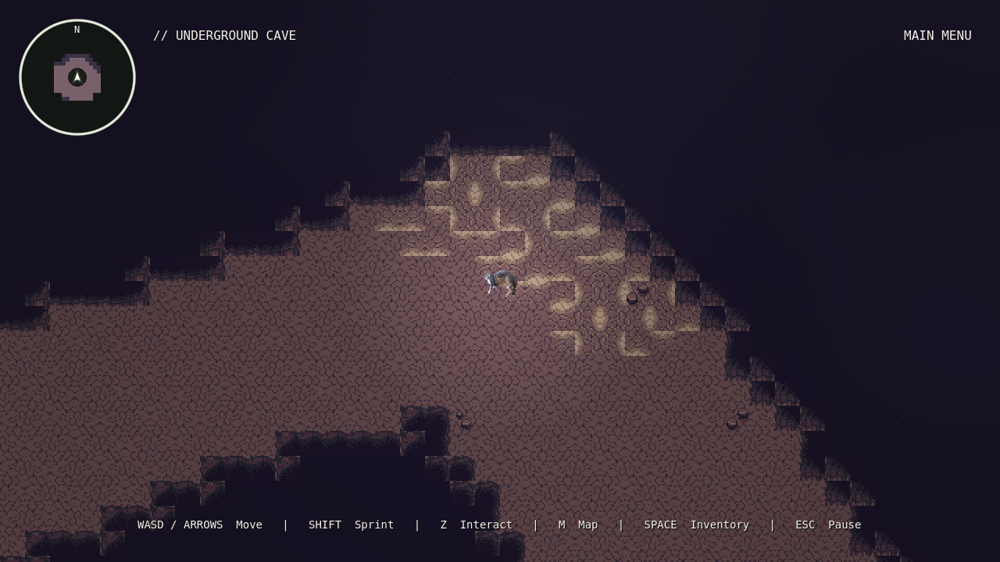
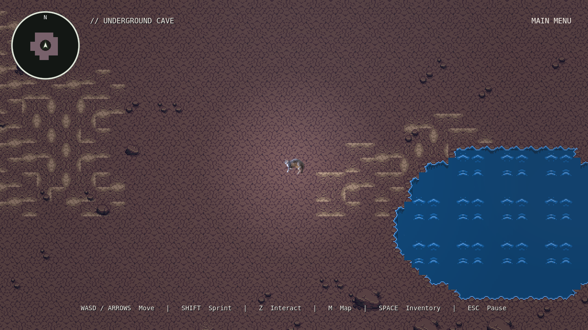
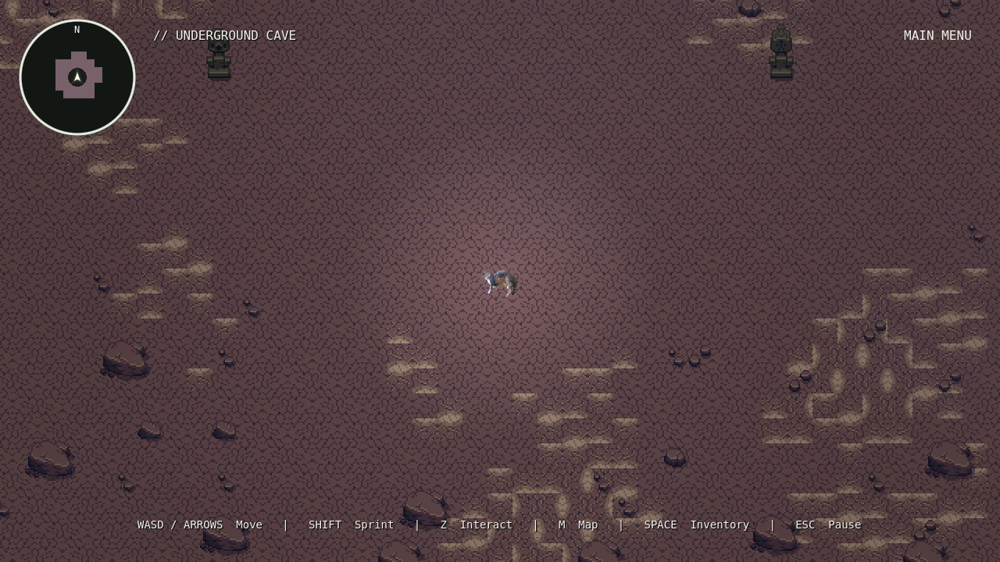
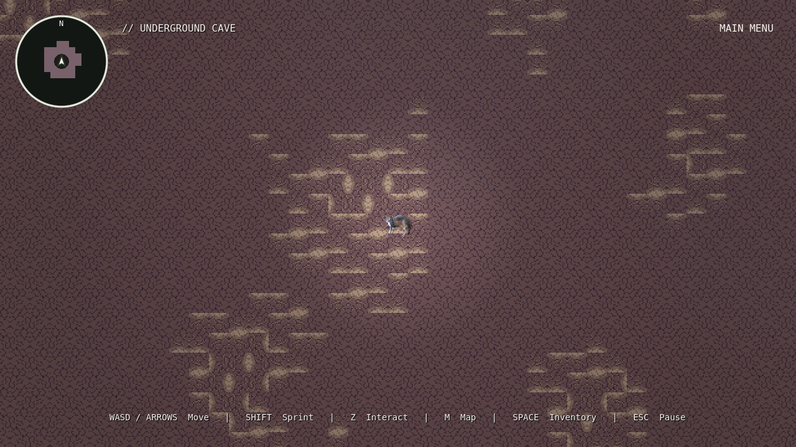
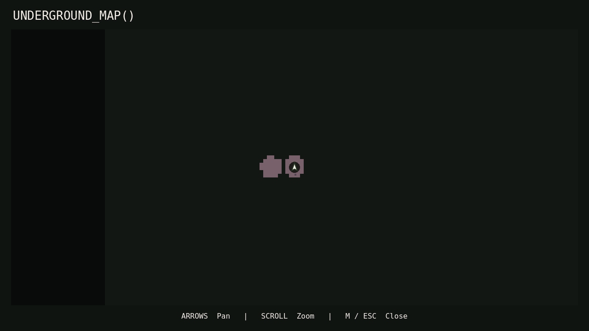

# Underground Cave review

A single continuous exploration region connects to Flooded Forest through a
Z-operated shaft. Original forest terrain, trees, paths, NPCs, boss mechanics,
player artwork/controls, inventory, dialogue and progression remain intact.
No Boss 4, combat, SATURATE, puzzles, secrets or difficulty settings were added.

## Entering and returning

The opening is at **Flooded Forest (1696, 1008)** on existing reachable ground.
Approach and press **Z**; the existing interaction HUD says **Z DESCEND**.
The player moves toward the opening, falls/shrinks/fades for 0.28 seconds, then
the existing regional fade loads the entrance chamber behind black. Travel
locks input immediately and ignores repeat/echo input.

The entrance chamber contains a rocky shaft and visible wooden rungs. Approach
and press **Z CLIMB** to return. The forest arrival is **(1696, 864)**, clear of
collision and outside the hole's interaction radius. All door artwork comes
from the original cave atlas, with uniform display scaling and nearest filtering.

## Layout and appearance

The cave occupies **20480×16384 world pixels**. The original atlas's **16×16**
cells are displayed at **2×**, giving **32×32 world-pixel cells**. Its fourteen
irregular chambers connect through seventeen winding passages and loops.
Narrow tunnels open into wider galleries, with stillwater pools, rocky ridges,
large/small boulders, pebble deposits and complete ancient stone-column sprites.
The deepest cavern at **(18096, 10896)** is accessible and intentionally empty
for a future boss. It contains no encounter node or combat logic.

The authored passage centerlines total **124877 px**. At the unchanged normal
speed of **260 px/s**, traversing each passage once takes about **8.0 minutes**.
This is a layout estimate, not a measured human completion time: shortcuts,
backtracking, time spent in chambers and sprinting change exploration duration.

TileMapLayers hold floor variants, natural rocky boundary/corner tiles, solid
water, rocks, complete ripple features and non-solid rubble. Larger atlas
features remain intact; original PNGs are neither split nor edited. Baked
terrain uses approximately **60,521 floor cells** and **10,665 boundary cells**.
Physics polygons cover walls/water and the visible bases of large decorations;
central routes remain clear. Y-sorting lets the player pass naturally in front
of or behind stone formations.

A dim cool ambient treatment and one soft following light keep paths readable.
One lightweight haze material and 26 small dust motes provide restrained motion.
The forest song fades out underground. Quiet native procedural rumble, dripping
water and occasional echoes provide ambience; the repository contains no suitable
standalone cave ambience recordings, so no missing-file references were added.
These sounds use the existing Overworld audio bus and pause with the game.
The overlay stops rendering under the opaque map. There are no per-tile lights
or particle nodes.

## Map, saves and editing

**M** opens **UNDERGROUND_MAP()**, using its own **1280×1024** cached terrain and
fog textures. Player coordinates still use the existing 16-world-pixels-per-map-
pixel convention; cave tiles cover two map pixels. The forest retains its
original **520×372** atlas and coordinates. Unexplored cave terrain is concealed
under uniform fog; the cache does not expose an unexplored cave silhouette.

Cave discovery uses the same bitset reveal radius/cell size as the forest, but
its own region key. Both sets persist independently through saving, loading,
leaving and re-entering. Existing version-one saves remain supported and acquire
an empty cave bitset without losing old flags or discovery. Saving underground
restores the cave and exact valid position. A saved position inside rock/void
falls back to the entrance. Save format/version and backup behavior are unchanged.

Open `scenes/world/underground_cave.tscn` in Godot to paint its TileMapLayers.
The editable TileSets are in `resources/cave/`; their atlas references the
original `assets/enironment/gfx/cave.png`. Keep wall/water/rock collision polygons
aligned when changing terrain. After manual painting, refresh **only the map
cache**, preserving the edited scene:

```sh
godot --headless --path . --script tools/bake_underground_cave.gd -- --cache-only
```

The authored layout is in `scripts/world/cave_layout.gd`. To rebuild its scene
and resources deterministically after changing that layout, run:

```sh
godot --headless --path . --script tools/bake_underground_cave.gd
```

**A full bake replaces manual terrain edits.** Forest cartography is refreshed
with the existing `tools/bake_world_map.gd`; this change only updates its source
metadata, and its cached forest pixel data was verified unchanged.

## Files

| Files | Changes |
|---|---|
| `scenes/world/{underground_cave,cave_hole,cave_return}.tscn` | New terrain and reusable descent/return objects |
| `scenes/world/flooded_forest.tscn` | Hole instance and safe arrival marker only |
| `scripts/world/{cave,cave_layout,cave_connection,cave_atmosphere}.gd` | Region validity, authored layout, existing interaction contract, atmosphere |
| `resources/cave/*.tres`, `resources/maps/underground_terrain.res`, `shaders/cave_haze.gdshader` | Editable original-art atlas layers, independent map cache and subtle haze |
| `scripts/world/overworld.gd` | Register cave, contextual interaction hint, validate cave save position |
| `scripts/systems/{session,music,save_manager}.gd` | Optional cave travel animation, cave ambience routing, accepted save bounds |
| `scripts/maps/{world_layout,exploration,map_canvas,map_ink,map_ui}.gd` | Separate map domain and saved fog using existing UI/reveal behavior |
| `resources/maps/world_terrain.res` | Forest cache source metadata refresh; terrain pixels unchanged |
| `tools/bake_underground_cave.gd` | Deterministic editable terrain/cache bake and cache-only mode |
| `tests/{headless_cave,render_cave}.gd`, `check_cave_preservation.py` | Physics reachability, integration, rendering and preservation checks |
| `tests/headless_cartography.gd` | Existing four-forest bitset-size assertion now explicitly measures the four forest regions |

## Validation and remaining manual checks

Godot **4.6.3** headless import completed with exit 0. All six affected scenes
loaded and instantiated. **56 cave integration checks passed**, including actual
player-sized physics searches to every chamber, reachable forest entrance,
descent/climb guards, keyboard movement, pause, separate fog/maps, save/load,
legacy save compatibility and invalid-position recovery.

The four focused existing suites also passed: **cartography 77**, **overworld 59**,
**quality-of-life 81**, and **region/progression 145** checks. A preservation check
protects **557 existing files/functions**, including all original artwork, player
controls, boss mechanics and dialogue; original flooded geometry is unchanged.
Forest map cached pixels were also compared exactly against `8dbfc2d`.

**35 graphical checks passed**, rendering all fourteen chambers, winding tunnels,
rock boundaries, map restoration and the entrance. Representative chambers,
tunnels, boundaries, pools and the entrance were visually inspected.
The Mesa llvmpipe software profile measured **35.126 ms median / 50.24 ms p95**
frames in the pool chamber, with **100 nodes**. This does not establish target-
hardware frame rate. The software driver's unsupported V-Sync warning is expected.

Reproduce focused validation with:

```sh
godot --headless --path . --editor --import
godot --headless --path . --script tests/headless_cave.gd
python tests/check_cave_preservation.py
godot --path . --rendering-method gl_compatibility --script tests/render_cave.gd
```

Manually play a full exploration circuit to judge pacing/wayfinding, audition
the ambience on real speakers, and check darkness and frame pacing on target
hardware. Automated reachability and rendered screenshots do not establish
those subjective qualities. No known functional failures remain.








