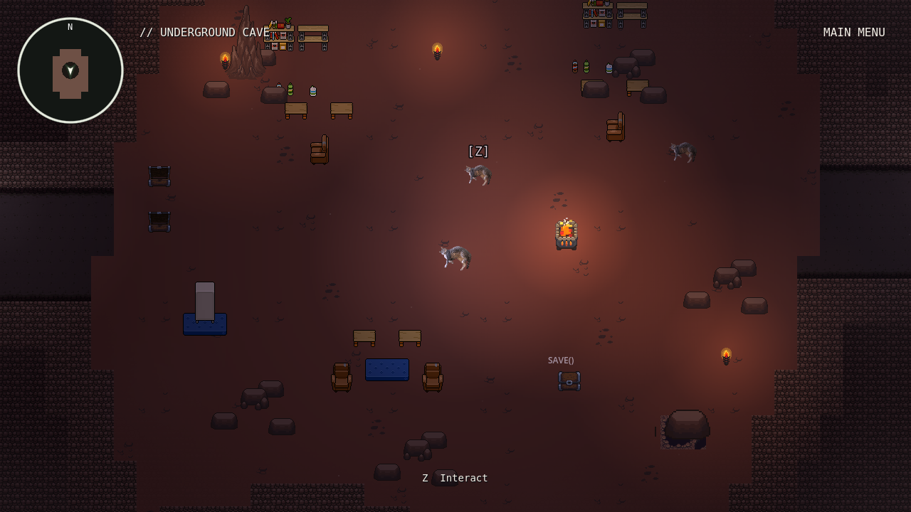
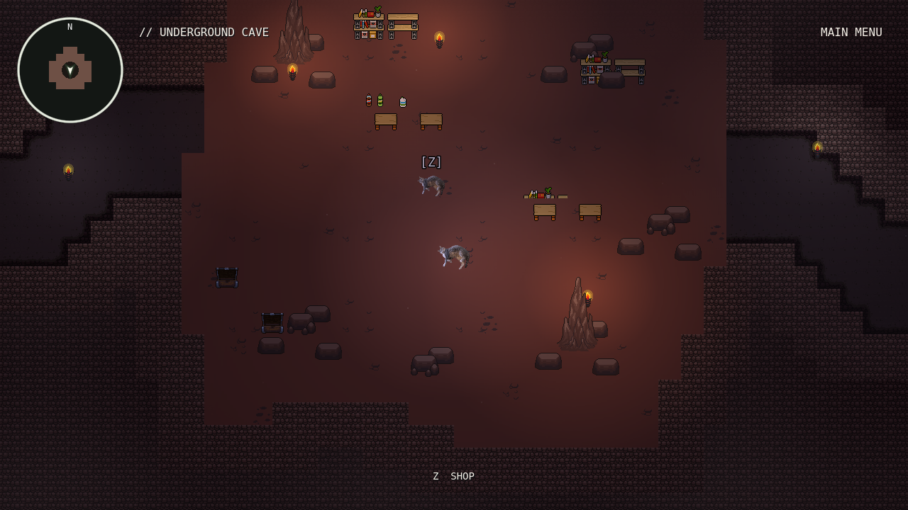
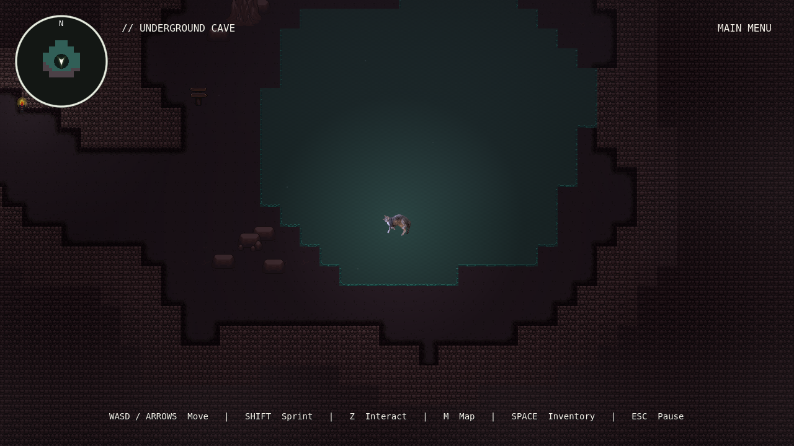
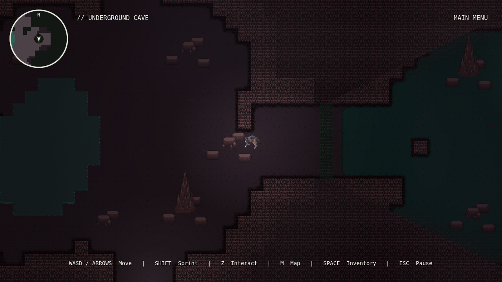
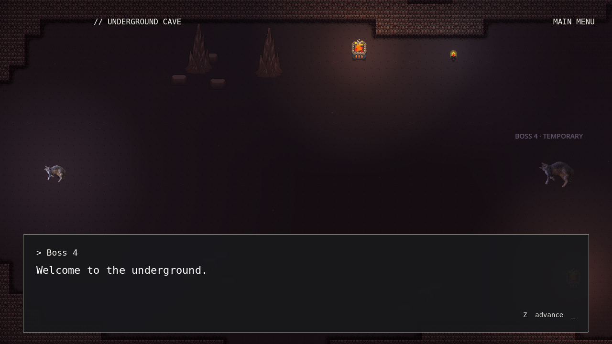

# Underground cave settlement overhaul

The cave now has **sixteen hand-authored chambers organized around a 4×4 grid**.
The original special IDs stay intact: entrance 1, riddle 2, hub 4, red approach 5,
window 6, grayscale room 7, shortcut junction 8, boss approach 9, sealed room 10.
Supply, market, residential, reading, echo-pool and watch chambers fill out the
settlement. Polygon outlines and bent passages replace large rectangular rooms.
The continuous map is **6016×4096 pixels**, with native **32px cells**; it is
smaller than the previous 6656×5888 layout and uses space much more densely.

The Flooded Forest entrance stays at **(1696, 1008)** and remains accessible.
The riddle's red key gates deeper cave progression and the two-way 4↔8 shortcut.
There are no internal scene loads when walking between rooms or using the shop.

## Assets and atmosphere

Primary floors, walls, water and environmental props now reference the newly
committed **Basic Caves & Dungeons 32×32** pack. Furnishings use the newly committed
`assets/makeshift_furnitureset.png`. Atlas coordinates were inspected, including
complete chest, torch, rock, chair, shelf, table and bed regions. Original PNGs
are unchanged; no artwork was generated or copied. The established hole/ladder
art is retained for compatible existing entrance/shortcut connections.

Editable TileSets are `resources/cave/settlement_{floor,hub,walls,water}.tres`.
Dirt terrain has 45 alpha-derived corner/side variants. Walls and all water
cells have solid collision; small pebbles, cloth and supplies are decorative.
Every layer uses native 32px regions and nearest filtering. The cave includes
four blocked pools, 671 placed prop/light nodes, floor details, stalagmites,
stone clusters, supplies, shelves, bedding and seating. The hub, market and
living rooms use warm floor accents, hearth/brazier lighting and restrained
flicker; outer passages keep cooler darkness, dust, haze and distant echoes.

Other interiors are concealed using the actual stone texture, with edge darkness
and vignette rather than flat black boxes. The only exception is the ray-clipped
window into sealed Area 10. World masking remains independent of saved map fog.
Area 7 desaturates the entire screen, including all UI, and crossfades its local
drone. Both effects stop at its actual floor boundary, including shared hallways.

The pack license permits commercial/noncommercial use and requires credit;
it prohibits redistributing/reselling the asset pack. Its documented creator,
**schwarnhild**, is credited in the existing Credits section alongside
**LLiosette — Creator**. No raw image files are added or duplicated by this change.

## Gameplay and presentation

The exact riddle, numeric 3/14 choices, unlimited failed attempts, one red key,
permanent red-barrier unlock and two-way shortcut remain functional and saved.
The hub has a Z save point, a physical rest bed and nearby NPC interactions.
The merchant opens a themed shop placeholder and returns to the same cave
instance; there are no purchases, prices or parallel inventory systems.
Rest uses existing dialogue; real fights retain their existing automatic full-
health initialization. Optional side alcoves contain inspectable supplies,
notes and seating, using existing interaction/dialogue and map discovery.

Boss 4 remains the existing placeholder, as confirmed for this overhaul.
Entering Area 9 automatically locks movement and starts a short camera pan at
unchanged zoom. The boss starts outside the frame; the midpoint framing ends
with **both player and boss visible near opposite sides**. The exact greeting is
`Welcome to the underground.` Advancing opens the existing **540×900** placeholder.
Return/retry restores a safe junction position and replays the introduction on
the next approach. There are no attacks, victory rewards or Boss 4 progression.
Existing battles, shooting, SATURATE, BEAM, CATA and developer-menu code are intact.

## Files and editing

- `scripts/world/cave_layout.gd`: room polygons, 4×4 organization, routes, pools,
  interaction coordinates and stable special IDs.
- `tools/bake_underground_cave.gd`: deterministic scene, detail/lighting recipes,
  ownership mask and map-cache baking.
- `scripts/world/cave_assets.gd`, `cave_light.gd`, `cave_services.gd`: shared atlas
  regions, restrained light flicker and the shop placeholder.
- `scripts/world/{cave,cave_actor,cave_atmosphere}.gd`, cave shaders and
  `scenes/world/underground_cave.tscn`: integration and presentation.
- Map dimensions/save migration, one modal-awareness reference in `overworld.gd`,
  and required credits are the only changes outside cave support/tests/docs.

Paint TileMapLayers in `scenes/world/underground_cave.tscn` using the Godot terrain
and atlas toolbar. Keep edits within the authored room footprints; changing room
boundaries also requires updating the ownership map through the blueprint/bake.
Full baking overwrites manual scene edits:

```sh
godot --headless --path . --editor --import
godot --headless --path . --script tools/import_dungeon_terrain.gd
godot --headless --path . --script tools/bake_underground_cave.gd
```

Refresh only cartography from a manually painted scene:

```sh
godot --headless --path . --script tools/bake_underground_cave.gd -- --cache-only
```

Legacy cave saves from both previous geometries move to the new safe entrance
and reset **only obsolete cave fog**. Keys, puzzle/barrier/shortcut flags, cave
discovery, other story progress, forest positions and forest fog are retained.
New saves restore exact valid cave positions and exploration. Water/hidden-room
or blocked positions use the established safe-spawn validation.

## Validation and limits

Godot **4.6.3** headless import passes. **120 cave gameplay checks** cover actual
player-sized physics reachability, all water cells, every interaction approach,
progression, service modals, saves/migrations, grayscale boundaries and intro/
retry behavior. **128 graphical checks** cover all explorable chambers, chamber
entrances, wide views, window clipping, full-UI grayscale and both-character
framing at 1280×720/zoom1 and 1920×1080/zoom0.75.

Existing gameplay/victory, developer menu (60), map/debug (38), cartography (77),
location discovery (40) and overworld (59) suites pass. The preservation script
compares against `01057ad`, protecting original artwork, other regions, player
controls, battle scripts, music timelines and original boss dialogue.

```sh
godot --headless --path . --script tests/headless_cave.gd
python tests/check_cave_preservation.py
godot --path . --rendering-method gl_compatibility --script tests/render_cave.gd
```

**The requested 30+ minute completion target remains unverified**, with Boss 4
still a placeholder. No artificial waits, reduced movement speed or invented
combat were added to inflate duration. Human playtesting should assess route
clarity, exploration pacing, visual density, darkness, audio levels and target-
hardware performance. Rendering was tested using Mesa llvmpipe; its unsupported
V-Sync warning and some test-shutdown ObjectDB warnings remain. No functional
validation errors remain.






