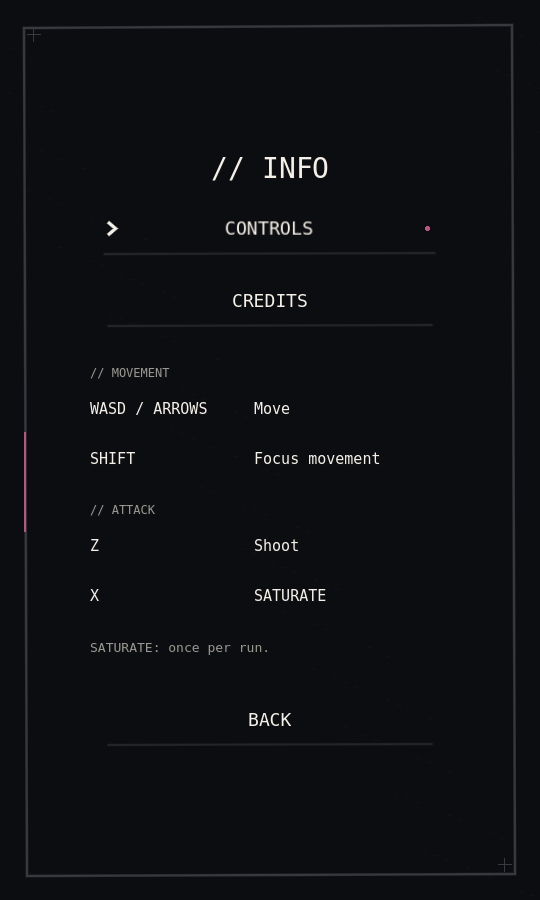
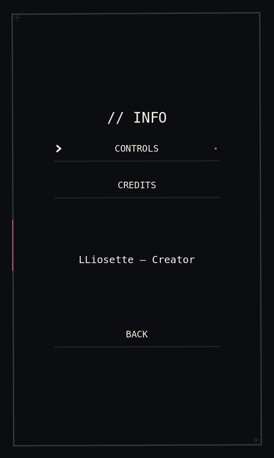
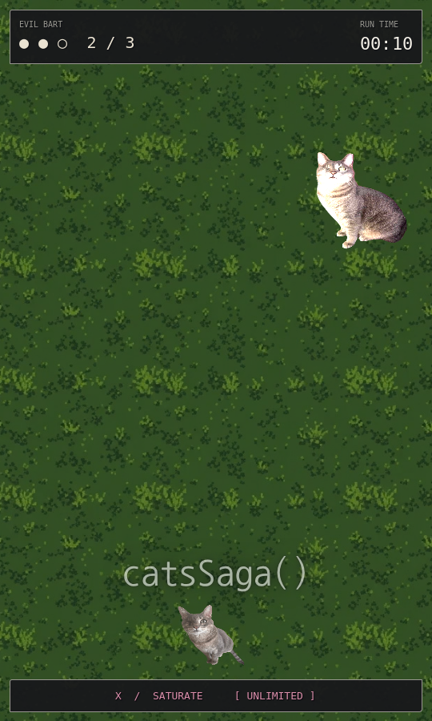
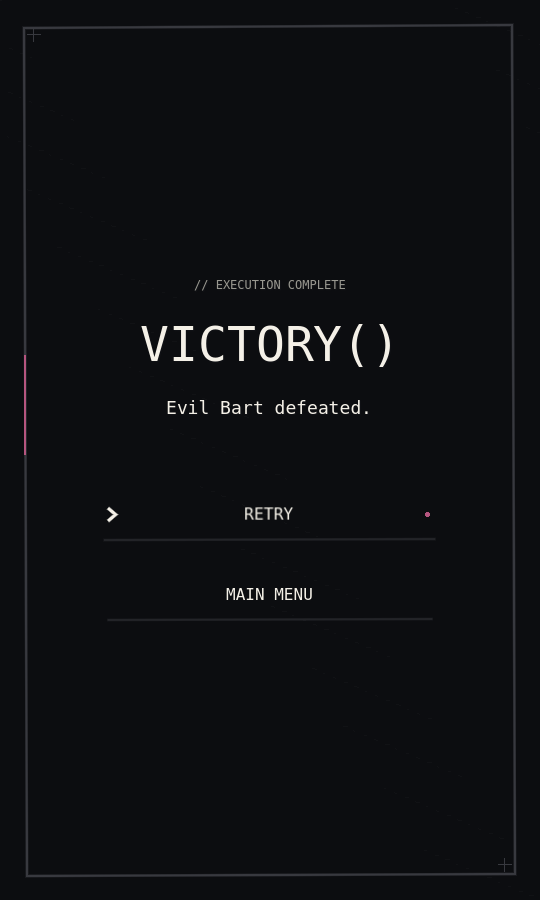

# Victory, credits, and controls review

Evil Bart previously disappeared immediately at zero health. Defeat now stops his attacks, disables his collision participation, clears every enemy projectile through safe deferred cleanup, and plays a sprite-only shake/flash followed by fade-out (0.65 seconds total). A one-time victory state freezes player input and movement; pending collision damage cannot interrupt it. The existing soundtrack continues while its volume fades to silence over 1.2 seconds, then stops. Normal fight timing, attacks, phase thresholds, collision geometry, and music synchronization are unchanged.

The centered monochrome victory screen fades in over 0.35 seconds and displays **VICTORY()**, **Evil Bart defeated.**, **Retry**, and **Main Menu**, using the existing bundled monospace font, sketch background, and animated button component. Retry starts a fresh run; Main Menu returns to the existing menu. Navigation fades out over 0.2 seconds and guards repeated activation. No new audio assets or duplicate existing HUD elements were added.

Info → Credits now displays exactly **LLiosette — Creator**, replacing the placeholder. Info → Controls uses two aligned columns, 32-pixel minimum row heights, 18-pixel row gaps, and 20-pixel padding. Movement and attacks have separate headings. Keybindings come from the existing player script: WASD/arrows, Shift focus, Z shoot, X SATURATE. Back and Escape navigation remain available.

## Verification

Godot 4.6.3 headless import, all scene loads, and **143 automated checks** passed without errors or warnings. The automated gameplay suite covers startup, navigation, shooting, boss spawn/attacks/phases, audio mixing and timeline synchronization, SATURATE's 30 damage and bullet clearing, BEAM/CATA toggles, game over and restart, plus:

- No victory during opening gameplay or nonlethal boss damage.
- Exactly one defeat signal despite repeat damage/callbacks.
- Attack termination, safe projectile removal, and protection from queued player damage.
- Defeat animation completion, victory reveal and keyboard focus.
- Continuing music during the fade, followed by stopping at its end.
- Victory Retry, fresh run state, Main Menu, and starting another run.
- Lethal SATURATE reaching victory through the real sweep.
- Exact creator credit, two-column controls spacing, and viewport containment.

Run from the repository root:

```sh
godot --headless --path . --editor --import
godot --headless --path . --script res://tests/headless_gameplay.gd
```

## Actual 540×900 Godot renders

Captured under Xvfb/Mesa software OpenGL and inspected; these are real viewport renders.

| Controls | Credits |
| --- | --- |
|  |  |

| Boss defeat | Victory |
| --- | --- |
|  |  |

Reproduce on a graphical display:

```sh
godot --path . --rendering-method gl_compatibility --audio-driver Dummy \
  --script res://tests/render_ui.gd -- --output=/tmp/catsSaga-review
```

The software driver reports unsupported VSync, without application errors. Manual playtesting is still needed for the perceived drama of the animation, audible music fade, mouse/keyboard transition feel, and real-device rendering. No unrelated balance, attacks, cheat behavior, controls, or SATURATE visuals changed.
